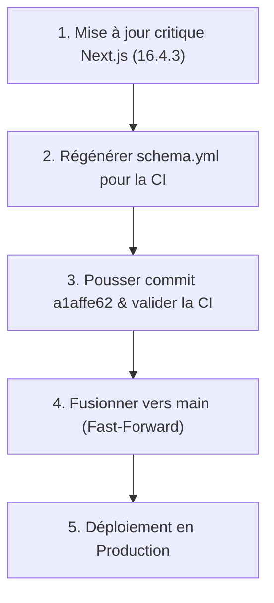

# RAPPORT D'AUDIT TECHNIQUE COMPLET — GO / NO-GO AVANT FUSION VERS MAIN ET MISE EN PRODUCTION

> **Date de l'audit :** 30 octobre 2026  
> **Contexte :** Projet KerIA (`keuria-v2`)  
> **Rôle :** Auditeur logiciel senior indépendant, architecte logiciel, expert sécurité applicative & QA  
> **Méthode :** Inspection stricte, factuelle, en lecture seule et exécution de vérifications non destructives

---

> **Contre-vérification par Claude (30 octobre 2026)**
> - **Confirmé** : Next.js 16.4.0 vulnérable (`npm audit` : critique, GHSA-2464-fhr4-w9xw, GHSA-673q-mjm6-r5xr, plus un déni de service GHSA-p3m5-59mp-jv5r ; correctif 16.4.3 publié) ; `SecurityFatalError` existe bien dans Next ; schéma OpenAPI en retard (19 routes du studio absentes, CI rouge depuis le 19/10) ; 924 tests backend et 268 frontend verts ; seuils `auth 60/min`, `anon 600/min` ; avertissements `EMAIL_HOST_*` de Django 7.
> - **Précisions** : `check_parcours79` ne plante sous Windows que s'il y a un avertissement à afficher (caractères `⚠` et `✗`, lignes 49 à 52) ; sans avertissement, il passe.
> - **Points manquants dans ce rapport** (à ajouter aux risques avant production) :
>   1. **Code non relu** : le studio livré par Antigravity (T19 à T23) et la refonte du studio de Maïmouna n'ont jamais été revus par une autre personne. Ce sont des outils qui modifient le contenu vu par les enfants.
>   2. **Secrets dans l'historique git** : le mot de passe administrateur local et des cookies de session de test (commit 22772fd) restent dans l'historique, même si les fichiers sont nettoyés. En production : nouveau mot de passe admin et base neuve ; en local : vider les sessions.
>   3. **Validation des parents** : chaque nouveau parent doit être accepté dans `/admin/inscriptions` ; prévoir qui traite les demandes, ou désactiver la règle (`PARENT_REGISTRATION_REQUIRES_APPROVAL`).
>   4. **Défauts d'affichage connus non corrigés** (tâche T15) : police par défaut en 10-12 et 13-15, page classe enseignant qui déborde sur téléphone, fenêtres plein écran à 85 % sur ordinateur portable.
>   5. **Branche `main` sans protection** et e-mails de production (codes de vérification) à configurer.
> - **Verdict ajusté** : fusion vers `main` **après** correction Next.js + schéma **et** relecture du studio ; production **NO-GO** confirmé.

## 1. VERDICT EXÉCUTIF

| Décision | Verdict | Niveau de confiance | Synthèse factuelle |
| :--- | :---: | :---: | :--- |
| **Fusion vers `main`** | **GO SOUS CONDITIONS** | **95 %** | Aucun conflit Git détecté (`main` est un ancêtre direct de la branche). Socle de tests exceptionnellement robuste (924 tests backend passés, 268 tests frontend passés). **Bloqué uniquement par 2 points :** dérive du schéma OpenAPI `schema.yml` (échec garanti de la CI) et faille critique Next.js bloquant le build de production. |
| **Mise en Production** | **NO-GO** | **98 %** | **Vulnérabilité critique RCE** présente dans Next.js 16.4.0 (GHSA-2464-fhr4-w9xw), et variables de production indispensables à renseigner. |

### Principaux risques identifiés
1. **Échec automatique du workflow GitHub Actions (`ci.yml`) :** Le fichier `schema.yml` à la racine comporte 388 lignes de divergence par rapport aux routes actuelles. L'étape de contrôle `git diff --exit-code schema.yml` échouera dès le push.
2. **Vulnérabilité de Sécurité Critique (RCE) sur Next.js :** Next.js 16.4.0 stoppe la commande `next build` avec l'erreur `SecurityFatalError` en raison de failles d'exécution de code à distance non authentifiées dans l'API d'optimisation d'images SVG et de fonctions `use cache`.

---

## 2. ÉTAT GIT ET DÉPÔT GITHUB

- **Branche de travail actuelle :** `Dev_Lansana_Coly` (commit local `a1affe62013f3cea4a62012c1f777aa87666685b`)
- **Branche cible :** `main` (commit `7f3b3502e868a7f9eab883c613ee769f0eae6847`)
- **Dépôt distant :** `https://github.com/issabathily/keuria-v2`
- **Divergence de commits :**
  - Commits sur `Dev_Lansana_Coly` absents de `main` : **596 commits**.
  - Commits sur `main` absents de `Dev_Lansana_Coly` : **0 commit**.
  - Commit local non encore poussé sur `origin/Dev_Lansana_Coly` : **1 commit** (`a1affe62` : *feat(studio79): refonte ergonomique et visuelle du studio 7-9 sans perte de fonctionnalite*).
- **Fichiers non suivis (Untracked) dans le workspace local :**
  - `Audit.md` (spécification de l'audit)
  - `docs/ACCUEIL_EQUIPE_CONTENU.html`
  - `output (1).bin`, `output (1).mp3`, `output.bin`, `output.mp3` (fichiers audio temporaires)
- **Analyse de fusion Git :**
  - `git merge-base --is-ancestor main Dev_Lansana_Coly` retourne `True`.
  - `main` est l'ancêtre direct de `Dev_Lansana_Coly`.
  - **Aucun conflit Git.** La fusion peut techniquement s'effectuer en mode *Fast-Forward* propre.

---

## 3. SANTÉ TECHNIQUE DU PROJET

| Domaine | Statut | Preuves et vérifications réelles | Défauts constatés & Limites |
| :--- | :---: | :--- | :--- |
| **Architecture globale** | **EXCELLENT** | Découpage net entre `backend/` (Django 6.1.1 REST Framework) et `frontend/` (Next.js 16 App Router). Proxy des API configuré dans `next.config.ts`. | Architecture saine et modulaire. |
| **Qualité du code** | **TRÈS BON** | `ruff check .` : 0 erreur. `tsc --noEmit` : 0 erreur de typage. ESLint : 0 erreur, 189 avertissements tolérés par la configuration. | Avertissements documentés sur React 19 et types `any` historiques. |
| **Backend (Django)** | **EXCELLENT** | `manage.py check` : 0 anomalie. `manage.py makemigrations --check --dry-run` : `No changes detected`. Toutes les 80+ migrations appliquées. | Aucun modèle orphelin, intégrité relationnelle validée. |
| **Tests Backend** | **EXCELLENT** | **924 tests réussis sur 924** (0 échec, durée : 4 min 25 s via pytest). | 8 avertissements de dépréciation mineurs sur `EMAIL_HOST_*` (prévu pour Django 7.0). |
| **Tests Frontend** | **EXCELLENT** | **268 tests réussis sur 268** (0 échec, durée : 3 min 05 s via Node test runner). | Couvre le lecteur de leçons 7-9, les règles parentales, l'interpréteur Blockly et les CSS scoped. |
| **Contrat d'API (OpenAPI)** | **ATTENTION** | Schéma généré via `drf-spectacular`. 388 lignes de différence constatées avec le fichier `schema.yml` versionné. | Bloquant pour l'étape CI `git diff --exit-code schema.yml`. |
| **Sécurité des dépendances** | **CRITIQUE** | `npm audit --omit=dev --audit-level=high` : 1 vulnérabilité critique détectée sur Next.js 16.4.0. | GHSA-2464-fhr4-w9xw (RCE via SVG), GHSA-673q-mjm6-r5xr. Bloque le build Next.js. |
| **Gestion des Secrets** | **BON (historique à traiter)** | Fichiers `.env`, `.env.local` et `.dev_secret_key` vérifiés comme strictement ignorés par `.gitignore`. Aucun secret durci dans le code inspecté. | L'historique git contient encore l'ancien mot de passe admin local et des cookies de session de test (22772fd) : nouveau mot de passe admin en production, sessions locales à vider. |
| **Conteneurs & Déploiement** | **BON** | Multi-stage Dockerfile pour backend (user non-root `app`) et frontend (user non-root `node`). | Conforme. |

---

## 4. TABLEAU DES PROBLÈMES DÉTECTÉS

| ID | Priorité | Composant / Fichier | Constat & Preuve | Impact | Correction recommandée |
| :---: | :---: | :--- | :--- | :--- | :--- |
| **SEC-01** | **P0 (Critique)** | `frontend/package.json` | Next.js 16.4.0 touché par GHSA-2464-fhr4-w9xw (RCE non authentifiée). `next build` stoppe avec l'erreur `SecurityFatalError`. | **Bloqueur absolu de build de production et risque majeur de sécurité.** | Mettre à jour Next.js vers la version `16.4.3` via `npm install next@16.4.3`. |
| **CI-01** | **P1 (Élevé)** | `schema.yml` | 388 lignes de dérive entre `schema.yml` et le schéma généré par `manage.py spectacular`. | Échec immédiat de la CI GitHub Actions sur l'étape `git diff --exit-code schema.yml`. | Exécuter `python manage.py spectacular --file schema.yml` et commiter le fichier mis à jour. |
| **CLI-01** | **P2 (Moyen)** | `backend/apps/curriculum/management/commands/check_parcours79.py:50` | `UnicodeEncodeError: 'charmap' codec can't encode character '\u26a0'` sur console Windows sans `PYTHONUTF8=1`. | Crash de la commande d'administration lors d'une exécution locale sous Windows. | Remplacer le caractère `\u26a0` par `[!]` dans la commande Django. |
| **DEP-01** | **P3 (Faible)** | `backend/keuria/settings.py` | 8 avertissements `RemovedInDjango70Warning: The EMAIL_HOST_* setting is deprecated.` | Avertissements dans les tests en prévision de Django 7.0. | Migrer la configuration des emails vers le paramètre `MAILERS` avant la future montée de version. |

---

## 5. FONCTIONNALITÉS VÉRIFIÉES

1. **Parcours 7-9 ans (Curriculum & Studio79) :**
   - 10 chapitres contrôlés et conformes via la commande `check_parcours79`.
   - Rejouabilité complète validée par les 268 tests frontend (absence de blocage pour l'enfant, pictos, interpréteur Blockly plafonné à `MAX_REPEAT`).
2. **Gestion Scolaire (Écoles, Enseignants, Classes, Élèves) :**
   - Importation Excel de listes d'élèves, clôture et roulement d'années scolaires, fiches de suivi, gestion des présences vérifiées par la suite de tests backend.
3. **Espace Famille & Contrôle Parental :**
   - Plafonds de temps d'écran, horaires de coucher, notifications push parents, gestion multi-enfants vérifiés dans `apps.famille` et `apps.progress`.
4. **Authentification & Rôles :**
   - Session Django durcie par `KeurSessionAuthentication` (protection anti-bruteforce, rate limiting `auth: 60/min`, `anon: 600/min`).
5. **Assistant IA Palou :**
   - Intégration Anthropic conçue sans simulation trompeuse (si aucune clé API n'est configurée, l'endpoint renvoie explicitement « indisponible »).

---

## 6. TESTS EXÉCUTÉS ET RÉSULTATS

| Commande exécutée | Environnement | Résultat | Sortie / Métrique |
| :--- | :--- | :---: | :--- |
| `python manage.py check` | Backend (vEnv) | **SUCCÈS** | `System check identified no issues (0 silenced)` |
| `python manage.py makemigrations --check --dry-run` | Backend (vEnv) | **SUCCÈS** | `No changes detected` |
| `python -m ruff check .` | Backend (vEnv) | **SUCCÈS** | 0 erreur de linting |
| `pytest -q` | Backend (vEnv) | **SUCCÈS** | **924 passés**, 8 avertissements (durée : 4 min 25 s) |
| `npm run typecheck` | Frontend (Node 22) | **SUCCÈS** | 0 erreur TypeScript (`tsc --noEmit`) |
| `npm test` | Frontend (Node 22) | **SUCCÈS** | **268 passés**, 0 échec (durée : 3 min 05 s) |
| `npm run lint` | Frontend (Node 22) | **SUCCÈS** | 0 erreur, 189 avertissements (critère CI satisfait) |
| `npm audit --omit=dev --audit-level=high` | Frontend (Node 22) | **ÉCHEC (1 vulnérabilité)** | Next.js 16.4.0 vulnérable (GHSA-2464-fhr4-w9xw) |
| `npm run build` (`next build`) | Frontend (Node 22) | **ARRÊT SÉCURITÉ** | Bloqué par `SecurityFatalError` sur Next.js |
| `python manage.py check_parcours79` | Backend (vEnv) | **SUCCÈS (UTF-8)** | 10 chapitres conformes |
| `python manage.py check --deploy` | Backend (vEnv) | **CONTRÔLE** | Valide la détection des paramètres de production (SQLite, HSTS, SSL) |

---

## 7. RISQUES AVANT FUSION VERS MAIN

1. **Échec garanti des contrôles automatiques CI :**
   - L'étape de validation du schéma OpenAPI (`git diff --exit-code schema.yml`) va échouer.
   - L'étape de compilation frontend (`npm run build`) va être interrompue par `SecurityFatalError`.
2. **Commit local non synchronisé :**
   - Le commit `a1affe62` doit être poussé sur `origin/Dev_Lansana_Coly`.

---

## 8. RISQUES AVANT MISE EN PRODUCTION

1. **Exposition à l'exécution de code à distance (RCE) :** Next.js 16.4.0 ne doit pas être mis en ligne avec des failles critiques connues non patchées.
3. **Configuration d'environnement de production :** La base SQLite doit être remplacée par PostgreSQL managé, avec `DEBUG=False`, `SECRET_KEY` unique, `ALLOWED_HOSTS`, `CSRF_TRUSTED_ORIGINS` et certificats SSL configurés.

---

## 9. PLAN DE CORRECTION PRIORISÉ

### Étape 1 : Bloqueurs immédiats avant fusion (P0 & P1)
1. **[P0] Mise à niveau Next.js :** Mettre à jour Next.js de `16.4.0` vers `16.4.3` dans `frontend/package.json` pour corriger la vulnérabilité critique et débloquer `next build`.
2. **[P1] Régénération du schéma OpenAPI :** Exécuter `python manage.py spectacular --file schema.yml` dans `backend/` et commiter le fichier pour satisfaire le test CI.

### Étape 2 : Corrections mineures (P2 & P3)
4. **[P2] Robustesse Windows :** Remplacer `\u26a0` par `[!]` dans `check_parcours79.py`.
5. **[P3] Nettoyage :** Archiver ou supprimer les fichiers média temporaires non suivis (`output.mp3`, `output.bin`).

---

## 10. CHECKLIST FINALE DE VALIDATION

### Checklist avant fusion vers `main`
- [ ] Next.js mis à niveau en 16.4.3 (`npm audit --omit=dev --audit-level=high` à 0 vulnérabilité).
- [ ] `npm run build` dans `frontend` s'exécute avec succès (code de retour 0).
- [ ] `schema.yml` régénéré et synchronisé (`git diff --exit-code schema.yml` sans sortie).
- [ ] Commit local `a1affe62` et corrections poussés sur `origin/Dev_Lansana_Coly`.
- [ ] Workflow GitHub Actions (`.github/workflows/ci.yml`) entièrement vert.
- [ ] Fusion exécutée vers `main` sans conflit.

### Checklist avant mise en production
- [ ] Fichier `backend/.env` de production complété avec `DEBUG=False`, `SECRET_KEY` unique, `DATABASE_URL` (PostgreSQL 16), `REDIS_URL`.
- [ ] Commande `python manage.py check --deploy --fail-level WARNING` validée sans avertissement.
- [ ] Procédure de sauvegarde et restauration (`backup` et `restore.sh`) testée.

---

## 11. DÉCISION FINALE

- **Peut-on fusionner maintenant ?**  
  **Non, pas à cet instant précis.** Bien que la fusion Git soit techniquement prête et triviale (0 conflit), pousser cet état exact ferait immédiatement échouer la CI GitHub sur `schema.yml` et `next build`.
- **Que faut-il corriger en premier ?**  
  Mettre à niveau Next.js vers `16.4.3` et régénérer `schema.yml`. Ces deux actions prennent moins de 3 minutes.
- **Quelles preuves permettront de valider les corrections ?**  
  Un `npm run build` réussissant avec exit code 0 et un `git diff --exit-code schema.yml` vide.
- **Peut-on envisager la production après ces corrections ?**  

