# M3 - Prompts des videos d'arrivee (V4 : images-cles dessinees pour chaque plan)
## `arrivee-a1.mp4` a `arrivee-a12.mp4`

Remplace la V3 (collages de decoupes), qui donnait des images posees les unes sur les autres. Les departs viendront plus tard.

## La methode, en 5 etapes
1. **Valider le plan de mise en scene** de chaque decor. J'ai d'abord analyse chaque decor : zones ou le car peut rouler (teinte BLEUE), zones ou les enfants peuvent marcher (teinte VERTE), obstacles (cercles ROUGES : lampadaires, bornes, jardinieres, eau). Les fleches sont CALCULEES pour ne jamais sortir de ces zones : fleche bleue = le car arrive (carre = arret), fleche rouge = le car repart, fleche verte = les enfants. Corrigez-moi les zones ou les fleches avant de generer quoi que ce soit : `plans-mise-en-scene/aN.jpg`.
2. **Generer les 6 images-cles du module avec Antigravity**, une par une, avec les references indiquees. Chaque image est un vrai dessin de la scene, pas un collage.
3. **Me donner les images** : je controle la taille de Palou (environ 85 % de Moussa), le car (pas un taxi), les tenues, la perspective et les obstacles. Je vous dis lesquelles refaire.
4. **Generer les 5 plans video dans Flow** (mode « Frames to video »), 4 s chacun, avec les images-cles validees.
5. **Me donner les clips** : je les monte (coupes, gros plan ecourte a 2,5 s, fondu au noir final). Duree finale : environ 18 s.

## Plans de chaque video (comme l'ouverture)
1. Plan large : le car arrive (a7 : la chaloupe est a quai). 2. Plan moyen : la porte s'ouvre, les trois descendent. 3. Gros plan : Papa Ibou salue. 4. Plan moyen-large : au revoir, le car repart. 5. Plan large : ils marchent vers le lieu, fondu au noir.

## Regles pour toutes les images
- Les images-cles sont enregistrees dans `frontend/public/images/parcours1012/keyframes/<module>/`, au format 16:9.
- Un seul personnage ou element par erreur de taille peut ruiner un clip : en cas de doute sur Palou, **refaire l'image**, ne pas la « corriger » dans Flow.
- Si un decor ne convient pas a un plan, on le redessine avant de continuer.
- Test d'abord : faire **uniquement le module a1**, valider, puis faire les autres.

## Description des personnages (a rappeler dans chaque prompt)
Moussa: yellow t-shirt, orange cargo shorts, blue backpack, white socks, orange-red sneakers. Fatou: royal-blue dress, green ribbon on braided bun, brown satchel, blue sandals. Palou: golden fur, orange mane, white diamond on chest, tufted tail. Papa Ibou: green cap, orange-yellow checkered shirt, moustache.

---

## Module a1 - Monument de la Renaissance africaine

**Fichier cible** : `arrivee-a1.mp4` (environ 18 s) - **Decor** : `frontend/public/images/parcours1012/decors/monument-exterieur.png`

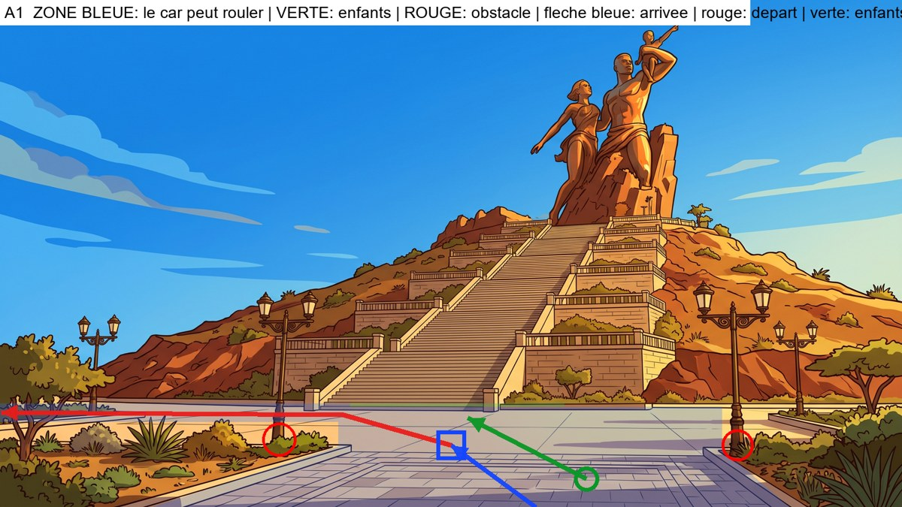

**Analyse du decor** : Plaza dallee. Jardinieres a gauche (x<600 sous y 750) et a droite (x>1250), lampadaires dessus. La seule sortie est la bande dallee derriere les jardinieres, a gauche, le long du pied de la colline (y 716-748) : le car y passe tout petit, dans le fond.

**Plan de mise en scene** (a valider avant de generer) :
- Type : **l'axe du decor va vers le fond : le car entre par le bas du cadre, vu de dos**
- Le car arrive : from the bottom edge of the frame, center-right, driving away from the camera toward the monument
- Il s'arrete : on the open paving left of center, about a quarter of the way to the staircase, its rear facing the camera
- Il repart : forward, then turning left onto the narrow paved strip behind the left planter along the foot of the hill, getting tiny in the distance and leaving the frame on the left; it never goes toward the staircase and never over grass, planters or lampposts
- Les enfants se tiennent : on the open paving to the right of the car, toward the camera
- Ils marchent : straight toward the foot of the grand staircase
- A eviter : the planters and shrubs on both sides, the lampposts, the staircase

### Images-cles (a generer avec Antigravity)

#### Image-cle K1 : le car vient de s'arreter (plan large)
- **Enregistrer sous** : `frontend/public/images/parcours1012/keyframes/a1/k1_car-arrete.png`
- **A donner a Antigravity** :
   - `frontend/public/images/parcours1012/decors/monument-exterieur.png`
   - `frontend/public/images/parcours1012/references/03_car-rapide_reference.png`
   - `frontend/public/images/parcours1012/references/05_car-profil-gauche_reference.jpg`
   - `frontend/public/images/parcours1012/references/05_car-face-arriere_reference.jpg`

```text
STYLE AND SCALE LOCK. 2D flat-vector animation illustration, 16:9 (1920x1080), clean dark-brown outlines, warm saturated colors, exactly the style of the reference images. Use the reference images as the ONLY source for faces, bodies, outfits and the vehicle, and use the background reference as the exact setting (same architecture, colors, light). Do not redesign anything. RELATIVE HEIGHTS (standing, same distance from the camera): Moussa 100% (11-year-old boy), Fatou 97% (11-year-old girl), Palou the lion 85% (a friend of the same age: his big mane top reaches Moussa's nose; slightly shorter than the children, NEVER taller, always upright on two legs, not a baby, not an adult lion), Papa Ibou 125% (adult). Characters keep these ratios and shrink with distance as real perspective requires. The vehicle is the Car Rapide of the references: tall boxy vintage Dakar minibus, yellow upper body, blue lower body, painted geometric patterns, painted eye and lion, roof rack with luggage, rear ladder, rear opening door; its roof is about 1.6 times Moussa's height. It is NOT a taxi, NOT a car, NOT a modern van. No text, no logo, no signs with writing.

Wide establishing shot. Background: the esplanade of the African Renaissance Monument: a wide light paved plaza in the foreground that runs straight toward the grand stone staircase and the bronze monument on the hill; on the left a planter with agaves and shrubs and a lamppost, on the right a planter with a tall lamppost and trees. Place the Car Rapide seen from behind (rear view, rear door facing the camera), stopped on the open paving left of center, about a quarter of the way to the staircase, its rear facing the camera. Nobody is outside. The car is drawn with correct perspective and scale for that spot. Avoid: the planters and shrubs on both sides, the lampposts, the staircase.
```

#### Image-cle K2 : la porte arriere s'ouvre (debut du plan 2)
- **Enregistrer sous** : `frontend/public/images/parcours1012/keyframes/a1/k2_porte-ouverte.png`
- **A donner a Antigravity** :
   - `frontend/public/images/parcours1012/decors/monument-exterieur.png`
   - `frontend/public/images/parcours1012/references/03_car-rapide_reference.png`
   - `frontend/public/images/parcours1012/references/05_car-profil-gauche_reference.jpg`
   - `frontend/public/images/parcours1012/references/05_car-face-arriere_reference.jpg`

```text
STYLE AND SCALE LOCK. 2D flat-vector animation illustration, 16:9 (1920x1080), clean dark-brown outlines, warm saturated colors, exactly the style of the reference images. Use the reference images as the ONLY source for faces, bodies, outfits and the vehicle, and use the background reference as the exact setting (same architecture, colors, light). Do not redesign anything. RELATIVE HEIGHTS (standing, same distance from the camera): Moussa 100% (11-year-old boy), Fatou 97% (11-year-old girl), Palou the lion 85% (a friend of the same age: his big mane top reaches Moussa's nose; slightly shorter than the children, NEVER taller, always upright on two legs, not a baby, not an adult lion), Papa Ibou 125% (adult). Characters keep these ratios and shrink with distance as real perspective requires. The vehicle is the Car Rapide of the references: tall boxy vintage Dakar minibus, yellow upper body, blue lower body, painted geometric patterns, painted eye and lion, roof rack with luggage, rear ladder, rear opening door; its roof is about 1.6 times Moussa's height. It is NOT a taxi, NOT a car, NOT a modern van. No text, no logo, no signs with writing.

Medium shot, the camera is low, in front of the car's rear, slightly to the left. Same place and same setting as image K1. The Car Rapide's rear door is wide open and the empty interior with its seats is visible. Nobody has got out yet. No people in the frame.
```

#### Image-cle K3 : les trois sont descendus (fin du plan 2)
- **Enregistrer sous** : `frontend/public/images/parcours1012/keyframes/a1/k3_trois-descendus.png`
- **A donner a Antigravity** :
   - `frontend/public/images/parcours1012/decors/monument-exterieur.png`
   - `frontend/public/images/parcours1012/references/04_scene3_enfants-salut-face_reference.jpg` (planche des trois : tailles relatives)
   - `frontend/public/images/parcours1012/references/02_moussa-11_reference.png`
   - `frontend/public/images/parcours1012/references/02_fatou-11_reference.png`
   - `frontend/public/images/parcours1012/references/01_palou-1012_reference.png`
   - `frontend/public/images/parcours1012/references/03_car-rapide_reference.png`

```text
STYLE AND SCALE LOCK. 2D flat-vector animation illustration, 16:9 (1920x1080), clean dark-brown outlines, warm saturated colors, exactly the style of the reference images. Use the reference images as the ONLY source for faces, bodies, outfits and the vehicle, and use the background reference as the exact setting (same architecture, colors, light). Do not redesign anything. RELATIVE HEIGHTS (standing, same distance from the camera): Moussa 100% (11-year-old boy), Fatou 97% (11-year-old girl), Palou the lion 85% (a friend of the same age: his big mane top reaches Moussa's nose; slightly shorter than the children, NEVER taller, always upright on two legs, not a baby, not an adult lion), Papa Ibou 125% (adult). Characters keep these ratios and shrink with distance as real perspective requires. The vehicle is the Car Rapide of the references: tall boxy vintage Dakar minibus, yellow upper body, blue lower body, painted geometric patterns, painted eye and lion, roof rack with luggage, rear ladder, rear opening door; its roof is about 1.6 times Moussa's height. It is NOT a taxi, NOT a car, NOT a modern van. No text, no logo, no signs with writing.

Same framing as image K2. The rear door is open. Moussa, Palou and Fatou, all full body and clearly visible, stand on the ground on the open paving to the right of the car, toward the camera, side by side, smiling, looking toward the driver's side of the car. Moussa: yellow t-shirt, orange cargo shorts, blue backpack, white socks, orange-red sneakers. Fatou: royal-blue dress, green ribbon on braided bun, brown satchel, blue sandals. Palou: golden fur, orange mane, white diamond on chest, tufted tail. Papa Ibou: green cap, orange-yellow checkered shirt, moustache. Correct relative heights: Palou slightly shorter than Moussa and Fatou. Avoid: the planters and shrubs on both sides, the lampposts, the staircase.
```

#### Image-cle K4 : gros plan de Papa Ibou qui salue (plan 3)
- **Enregistrer sous** : `frontend/public/images/parcours1012/keyframes/a1/k4_papa-ibou-salue.png`
- **A donner a Antigravity** :
   - `frontend/public/images/parcours1012/references/02_papa-ibou_reference.png`
   - `frontend/public/images/parcours1012/references/06_papa-ibou-volant-gauche_reference.jpg`
   - `frontend/public/images/parcours1012/references/03_car-rapide_reference.png`

```text
STYLE AND SCALE LOCK. 2D flat-vector animation illustration, 16:9 (1920x1080), clean dark-brown outlines, warm saturated colors, exactly the style of the reference images. Use the reference images as the ONLY source for faces, bodies, outfits and the vehicle, and use the background reference as the exact setting (same architecture, colors, light). Do not redesign anything. RELATIVE HEIGHTS (standing, same distance from the camera): Moussa 100% (11-year-old boy), Fatou 97% (11-year-old girl), Palou the lion 85% (a friend of the same age: his big mane top reaches Moussa's nose; slightly shorter than the children, NEVER taller, always upright on two legs, not a baby, not an adult lion), Papa Ibou 125% (adult). Characters keep these ratios and shrink with distance as real perspective requires. The vehicle is the Car Rapide of the references: tall boxy vintage Dakar minibus, yellow upper body, blue lower body, painted geometric patterns, painted eye and lion, roof rack with luggage, rear ladder, rear opening door; its roof is about 1.6 times Moussa's height. It is NOT a taxi, NOT a car, NOT a modern van. No text, no logo, no signs with writing.

Close-up of Papa Ibou at the open driver's window of the Car Rapide, smiling warmly and waving his right hand, the yellow door with painted patterns around him. The background outside the window is a soft blurred version of the colors of the setting: the esplanade of the African Renaissance Monument: a wide light paved plaza in the foreground that runs straight toward the grand stone staircase and the bronze monument on the hill; on the left a planter with agaves and shrubs and a lamppost, on the right a planter with a tall lamppost and trees. Same style as a cinematic close-up of a cartoon.
```

#### Image-cle K5 : les enfants font au revoir, le car est a cote (debut du plan 4)
- **Enregistrer sous** : `frontend/public/images/parcours1012/keyframes/a1/k5_au-revoir.png`
- **A donner a Antigravity** :
   - `frontend/public/images/parcours1012/decors/monument-exterieur.png`
   - `frontend/public/images/parcours1012/references/04_scene3_enfants-salut-face_reference.jpg` (planche des trois : tailles relatives)
   - `frontend/public/images/parcours1012/references/02_moussa-11_reference.png`
   - `frontend/public/images/parcours1012/references/02_fatou-11_reference.png`
   - `frontend/public/images/parcours1012/references/01_palou-1012_reference.png`
   - `frontend/public/images/parcours1012/references/03_car-rapide_reference.png`
   - `frontend/public/images/parcours1012/references/05_car-profil-gauche_reference.jpg`

```text
STYLE AND SCALE LOCK. 2D flat-vector animation illustration, 16:9 (1920x1080), clean dark-brown outlines, warm saturated colors, exactly the style of the reference images. Use the reference images as the ONLY source for faces, bodies, outfits and the vehicle, and use the background reference as the exact setting (same architecture, colors, light). Do not redesign anything. RELATIVE HEIGHTS (standing, same distance from the camera): Moussa 100% (11-year-old boy), Fatou 97% (11-year-old girl), Palou the lion 85% (a friend of the same age: his big mane top reaches Moussa's nose; slightly shorter than the children, NEVER taller, always upright on two legs, not a baby, not an adult lion), Papa Ibou 125% (adult). Characters keep these ratios and shrink with distance as real perspective requires. The vehicle is the Car Rapide of the references: tall boxy vintage Dakar minibus, yellow upper body, blue lower body, painted geometric patterns, painted eye and lion, roof rack with luggage, rear ladder, rear opening door; its roof is about 1.6 times Moussa's height. It is NOT a taxi, NOT a car, NOT a modern van. No text, no logo, no signs with writing.

Medium-wide shot from behind. In the foreground the three friends (seen from behind, 3/4 back) stand on the open paving to the right of the car, toward the camera and wave goodbye with one raised hand; beyond them the Car Rapide is stopped on the open paving left of center, about a quarter of the way to the staircase, its rear facing the camera, seen from behind, with Papa Ibou's arm waving out of the driver's window. Moussa: yellow t-shirt, orange cargo shorts, blue backpack, white socks, orange-red sneakers. Fatou: royal-blue dress, green ribbon on braided bun, brown satchel, blue sandals. Palou: golden fur, orange mane, white diamond on chest, tufted tail. Papa Ibou: green cap, orange-yellow checkered shirt, moustache. Palou is slightly shorter than the children. Avoid: the planters and shrubs on both sides, the lampposts, the staircase.
```

#### Image-cle K6 : les enfants marchent vers le lieu (debut du plan 5)
- **Enregistrer sous** : `frontend/public/images/parcours1012/keyframes/a1/k6_marche.png`
- **A donner a Antigravity** :
   - `frontend/public/images/parcours1012/decors/monument-exterieur.png`
   - `frontend/public/images/parcours1012/references/04_scene3_enfants-salut-face_reference.jpg` (planche des trois : tailles relatives)
   - `frontend/public/images/parcours1012/references/02_moussa-11_reference.png`
   - `frontend/public/images/parcours1012/references/02_fatou-11_reference.png`
   - `frontend/public/images/parcours1012/references/01_palou-1012_reference.png`

```text
STYLE AND SCALE LOCK. 2D flat-vector animation illustration, 16:9 (1920x1080), clean dark-brown outlines, warm saturated colors, exactly the style of the reference images. Use the reference images as the ONLY source for faces, bodies, outfits and the vehicle, and use the background reference as the exact setting (same architecture, colors, light). Do not redesign anything. RELATIVE HEIGHTS (standing, same distance from the camera): Moussa 100% (11-year-old boy), Fatou 97% (11-year-old girl), Palou the lion 85% (a friend of the same age: his big mane top reaches Moussa's nose; slightly shorter than the children, NEVER taller, always upright on two legs, not a baby, not an adult lion), Papa Ibou 125% (adult). Characters keep these ratios and shrink with distance as real perspective requires. The vehicle is the Car Rapide of the references: tall boxy vintage Dakar minibus, yellow upper body, blue lower body, painted geometric patterns, painted eye and lion, roof rack with luggage, rear ladder, rear opening door; its roof is about 1.6 times Moussa's height. It is NOT a taxi, NOT a car, NOT a modern van. No text, no logo, no signs with writing.

Wide shot in correct perspective. The Car Rapide has gone: it is not in the frame. The three friends, full body and seen from behind, walk side by side straight toward the foot of the grand staircase. Moussa: yellow t-shirt, orange cargo shorts, blue backpack, white socks, orange-red sneakers. Fatou: royal-blue dress, green ribbon on braided bun, brown satchel, blue sandals. Palou: golden fur, orange mane, white diamond on chest, tufted tail. Papa Ibou: green cap, orange-yellow checkered shirt, moustache. Palou slightly shorter than the children, walking upright on two legs. Avoid: the planters and shrubs on both sides, the lampposts, the staircase.
```

### Plans video (Flow, Frames to video, 4 s chacun)

#### Plan 1 : le car arrive (4 s)
- **Flow, mode Frames to video** : image de debut `frontend/public/images/parcours1012/decors/monument-exterieur.png`
- **Image de fin** : `frontend/public/images/parcours1012/keyframes/a1/k1_car-arrete.png`

```text
Animate the provided frame(s) like a 2D flat-vector cartoon. Keep every character, outfit, face and the Car Rapide EXACTLY as drawn; do not redraw or resize anything; Palou stays slightly shorter than the children. Natural, smooth, readable motion. No text, no speech, no music. Static wide shot of the empty setting. The Car Rapide enters from the bottom edge of the frame, center-right, driving away from the camera toward the monument and slowly stops on the open paving left of center, about a quarter of the way to the staircase, its rear facing the camera, ending exactly like the last frame. Avoid: the planters and shrubs on both sides, the lampposts, the staircase.
```

#### Plan 2 : les trois descendent (4 s)
- **Flow, mode Frames to video** : image de debut `frontend/public/images/parcours1012/keyframes/a1/k2_porte-ouverte.png`
- **Image de fin** : `frontend/public/images/parcours1012/keyframes/a1/k3_trois-descendus.png`

```text
Animate the provided frame(s) like a 2D flat-vector cartoon. Keep every character, outfit, face and the Car Rapide EXACTLY as drawn; do not redraw or resize anything; Palou stays slightly shorter than the children. Natural, smooth, readable motion. No text, no speech, no music. Moussa steps down from the open rear door, then Palou hops down, then Fatou; they come to stand where the last frame shows them. The minibus does not move.
```

#### Plan 3 : Papa Ibou salue (gros plan) (4 s, a couper a 2,5 s au montage)
- **Flow, mode Frames to video** : image de debut `frontend/public/images/parcours1012/keyframes/a1/k4_papa-ibou-salue.png`

```text
Animate the provided frame(s) like a 2D flat-vector cartoon. Keep every character, outfit, face and the Car Rapide EXACTLY as drawn; do not redraw or resize anything; Palou stays slightly shorter than the children. Natural, smooth, readable motion. No text, no speech, no music. Close-up: Papa Ibou smiles and waves his hand warmly, a small head tilt, blinks; the background stays softly blurred.
```

#### Plan 4 : au revoir, le car repart (4 s)
- **Flow, mode Frames to video** : image de debut `frontend/public/images/parcours1012/keyframes/a1/k5_au-revoir.png`

```text
Animate the provided frame(s) like a 2D flat-vector cartoon. Keep every character, outfit, face and the Car Rapide EXACTLY as drawn; do not redraw or resize anything; Palou stays slightly shorter than the children. Natural, smooth, readable motion. No text, no speech, no music. The three children wave goodbye; Papa Ibou waves back; then the Car Rapide pulls away smoothly: it goes forward, then turning left onto the narrow paved strip behind the left planter along the foot of the hill, getting tiny in the distance and leaving the frame on the left; it never goes toward the staircase and never over grass, planters or lampposts, getting smaller with distance until it leaves the frame. The children keep waving, then lower their arms. Avoid: the planters and shrubs on both sides, the lampposts, the staircase.
```

#### Plan 5 : ils marchent vers le lieu, fondu au noir (4 s)
- **Flow, mode Frames to video** : image de debut `frontend/public/images/parcours1012/keyframes/a1/k6_marche.png`

```text
Animate the provided frame(s) like a 2D flat-vector cartoon. Keep every character, outfit, face and the Car Rapide EXACTLY as drawn; do not redraw or resize anything; Palou stays slightly shorter than the children. Natural, smooth, readable motion. No text, no speech, no music. The three friends walk side by side straight toward the foot of the grand staircase with a natural walking cycle, getting slightly smaller with distance. Static camera. In the last second the image fades smoothly to black.
```

---

## Module a2 - Port autonome de Dakar

**Fichier cible** : `arrivee-a2.mp4` (environ 18 s) - **Decor** : `frontend/public/images/parcours1012/decors/port-exterieur.png`

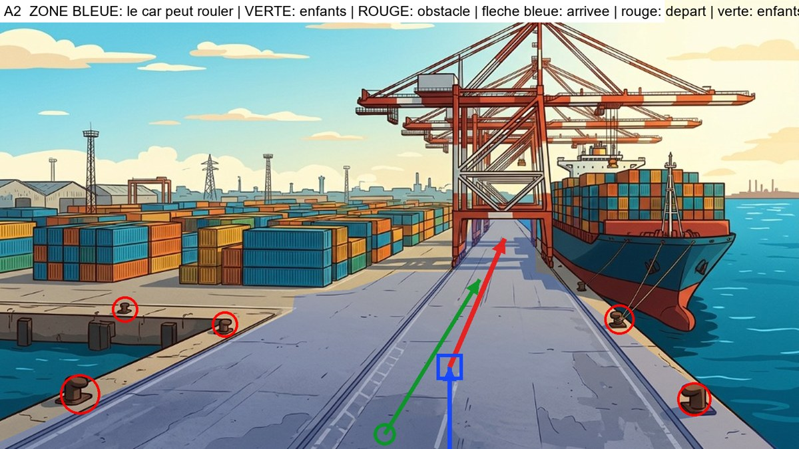

**Analyse du decor** : Quai en profondeur. Eau a gauche (baie) et a droite (navire), conteneurs au fond a gauche, jambes de la grue a x 905-945 et 1072-1100 : seul l'espace entre les jambes (x 950-1070) mene au fond.

**Plan de mise en scene** (a valider avant de generer) :
- Type : **l'axe du decor va vers le fond : le car entre par le bas du cadre, vu de dos**
- Le car arrive : from the bottom edge, in the middle of the dock road, driving away from the camera
- Il s'arrete : in the middle of the road just right of the left rail, far from both water edges
- Il repart : straight ahead along the middle of the road and through the gap between the crane legs, into the distance; never toward the containers on the left, nor the water or the ship on the right
- Les enfants se tiennent : on the road in front of the car, slightly to its left, toward the camera
- Ils marchent : straight along the middle of the dock road toward the cranes
- A eviter : the water in the dock basin on the left, the quay edge and the ship on the right, the bollards, the containers

### Images-cles (a generer avec Antigravity)

#### Image-cle K1 : le car vient de s'arreter (plan large)
- **Enregistrer sous** : `frontend/public/images/parcours1012/keyframes/a2/k1_car-arrete.png`
- **A donner a Antigravity** :
   - `frontend/public/images/parcours1012/decors/port-exterieur.png`
   - `frontend/public/images/parcours1012/references/03_car-rapide_reference.png`
   - `frontend/public/images/parcours1012/references/05_car-profil-gauche_reference.jpg`
   - `frontend/public/images/parcours1012/references/05_car-face-arriere_reference.jpg`

```text
STYLE AND SCALE LOCK. 2D flat-vector animation illustration, 16:9 (1920x1080), clean dark-brown outlines, warm saturated colors, exactly the style of the reference images. Use the reference images as the ONLY source for faces, bodies, outfits and the vehicle, and use the background reference as the exact setting (same architecture, colors, light). Do not redesign anything. RELATIVE HEIGHTS (standing, same distance from the camera): Moussa 100% (11-year-old boy), Fatou 97% (11-year-old girl), Palou the lion 85% (a friend of the same age: his big mane top reaches Moussa's nose; slightly shorter than the children, NEVER taller, always upright on two legs, not a baby, not an adult lion), Papa Ibou 125% (adult). Characters keep these ratios and shrink with distance as real perspective requires. The vehicle is the Car Rapide of the references: tall boxy vintage Dakar minibus, yellow upper body, blue lower body, painted geometric patterns, painted eye and lion, roof rack with luggage, rear ladder, rear opening door; its roof is about 1.6 times Moussa's height. It is NOT a taxi, NOT a car, NOT a modern van. No text, no logo, no signs with writing.

Wide establishing shot. Background: the container terminal of the Port of Dakar: a wide concrete dock road with rail tracks running straight to the vanishing point between the legs of giant red gantry cranes; stacked colorful containers far on the left beyond a dock basin, a cargo ship at the quay on the right, water on both sides. Place the Car Rapide seen from behind (rear view, rear door facing the camera), stopped in the middle of the road just right of the left rail, far from both water edges. Nobody is outside. The car is drawn with correct perspective and scale for that spot. Avoid: the water in the dock basin on the left, the quay edge and the ship on the right, the bollards, the containers.
```

#### Image-cle K2 : la porte arriere s'ouvre (debut du plan 2)
- **Enregistrer sous** : `frontend/public/images/parcours1012/keyframes/a2/k2_porte-ouverte.png`
- **A donner a Antigravity** :
   - `frontend/public/images/parcours1012/decors/port-exterieur.png`
   - `frontend/public/images/parcours1012/references/03_car-rapide_reference.png`
   - `frontend/public/images/parcours1012/references/05_car-profil-gauche_reference.jpg`
   - `frontend/public/images/parcours1012/references/05_car-face-arriere_reference.jpg`

```text
STYLE AND SCALE LOCK. 2D flat-vector animation illustration, 16:9 (1920x1080), clean dark-brown outlines, warm saturated colors, exactly the style of the reference images. Use the reference images as the ONLY source for faces, bodies, outfits and the vehicle, and use the background reference as the exact setting (same architecture, colors, light). Do not redesign anything. RELATIVE HEIGHTS (standing, same distance from the camera): Moussa 100% (11-year-old boy), Fatou 97% (11-year-old girl), Palou the lion 85% (a friend of the same age: his big mane top reaches Moussa's nose; slightly shorter than the children, NEVER taller, always upright on two legs, not a baby, not an adult lion), Papa Ibou 125% (adult). Characters keep these ratios and shrink with distance as real perspective requires. The vehicle is the Car Rapide of the references: tall boxy vintage Dakar minibus, yellow upper body, blue lower body, painted geometric patterns, painted eye and lion, roof rack with luggage, rear ladder, rear opening door; its roof is about 1.6 times Moussa's height. It is NOT a taxi, NOT a car, NOT a modern van. No text, no logo, no signs with writing.

Medium shot, the camera is low, in front of the car's rear, slightly to the left. Same place and same setting as image K1. The Car Rapide's rear door is wide open and the empty interior with its seats is visible. Nobody has got out yet. No people in the frame.
```

#### Image-cle K3 : les trois sont descendus (fin du plan 2)
- **Enregistrer sous** : `frontend/public/images/parcours1012/keyframes/a2/k3_trois-descendus.png`
- **A donner a Antigravity** :
   - `frontend/public/images/parcours1012/decors/port-exterieur.png`
   - `frontend/public/images/parcours1012/references/04_scene3_enfants-salut-face_reference.jpg` (planche des trois : tailles relatives)
   - `frontend/public/images/parcours1012/references/02_moussa-11_reference.png`
   - `frontend/public/images/parcours1012/references/02_fatou-11_reference.png`
   - `frontend/public/images/parcours1012/references/01_palou-1012_reference.png`
   - `frontend/public/images/parcours1012/references/03_car-rapide_reference.png`

```text
STYLE AND SCALE LOCK. 2D flat-vector animation illustration, 16:9 (1920x1080), clean dark-brown outlines, warm saturated colors, exactly the style of the reference images. Use the reference images as the ONLY source for faces, bodies, outfits and the vehicle, and use the background reference as the exact setting (same architecture, colors, light). Do not redesign anything. RELATIVE HEIGHTS (standing, same distance from the camera): Moussa 100% (11-year-old boy), Fatou 97% (11-year-old girl), Palou the lion 85% (a friend of the same age: his big mane top reaches Moussa's nose; slightly shorter than the children, NEVER taller, always upright on two legs, not a baby, not an adult lion), Papa Ibou 125% (adult). Characters keep these ratios and shrink with distance as real perspective requires. The vehicle is the Car Rapide of the references: tall boxy vintage Dakar minibus, yellow upper body, blue lower body, painted geometric patterns, painted eye and lion, roof rack with luggage, rear ladder, rear opening door; its roof is about 1.6 times Moussa's height. It is NOT a taxi, NOT a car, NOT a modern van. No text, no logo, no signs with writing.

Same framing as image K2. The rear door is open. Moussa, Palou and Fatou, all full body and clearly visible, stand on the ground on the road in front of the car, slightly to its left, toward the camera, side by side, smiling, looking toward the driver's side of the car. Moussa: yellow t-shirt, orange cargo shorts, blue backpack, white socks, orange-red sneakers. Fatou: royal-blue dress, green ribbon on braided bun, brown satchel, blue sandals. Palou: golden fur, orange mane, white diamond on chest, tufted tail. Papa Ibou: green cap, orange-yellow checkered shirt, moustache. Correct relative heights: Palou slightly shorter than Moussa and Fatou. Avoid: the water in the dock basin on the left, the quay edge and the ship on the right, the bollards, the containers.
```

#### Image-cle K4 : gros plan de Papa Ibou qui salue (plan 3)
- **Enregistrer sous** : `frontend/public/images/parcours1012/keyframes/a2/k4_papa-ibou-salue.png`
- **A donner a Antigravity** :
   - `frontend/public/images/parcours1012/references/02_papa-ibou_reference.png`
   - `frontend/public/images/parcours1012/references/06_papa-ibou-volant-gauche_reference.jpg`
   - `frontend/public/images/parcours1012/references/03_car-rapide_reference.png`

```text
STYLE AND SCALE LOCK. 2D flat-vector animation illustration, 16:9 (1920x1080), clean dark-brown outlines, warm saturated colors, exactly the style of the reference images. Use the reference images as the ONLY source for faces, bodies, outfits and the vehicle, and use the background reference as the exact setting (same architecture, colors, light). Do not redesign anything. RELATIVE HEIGHTS (standing, same distance from the camera): Moussa 100% (11-year-old boy), Fatou 97% (11-year-old girl), Palou the lion 85% (a friend of the same age: his big mane top reaches Moussa's nose; slightly shorter than the children, NEVER taller, always upright on two legs, not a baby, not an adult lion), Papa Ibou 125% (adult). Characters keep these ratios and shrink with distance as real perspective requires. The vehicle is the Car Rapide of the references: tall boxy vintage Dakar minibus, yellow upper body, blue lower body, painted geometric patterns, painted eye and lion, roof rack with luggage, rear ladder, rear opening door; its roof is about 1.6 times Moussa's height. It is NOT a taxi, NOT a car, NOT a modern van. No text, no logo, no signs with writing.

Close-up of Papa Ibou at the open driver's window of the Car Rapide, smiling warmly and waving his right hand, the yellow door with painted patterns around him. The background outside the window is a soft blurred version of the colors of the setting: the container terminal of the Port of Dakar: a wide concrete dock road with rail tracks running straight to the vanishing point between the legs of giant red gantry cranes; stacked colorful containers far on the left beyond a dock basin, a cargo ship at the quay on the right, water on both sides. Same style as a cinematic close-up of a cartoon.
```

#### Image-cle K5 : les enfants font au revoir, le car est a cote (debut du plan 4)
- **Enregistrer sous** : `frontend/public/images/parcours1012/keyframes/a2/k5_au-revoir.png`
- **A donner a Antigravity** :
   - `frontend/public/images/parcours1012/decors/port-exterieur.png`
   - `frontend/public/images/parcours1012/references/04_scene3_enfants-salut-face_reference.jpg` (planche des trois : tailles relatives)
   - `frontend/public/images/parcours1012/references/02_moussa-11_reference.png`
   - `frontend/public/images/parcours1012/references/02_fatou-11_reference.png`
   - `frontend/public/images/parcours1012/references/01_palou-1012_reference.png`
   - `frontend/public/images/parcours1012/references/03_car-rapide_reference.png`
   - `frontend/public/images/parcours1012/references/05_car-profil-gauche_reference.jpg`

```text
STYLE AND SCALE LOCK. 2D flat-vector animation illustration, 16:9 (1920x1080), clean dark-brown outlines, warm saturated colors, exactly the style of the reference images. Use the reference images as the ONLY source for faces, bodies, outfits and the vehicle, and use the background reference as the exact setting (same architecture, colors, light). Do not redesign anything. RELATIVE HEIGHTS (standing, same distance from the camera): Moussa 100% (11-year-old boy), Fatou 97% (11-year-old girl), Palou the lion 85% (a friend of the same age: his big mane top reaches Moussa's nose; slightly shorter than the children, NEVER taller, always upright on two legs, not a baby, not an adult lion), Papa Ibou 125% (adult). Characters keep these ratios and shrink with distance as real perspective requires. The vehicle is the Car Rapide of the references: tall boxy vintage Dakar minibus, yellow upper body, blue lower body, painted geometric patterns, painted eye and lion, roof rack with luggage, rear ladder, rear opening door; its roof is about 1.6 times Moussa's height. It is NOT a taxi, NOT a car, NOT a modern van. No text, no logo, no signs with writing.

Medium-wide shot from behind. In the foreground the three friends (seen from behind, 3/4 back) stand on the road in front of the car, slightly to its left, toward the camera and wave goodbye with one raised hand; beyond them the Car Rapide is stopped in the middle of the road just right of the left rail, far from both water edges, seen from behind, with Papa Ibou's arm waving out of the driver's window. Moussa: yellow t-shirt, orange cargo shorts, blue backpack, white socks, orange-red sneakers. Fatou: royal-blue dress, green ribbon on braided bun, brown satchel, blue sandals. Palou: golden fur, orange mane, white diamond on chest, tufted tail. Papa Ibou: green cap, orange-yellow checkered shirt, moustache. Palou is slightly shorter than the children. Avoid: the water in the dock basin on the left, the quay edge and the ship on the right, the bollards, the containers.
```

#### Image-cle K6 : les enfants marchent vers le lieu (debut du plan 5)
- **Enregistrer sous** : `frontend/public/images/parcours1012/keyframes/a2/k6_marche.png`
- **A donner a Antigravity** :
   - `frontend/public/images/parcours1012/decors/port-exterieur.png`
   - `frontend/public/images/parcours1012/references/04_scene3_enfants-salut-face_reference.jpg` (planche des trois : tailles relatives)
   - `frontend/public/images/parcours1012/references/02_moussa-11_reference.png`
   - `frontend/public/images/parcours1012/references/02_fatou-11_reference.png`
   - `frontend/public/images/parcours1012/references/01_palou-1012_reference.png`

```text
STYLE AND SCALE LOCK. 2D flat-vector animation illustration, 16:9 (1920x1080), clean dark-brown outlines, warm saturated colors, exactly the style of the reference images. Use the reference images as the ONLY source for faces, bodies, outfits and the vehicle, and use the background reference as the exact setting (same architecture, colors, light). Do not redesign anything. RELATIVE HEIGHTS (standing, same distance from the camera): Moussa 100% (11-year-old boy), Fatou 97% (11-year-old girl), Palou the lion 85% (a friend of the same age: his big mane top reaches Moussa's nose; slightly shorter than the children, NEVER taller, always upright on two legs, not a baby, not an adult lion), Papa Ibou 125% (adult). Characters keep these ratios and shrink with distance as real perspective requires. The vehicle is the Car Rapide of the references: tall boxy vintage Dakar minibus, yellow upper body, blue lower body, painted geometric patterns, painted eye and lion, roof rack with luggage, rear ladder, rear opening door; its roof is about 1.6 times Moussa's height. It is NOT a taxi, NOT a car, NOT a modern van. No text, no logo, no signs with writing.

Wide shot in correct perspective. The Car Rapide has gone: it is not in the frame. The three friends, full body and seen from behind, walk side by side straight along the middle of the dock road toward the cranes. Moussa: yellow t-shirt, orange cargo shorts, blue backpack, white socks, orange-red sneakers. Fatou: royal-blue dress, green ribbon on braided bun, brown satchel, blue sandals. Palou: golden fur, orange mane, white diamond on chest, tufted tail. Papa Ibou: green cap, orange-yellow checkered shirt, moustache. Palou slightly shorter than the children, walking upright on two legs. Avoid: the water in the dock basin on the left, the quay edge and the ship on the right, the bollards, the containers.
```

### Plans video (Flow, Frames to video, 4 s chacun)

#### Plan 1 : le car arrive (4 s)
- **Flow, mode Frames to video** : image de debut `frontend/public/images/parcours1012/decors/port-exterieur.png`
- **Image de fin** : `frontend/public/images/parcours1012/keyframes/a2/k1_car-arrete.png`

```text
Animate the provided frame(s) like a 2D flat-vector cartoon. Keep every character, outfit, face and the Car Rapide EXACTLY as drawn; do not redraw or resize anything; Palou stays slightly shorter than the children. Natural, smooth, readable motion. No text, no speech, no music. Static wide shot of the empty setting. The Car Rapide enters from the bottom edge, in the middle of the dock road, driving away from the camera and slowly stops in the middle of the road just right of the left rail, far from both water edges, ending exactly like the last frame. Avoid: the water in the dock basin on the left, the quay edge and the ship on the right, the bollards, the containers.
```

#### Plan 2 : les trois descendent (4 s)
- **Flow, mode Frames to video** : image de debut `frontend/public/images/parcours1012/keyframes/a2/k2_porte-ouverte.png`
- **Image de fin** : `frontend/public/images/parcours1012/keyframes/a2/k3_trois-descendus.png`

```text
Animate the provided frame(s) like a 2D flat-vector cartoon. Keep every character, outfit, face and the Car Rapide EXACTLY as drawn; do not redraw or resize anything; Palou stays slightly shorter than the children. Natural, smooth, readable motion. No text, no speech, no music. Moussa steps down from the open rear door, then Palou hops down, then Fatou; they come to stand where the last frame shows them. The minibus does not move.
```

#### Plan 3 : Papa Ibou salue (gros plan) (4 s, a couper a 2,5 s au montage)
- **Flow, mode Frames to video** : image de debut `frontend/public/images/parcours1012/keyframes/a2/k4_papa-ibou-salue.png`

```text
Animate the provided frame(s) like a 2D flat-vector cartoon. Keep every character, outfit, face and the Car Rapide EXACTLY as drawn; do not redraw or resize anything; Palou stays slightly shorter than the children. Natural, smooth, readable motion. No text, no speech, no music. Close-up: Papa Ibou smiles and waves his hand warmly, a small head tilt, blinks; the background stays softly blurred.
```

#### Plan 4 : au revoir, le car repart (4 s)
- **Flow, mode Frames to video** : image de debut `frontend/public/images/parcours1012/keyframes/a2/k5_au-revoir.png`

```text
Animate the provided frame(s) like a 2D flat-vector cartoon. Keep every character, outfit, face and the Car Rapide EXACTLY as drawn; do not redraw or resize anything; Palou stays slightly shorter than the children. Natural, smooth, readable motion. No text, no speech, no music. The three children wave goodbye; Papa Ibou waves back; then the Car Rapide pulls away smoothly: it goes straight ahead along the middle of the road and through the gap between the crane legs, into the distance; never toward the containers on the left, nor the water or the ship on the right, getting smaller with distance until it leaves the frame. The children keep waving, then lower their arms. Avoid: the water in the dock basin on the left, the quay edge and the ship on the right, the bollards, the containers.
```

#### Plan 5 : ils marchent vers le lieu, fondu au noir (4 s)
- **Flow, mode Frames to video** : image de debut `frontend/public/images/parcours1012/keyframes/a2/k6_marche.png`

```text
Animate the provided frame(s) like a 2D flat-vector cartoon. Keep every character, outfit, face and the Car Rapide EXACTLY as drawn; do not redraw or resize anything; Palou stays slightly shorter than the children. Natural, smooth, readable motion. No text, no speech, no music. The three friends walk side by side straight along the middle of the dock road toward the cranes with a natural walking cycle, getting slightly smaller with distance. Static camera. In the last second the image fades smoothly to black.
```

---

## Module a3 - Gare du TER

**Fichier cible** : `arrivee-a3.mp4` (environ 18 s) - **Decor** : `frontend/public/images/parcours1012/decors/gare-ter-exterieur.png`

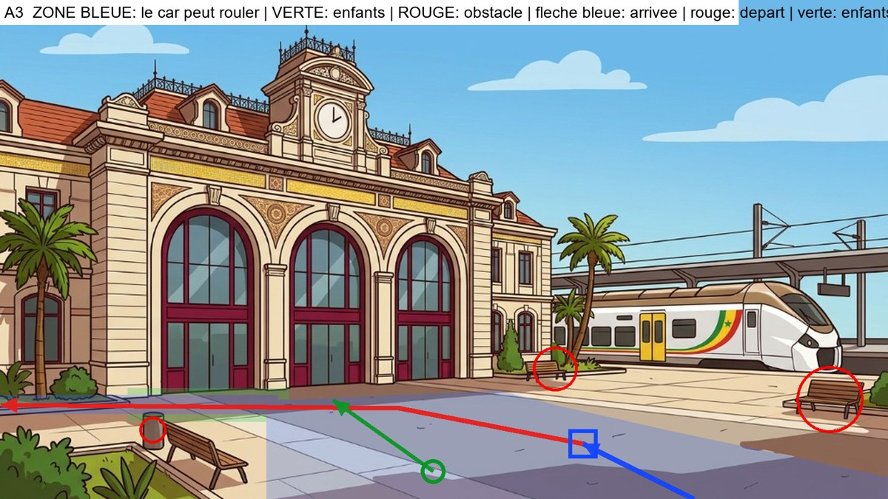

**Analyse du decor** : Parvis. Banc et massif a gauche (x<450, y>765), banc a droite pres du quai du train, train au fond a droite : le car reste sur l'asphalte et repart derriere le banc de gauche, le long de la facade.

**Plan de mise en scene** (a valider avant de generer) :
- Type : **l'axe du decor va vers le fond : le car entre par le bas du cadre, vu de dos**
- Le car arrive : from the bottom edge, right of center, driving toward the building
- Il s'arrete : on the asphalt right of center, well away from the train platform on the right
- Il repart : forward, then turning left and driving along the front of the station building, behind the left bench, getting tiny in the distance and leaving the frame on the left
- Les enfants se tiennent : on the open asphalt to the left of the car, toward the camera
- Ils marchent : across the forecourt toward the central arched glass door under the clock tower
- A eviter : the train and its platform, the two benches, the flowerbeds and the palm trees

### Images-cles (a generer avec Antigravity)

#### Image-cle K1 : le car vient de s'arreter (plan large)
- **Enregistrer sous** : `frontend/public/images/parcours1012/keyframes/a3/k1_car-arrete.png`
- **A donner a Antigravity** :
   - `frontend/public/images/parcours1012/decors/gare-ter-exterieur.png`
   - `frontend/public/images/parcours1012/references/03_car-rapide_reference.png`
   - `frontend/public/images/parcours1012/references/05_car-profil-gauche_reference.jpg`
   - `frontend/public/images/parcours1012/references/05_car-face-arriere_reference.jpg`

```text
STYLE AND SCALE LOCK. 2D flat-vector animation illustration, 16:9 (1920x1080), clean dark-brown outlines, warm saturated colors, exactly the style of the reference images. Use the reference images as the ONLY source for faces, bodies, outfits and the vehicle, and use the background reference as the exact setting (same architecture, colors, light). Do not redesign anything. RELATIVE HEIGHTS (standing, same distance from the camera): Moussa 100% (11-year-old boy), Fatou 97% (11-year-old girl), Palou the lion 85% (a friend of the same age: his big mane top reaches Moussa's nose; slightly shorter than the children, NEVER taller, always upright on two legs, not a baby, not an adult lion), Papa Ibou 125% (adult). Characters keep these ratios and shrink with distance as real perspective requires. The vehicle is the Car Rapide of the references: tall boxy vintage Dakar minibus, yellow upper body, blue lower body, painted geometric patterns, painted eye and lion, roof rack with luggage, rear ladder, rear opening door; its roof is about 1.6 times Moussa's height. It is NOT a taxi, NOT a car, NOT a modern van. No text, no logo, no signs with writing.

Wide establishing shot. Background: the forecourt of the historic Dakar TER station: a large open paved plaza in front of the cream building with three big arched glass doors and a clock tower; a white TER train far on the right behind palm trees; a bench and a flowerbed at the bottom left, a bench on the right. Place the Car Rapide seen from behind (rear view, rear door facing the camera), stopped on the asphalt right of center, well away from the train platform on the right. Nobody is outside. The car is drawn with correct perspective and scale for that spot. Avoid: the train and its platform, the two benches, the flowerbeds and the palm trees.
```

#### Image-cle K2 : la porte arriere s'ouvre (debut du plan 2)
- **Enregistrer sous** : `frontend/public/images/parcours1012/keyframes/a3/k2_porte-ouverte.png`
- **A donner a Antigravity** :
   - `frontend/public/images/parcours1012/decors/gare-ter-exterieur.png`
   - `frontend/public/images/parcours1012/references/03_car-rapide_reference.png`
   - `frontend/public/images/parcours1012/references/05_car-profil-gauche_reference.jpg`
   - `frontend/public/images/parcours1012/references/05_car-face-arriere_reference.jpg`

```text
STYLE AND SCALE LOCK. 2D flat-vector animation illustration, 16:9 (1920x1080), clean dark-brown outlines, warm saturated colors, exactly the style of the reference images. Use the reference images as the ONLY source for faces, bodies, outfits and the vehicle, and use the background reference as the exact setting (same architecture, colors, light). Do not redesign anything. RELATIVE HEIGHTS (standing, same distance from the camera): Moussa 100% (11-year-old boy), Fatou 97% (11-year-old girl), Palou the lion 85% (a friend of the same age: his big mane top reaches Moussa's nose; slightly shorter than the children, NEVER taller, always upright on two legs, not a baby, not an adult lion), Papa Ibou 125% (adult). Characters keep these ratios and shrink with distance as real perspective requires. The vehicle is the Car Rapide of the references: tall boxy vintage Dakar minibus, yellow upper body, blue lower body, painted geometric patterns, painted eye and lion, roof rack with luggage, rear ladder, rear opening door; its roof is about 1.6 times Moussa's height. It is NOT a taxi, NOT a car, NOT a modern van. No text, no logo, no signs with writing.

Medium shot, the camera is low, in front of the car's rear, slightly to the left. Same place and same setting as image K1. The Car Rapide's rear door is wide open and the empty interior with its seats is visible. Nobody has got out yet. No people in the frame.
```

#### Image-cle K3 : les trois sont descendus (fin du plan 2)
- **Enregistrer sous** : `frontend/public/images/parcours1012/keyframes/a3/k3_trois-descendus.png`
- **A donner a Antigravity** :
   - `frontend/public/images/parcours1012/decors/gare-ter-exterieur.png`
   - `frontend/public/images/parcours1012/references/04_scene3_enfants-salut-face_reference.jpg` (planche des trois : tailles relatives)
   - `frontend/public/images/parcours1012/references/02_moussa-11_reference.png`
   - `frontend/public/images/parcours1012/references/02_fatou-11_reference.png`
   - `frontend/public/images/parcours1012/references/01_palou-1012_reference.png`
   - `frontend/public/images/parcours1012/references/03_car-rapide_reference.png`

```text
STYLE AND SCALE LOCK. 2D flat-vector animation illustration, 16:9 (1920x1080), clean dark-brown outlines, warm saturated colors, exactly the style of the reference images. Use the reference images as the ONLY source for faces, bodies, outfits and the vehicle, and use the background reference as the exact setting (same architecture, colors, light). Do not redesign anything. RELATIVE HEIGHTS (standing, same distance from the camera): Moussa 100% (11-year-old boy), Fatou 97% (11-year-old girl), Palou the lion 85% (a friend of the same age: his big mane top reaches Moussa's nose; slightly shorter than the children, NEVER taller, always upright on two legs, not a baby, not an adult lion), Papa Ibou 125% (adult). Characters keep these ratios and shrink with distance as real perspective requires. The vehicle is the Car Rapide of the references: tall boxy vintage Dakar minibus, yellow upper body, blue lower body, painted geometric patterns, painted eye and lion, roof rack with luggage, rear ladder, rear opening door; its roof is about 1.6 times Moussa's height. It is NOT a taxi, NOT a car, NOT a modern van. No text, no logo, no signs with writing.

Same framing as image K2. The rear door is open. Moussa, Palou and Fatou, all full body and clearly visible, stand on the ground on the open asphalt to the left of the car, toward the camera, side by side, smiling, looking toward the driver's side of the car. Moussa: yellow t-shirt, orange cargo shorts, blue backpack, white socks, orange-red sneakers. Fatou: royal-blue dress, green ribbon on braided bun, brown satchel, blue sandals. Palou: golden fur, orange mane, white diamond on chest, tufted tail. Papa Ibou: green cap, orange-yellow checkered shirt, moustache. Correct relative heights: Palou slightly shorter than Moussa and Fatou. Avoid: the train and its platform, the two benches, the flowerbeds and the palm trees.
```

#### Image-cle K4 : gros plan de Papa Ibou qui salue (plan 3)
- **Enregistrer sous** : `frontend/public/images/parcours1012/keyframes/a3/k4_papa-ibou-salue.png`
- **A donner a Antigravity** :
   - `frontend/public/images/parcours1012/references/02_papa-ibou_reference.png`
   - `frontend/public/images/parcours1012/references/06_papa-ibou-volant-gauche_reference.jpg`
   - `frontend/public/images/parcours1012/references/03_car-rapide_reference.png`

```text
STYLE AND SCALE LOCK. 2D flat-vector animation illustration, 16:9 (1920x1080), clean dark-brown outlines, warm saturated colors, exactly the style of the reference images. Use the reference images as the ONLY source for faces, bodies, outfits and the vehicle, and use the background reference as the exact setting (same architecture, colors, light). Do not redesign anything. RELATIVE HEIGHTS (standing, same distance from the camera): Moussa 100% (11-year-old boy), Fatou 97% (11-year-old girl), Palou the lion 85% (a friend of the same age: his big mane top reaches Moussa's nose; slightly shorter than the children, NEVER taller, always upright on two legs, not a baby, not an adult lion), Papa Ibou 125% (adult). Characters keep these ratios and shrink with distance as real perspective requires. The vehicle is the Car Rapide of the references: tall boxy vintage Dakar minibus, yellow upper body, blue lower body, painted geometric patterns, painted eye and lion, roof rack with luggage, rear ladder, rear opening door; its roof is about 1.6 times Moussa's height. It is NOT a taxi, NOT a car, NOT a modern van. No text, no logo, no signs with writing.

Close-up of Papa Ibou at the open driver's window of the Car Rapide, smiling warmly and waving his right hand, the yellow door with painted patterns around him. The background outside the window is a soft blurred version of the colors of the setting: the forecourt of the historic Dakar TER station: a large open paved plaza in front of the cream building with three big arched glass doors and a clock tower; a white TER train far on the right behind palm trees; a bench and a flowerbed at the bottom left, a bench on the right. Same style as a cinematic close-up of a cartoon.
```

#### Image-cle K5 : les enfants font au revoir, le car est a cote (debut du plan 4)
- **Enregistrer sous** : `frontend/public/images/parcours1012/keyframes/a3/k5_au-revoir.png`
- **A donner a Antigravity** :
   - `frontend/public/images/parcours1012/decors/gare-ter-exterieur.png`
   - `frontend/public/images/parcours1012/references/04_scene3_enfants-salut-face_reference.jpg` (planche des trois : tailles relatives)
   - `frontend/public/images/parcours1012/references/02_moussa-11_reference.png`
   - `frontend/public/images/parcours1012/references/02_fatou-11_reference.png`
   - `frontend/public/images/parcours1012/references/01_palou-1012_reference.png`
   - `frontend/public/images/parcours1012/references/03_car-rapide_reference.png`
   - `frontend/public/images/parcours1012/references/05_car-profil-gauche_reference.jpg`

```text
STYLE AND SCALE LOCK. 2D flat-vector animation illustration, 16:9 (1920x1080), clean dark-brown outlines, warm saturated colors, exactly the style of the reference images. Use the reference images as the ONLY source for faces, bodies, outfits and the vehicle, and use the background reference as the exact setting (same architecture, colors, light). Do not redesign anything. RELATIVE HEIGHTS (standing, same distance from the camera): Moussa 100% (11-year-old boy), Fatou 97% (11-year-old girl), Palou the lion 85% (a friend of the same age: his big mane top reaches Moussa's nose; slightly shorter than the children, NEVER taller, always upright on two legs, not a baby, not an adult lion), Papa Ibou 125% (adult). Characters keep these ratios and shrink with distance as real perspective requires. The vehicle is the Car Rapide of the references: tall boxy vintage Dakar minibus, yellow upper body, blue lower body, painted geometric patterns, painted eye and lion, roof rack with luggage, rear ladder, rear opening door; its roof is about 1.6 times Moussa's height. It is NOT a taxi, NOT a car, NOT a modern van. No text, no logo, no signs with writing.

Medium-wide shot from behind. In the foreground the three friends (seen from behind, 3/4 back) stand on the open asphalt to the left of the car, toward the camera and wave goodbye with one raised hand; beyond them the Car Rapide is stopped on the asphalt right of center, well away from the train platform on the right, seen from behind, with Papa Ibou's arm waving out of the driver's window. Moussa: yellow t-shirt, orange cargo shorts, blue backpack, white socks, orange-red sneakers. Fatou: royal-blue dress, green ribbon on braided bun, brown satchel, blue sandals. Palou: golden fur, orange mane, white diamond on chest, tufted tail. Papa Ibou: green cap, orange-yellow checkered shirt, moustache. Palou is slightly shorter than the children. Avoid: the train and its platform, the two benches, the flowerbeds and the palm trees.
```

#### Image-cle K6 : les enfants marchent vers le lieu (debut du plan 5)
- **Enregistrer sous** : `frontend/public/images/parcours1012/keyframes/a3/k6_marche.png`
- **A donner a Antigravity** :
   - `frontend/public/images/parcours1012/decors/gare-ter-exterieur.png`
   - `frontend/public/images/parcours1012/references/04_scene3_enfants-salut-face_reference.jpg` (planche des trois : tailles relatives)
   - `frontend/public/images/parcours1012/references/02_moussa-11_reference.png`
   - `frontend/public/images/parcours1012/references/02_fatou-11_reference.png`
   - `frontend/public/images/parcours1012/references/01_palou-1012_reference.png`

```text
STYLE AND SCALE LOCK. 2D flat-vector animation illustration, 16:9 (1920x1080), clean dark-brown outlines, warm saturated colors, exactly the style of the reference images. Use the reference images as the ONLY source for faces, bodies, outfits and the vehicle, and use the background reference as the exact setting (same architecture, colors, light). Do not redesign anything. RELATIVE HEIGHTS (standing, same distance from the camera): Moussa 100% (11-year-old boy), Fatou 97% (11-year-old girl), Palou the lion 85% (a friend of the same age: his big mane top reaches Moussa's nose; slightly shorter than the children, NEVER taller, always upright on two legs, not a baby, not an adult lion), Papa Ibou 125% (adult). Characters keep these ratios and shrink with distance as real perspective requires. The vehicle is the Car Rapide of the references: tall boxy vintage Dakar minibus, yellow upper body, blue lower body, painted geometric patterns, painted eye and lion, roof rack with luggage, rear ladder, rear opening door; its roof is about 1.6 times Moussa's height. It is NOT a taxi, NOT a car, NOT a modern van. No text, no logo, no signs with writing.

Wide shot in correct perspective. The Car Rapide has gone: it is not in the frame. The three friends, full body and seen from behind, walk side by side across the forecourt toward the central arched glass door under the clock tower. Moussa: yellow t-shirt, orange cargo shorts, blue backpack, white socks, orange-red sneakers. Fatou: royal-blue dress, green ribbon on braided bun, brown satchel, blue sandals. Palou: golden fur, orange mane, white diamond on chest, tufted tail. Papa Ibou: green cap, orange-yellow checkered shirt, moustache. Palou slightly shorter than the children, walking upright on two legs. Avoid: the train and its platform, the two benches, the flowerbeds and the palm trees.
```

### Plans video (Flow, Frames to video, 4 s chacun)

#### Plan 1 : le car arrive (4 s)
- **Flow, mode Frames to video** : image de debut `frontend/public/images/parcours1012/decors/gare-ter-exterieur.png`
- **Image de fin** : `frontend/public/images/parcours1012/keyframes/a3/k1_car-arrete.png`

```text
Animate the provided frame(s) like a 2D flat-vector cartoon. Keep every character, outfit, face and the Car Rapide EXACTLY as drawn; do not redraw or resize anything; Palou stays slightly shorter than the children. Natural, smooth, readable motion. No text, no speech, no music. Static wide shot of the empty setting. The Car Rapide enters from the bottom edge, right of center, driving toward the building and slowly stops on the asphalt right of center, well away from the train platform on the right, ending exactly like the last frame. Avoid: the train and its platform, the two benches, the flowerbeds and the palm trees.
```

#### Plan 2 : les trois descendent (4 s)
- **Flow, mode Frames to video** : image de debut `frontend/public/images/parcours1012/keyframes/a3/k2_porte-ouverte.png`
- **Image de fin** : `frontend/public/images/parcours1012/keyframes/a3/k3_trois-descendus.png`

```text
Animate the provided frame(s) like a 2D flat-vector cartoon. Keep every character, outfit, face and the Car Rapide EXACTLY as drawn; do not redraw or resize anything; Palou stays slightly shorter than the children. Natural, smooth, readable motion. No text, no speech, no music. Moussa steps down from the open rear door, then Palou hops down, then Fatou; they come to stand where the last frame shows them. The minibus does not move.
```

#### Plan 3 : Papa Ibou salue (gros plan) (4 s, a couper a 2,5 s au montage)
- **Flow, mode Frames to video** : image de debut `frontend/public/images/parcours1012/keyframes/a3/k4_papa-ibou-salue.png`

```text
Animate the provided frame(s) like a 2D flat-vector cartoon. Keep every character, outfit, face and the Car Rapide EXACTLY as drawn; do not redraw or resize anything; Palou stays slightly shorter than the children. Natural, smooth, readable motion. No text, no speech, no music. Close-up: Papa Ibou smiles and waves his hand warmly, a small head tilt, blinks; the background stays softly blurred.
```

#### Plan 4 : au revoir, le car repart (4 s)
- **Flow, mode Frames to video** : image de debut `frontend/public/images/parcours1012/keyframes/a3/k5_au-revoir.png`

```text
Animate the provided frame(s) like a 2D flat-vector cartoon. Keep every character, outfit, face and the Car Rapide EXACTLY as drawn; do not redraw or resize anything; Palou stays slightly shorter than the children. Natural, smooth, readable motion. No text, no speech, no music. The three children wave goodbye; Papa Ibou waves back; then the Car Rapide pulls away smoothly: it goes forward, then turning left and driving along the front of the station building, behind the left bench, getting tiny in the distance and leaving the frame on the left, getting smaller with distance until it leaves the frame. The children keep waving, then lower their arms. Avoid: the train and its platform, the two benches, the flowerbeds and the palm trees.
```

#### Plan 5 : ils marchent vers le lieu, fondu au noir (4 s)
- **Flow, mode Frames to video** : image de debut `frontend/public/images/parcours1012/keyframes/a3/k6_marche.png`

```text
Animate the provided frame(s) like a 2D flat-vector cartoon. Keep every character, outfit, face and the Car Rapide EXACTLY as drawn; do not redraw or resize anything; Palou stays slightly shorter than the children. Natural, smooth, readable motion. No text, no speech, no music. The three friends walk side by side across the forecourt toward the central arched glass door under the clock tower with a natural walking cycle, getting slightly smaller with distance. Static camera. In the last second the image fades smoothly to black.
```

---

## Module a4 - Plage de Soumbedioune

**Fichier cible** : `arrivee-a4.mp4` (environ 18 s) - **Decor** : `frontend/public/images/parcours1012/decors/soumbedioune-exterieur.png`

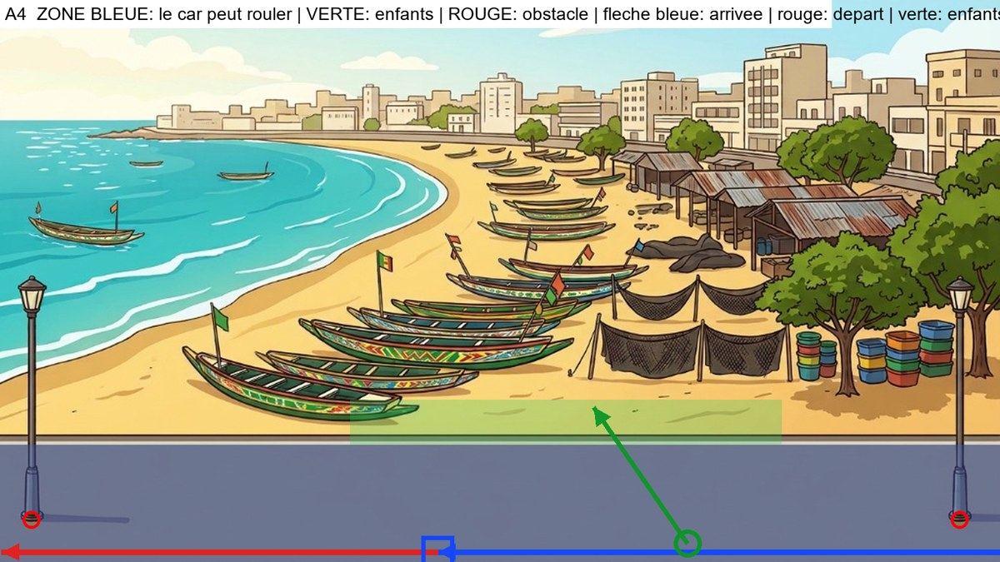

**Analyse du decor** : Route de corniche horizontale sur toute la largeur. Lampadaires aux deux bouts (x 50 et 1535) : le car passe devant eux, sur la voie du bas. La plage est de l'autre cote du trottoir (y<705) : le car ne quitte jamais l'asphalte.

**Plan de mise en scene** (a valider avant de generer) :
- Type : **voie horizontale : le car entre par la droite, vu de profil, et roule vers la gauche**
- Le car arrive : from the right edge of the frame, driving left along the bottom lane of the asphalt road
- Il s'arrete : in the left-center of the road, in front of the beach
- Il repart : continuing left along the same bottom lane, passing in front of the left lamppost, out of frame
- Les enfants se tiennent : on the road to the right of the car, near its rear
- Ils marchent : across the sidewalk edge and onto the sand toward the pirogues
- A eviter : the sand (the car never leaves the asphalt) and the two lamppost bases

### Images-cles (a generer avec Antigravity)

#### Image-cle K1 : le car vient de s'arreter (plan large)
- **Enregistrer sous** : `frontend/public/images/parcours1012/keyframes/a4/k1_car-arrete.png`
- **A donner a Antigravity** :
   - `frontend/public/images/parcours1012/decors/soumbedioune-exterieur.png`
   - `frontend/public/images/parcours1012/references/03_car-rapide_reference.png`
   - `frontend/public/images/parcours1012/references/05_car-profil-gauche_reference.jpg`
   - `frontend/public/images/parcours1012/references/05_car-face-arriere_reference.jpg`

```text
STYLE AND SCALE LOCK. 2D flat-vector animation illustration, 16:9 (1920x1080), clean dark-brown outlines, warm saturated colors, exactly the style of the reference images. Use the reference images as the ONLY source for faces, bodies, outfits and the vehicle, and use the background reference as the exact setting (same architecture, colors, light). Do not redesign anything. RELATIVE HEIGHTS (standing, same distance from the camera): Moussa 100% (11-year-old boy), Fatou 97% (11-year-old girl), Palou the lion 85% (a friend of the same age: his big mane top reaches Moussa's nose; slightly shorter than the children, NEVER taller, always upright on two legs, not a baby, not an adult lion), Papa Ibou 125% (adult). Characters keep these ratios and shrink with distance as real perspective requires. The vehicle is the Car Rapide of the references: tall boxy vintage Dakar minibus, yellow upper body, blue lower body, painted geometric patterns, painted eye and lion, roof rack with luggage, rear ladder, rear opening door; its roof is about 1.6 times Moussa's height. It is NOT a taxi, NOT a car, NOT a modern van. No text, no logo, no signs with writing.

Wide establishing shot. Background: the paved Corniche road in the foreground running left-right across the whole frame, with the beach of Soumbedioune behind it: colorful pirogues on the sand, turquoise sea on the left, fish market shelters and trees on the right; a lamppost at each edge of the frame. Place the Car Rapide in side view facing left, stopped in the left-center of the road, in front of the beach. Nobody is outside. The car is drawn with correct perspective and scale for that spot. Avoid: the sand (the car never leaves the asphalt) and the two lamppost bases.
```

#### Image-cle K2 : la porte arriere s'ouvre (debut du plan 2)
- **Enregistrer sous** : `frontend/public/images/parcours1012/keyframes/a4/k2_porte-ouverte.png`
- **A donner a Antigravity** :
   - `frontend/public/images/parcours1012/decors/soumbedioune-exterieur.png`
   - `frontend/public/images/parcours1012/references/03_car-rapide_reference.png`
   - `frontend/public/images/parcours1012/references/05_car-profil-gauche_reference.jpg`
   - `frontend/public/images/parcours1012/references/05_car-face-arriere_reference.jpg`

```text
STYLE AND SCALE LOCK. 2D flat-vector animation illustration, 16:9 (1920x1080), clean dark-brown outlines, warm saturated colors, exactly the style of the reference images. Use the reference images as the ONLY source for faces, bodies, outfits and the vehicle, and use the background reference as the exact setting (same architecture, colors, light). Do not redesign anything. RELATIVE HEIGHTS (standing, same distance from the camera): Moussa 100% (11-year-old boy), Fatou 97% (11-year-old girl), Palou the lion 85% (a friend of the same age: his big mane top reaches Moussa's nose; slightly shorter than the children, NEVER taller, always upright on two legs, not a baby, not an adult lion), Papa Ibou 125% (adult). Characters keep these ratios and shrink with distance as real perspective requires. The vehicle is the Car Rapide of the references: tall boxy vintage Dakar minibus, yellow upper body, blue lower body, painted geometric patterns, painted eye and lion, roof rack with luggage, rear ladder, rear opening door; its roof is about 1.6 times Moussa's height. It is NOT a taxi, NOT a car, NOT a modern van. No text, no logo, no signs with writing.

Medium shot, 3/4 rear view from the right of the car, the car facing left, the rear door on the right side of the frame. Same place and same setting as image K1. The Car Rapide's rear door is wide open and the empty interior with its seats is visible. Nobody has got out yet. No people in the frame.
```

#### Image-cle K3 : les trois sont descendus (fin du plan 2)
- **Enregistrer sous** : `frontend/public/images/parcours1012/keyframes/a4/k3_trois-descendus.png`
- **A donner a Antigravity** :
   - `frontend/public/images/parcours1012/decors/soumbedioune-exterieur.png`
   - `frontend/public/images/parcours1012/references/04_scene3_enfants-salut-face_reference.jpg` (planche des trois : tailles relatives)
   - `frontend/public/images/parcours1012/references/02_moussa-11_reference.png`
   - `frontend/public/images/parcours1012/references/02_fatou-11_reference.png`
   - `frontend/public/images/parcours1012/references/01_palou-1012_reference.png`
   - `frontend/public/images/parcours1012/references/03_car-rapide_reference.png`

```text
STYLE AND SCALE LOCK. 2D flat-vector animation illustration, 16:9 (1920x1080), clean dark-brown outlines, warm saturated colors, exactly the style of the reference images. Use the reference images as the ONLY source for faces, bodies, outfits and the vehicle, and use the background reference as the exact setting (same architecture, colors, light). Do not redesign anything. RELATIVE HEIGHTS (standing, same distance from the camera): Moussa 100% (11-year-old boy), Fatou 97% (11-year-old girl), Palou the lion 85% (a friend of the same age: his big mane top reaches Moussa's nose; slightly shorter than the children, NEVER taller, always upright on two legs, not a baby, not an adult lion), Papa Ibou 125% (adult). Characters keep these ratios and shrink with distance as real perspective requires. The vehicle is the Car Rapide of the references: tall boxy vintage Dakar minibus, yellow upper body, blue lower body, painted geometric patterns, painted eye and lion, roof rack with luggage, rear ladder, rear opening door; its roof is about 1.6 times Moussa's height. It is NOT a taxi, NOT a car, NOT a modern van. No text, no logo, no signs with writing.

Same framing as image K2. The rear door is open. Moussa, Palou and Fatou, all full body and clearly visible, stand on the ground on the road to the right of the car, near its rear, side by side, smiling, looking toward the driver's side of the car. Moussa: yellow t-shirt, orange cargo shorts, blue backpack, white socks, orange-red sneakers. Fatou: royal-blue dress, green ribbon on braided bun, brown satchel, blue sandals. Palou: golden fur, orange mane, white diamond on chest, tufted tail. Papa Ibou: green cap, orange-yellow checkered shirt, moustache. Correct relative heights: Palou slightly shorter than Moussa and Fatou. Avoid: the sand (the car never leaves the asphalt) and the two lamppost bases.
```

#### Image-cle K4 : gros plan de Papa Ibou qui salue (plan 3)
- **Enregistrer sous** : `frontend/public/images/parcours1012/keyframes/a4/k4_papa-ibou-salue.png`
- **A donner a Antigravity** :
   - `frontend/public/images/parcours1012/references/02_papa-ibou_reference.png`
   - `frontend/public/images/parcours1012/references/06_papa-ibou-volant-gauche_reference.jpg`
   - `frontend/public/images/parcours1012/references/03_car-rapide_reference.png`

```text
STYLE AND SCALE LOCK. 2D flat-vector animation illustration, 16:9 (1920x1080), clean dark-brown outlines, warm saturated colors, exactly the style of the reference images. Use the reference images as the ONLY source for faces, bodies, outfits and the vehicle, and use the background reference as the exact setting (same architecture, colors, light). Do not redesign anything. RELATIVE HEIGHTS (standing, same distance from the camera): Moussa 100% (11-year-old boy), Fatou 97% (11-year-old girl), Palou the lion 85% (a friend of the same age: his big mane top reaches Moussa's nose; slightly shorter than the children, NEVER taller, always upright on two legs, not a baby, not an adult lion), Papa Ibou 125% (adult). Characters keep these ratios and shrink with distance as real perspective requires. The vehicle is the Car Rapide of the references: tall boxy vintage Dakar minibus, yellow upper body, blue lower body, painted geometric patterns, painted eye and lion, roof rack with luggage, rear ladder, rear opening door; its roof is about 1.6 times Moussa's height. It is NOT a taxi, NOT a car, NOT a modern van. No text, no logo, no signs with writing.

Close-up of Papa Ibou at the open driver's window of the Car Rapide, smiling warmly and waving his right hand, the yellow door with painted patterns around him. The background outside the window is a soft blurred version of the colors of the setting: the paved Corniche road in the foreground running left-right across the whole frame, with the beach of Soumbedioune behind it: colorful pirogues on the sand, turquoise sea on the left, fish market shelters and trees on the right; a lamppost at each edge of the frame. Same style as a cinematic close-up of a cartoon.
```

#### Image-cle K5 : les enfants font au revoir, le car est a cote (debut du plan 4)
- **Enregistrer sous** : `frontend/public/images/parcours1012/keyframes/a4/k5_au-revoir.png`
- **A donner a Antigravity** :
   - `frontend/public/images/parcours1012/decors/soumbedioune-exterieur.png`
   - `frontend/public/images/parcours1012/references/04_scene3_enfants-salut-face_reference.jpg` (planche des trois : tailles relatives)
   - `frontend/public/images/parcours1012/references/02_moussa-11_reference.png`
   - `frontend/public/images/parcours1012/references/02_fatou-11_reference.png`
   - `frontend/public/images/parcours1012/references/01_palou-1012_reference.png`
   - `frontend/public/images/parcours1012/references/03_car-rapide_reference.png`
   - `frontend/public/images/parcours1012/references/05_car-profil-gauche_reference.jpg`

```text
STYLE AND SCALE LOCK. 2D flat-vector animation illustration, 16:9 (1920x1080), clean dark-brown outlines, warm saturated colors, exactly the style of the reference images. Use the reference images as the ONLY source for faces, bodies, outfits and the vehicle, and use the background reference as the exact setting (same architecture, colors, light). Do not redesign anything. RELATIVE HEIGHTS (standing, same distance from the camera): Moussa 100% (11-year-old boy), Fatou 97% (11-year-old girl), Palou the lion 85% (a friend of the same age: his big mane top reaches Moussa's nose; slightly shorter than the children, NEVER taller, always upright on two legs, not a baby, not an adult lion), Papa Ibou 125% (adult). Characters keep these ratios and shrink with distance as real perspective requires. The vehicle is the Car Rapide of the references: tall boxy vintage Dakar minibus, yellow upper body, blue lower body, painted geometric patterns, painted eye and lion, roof rack with luggage, rear ladder, rear opening door; its roof is about 1.6 times Moussa's height. It is NOT a taxi, NOT a car, NOT a modern van. No text, no logo, no signs with writing.

Medium-wide shot. The three friends, seen from behind (3/4 back) on the road to the right of the car, near its rear, wave goodbye with one raised hand toward the Car Rapide, which is stopped on the left in side view facing left, with Papa Ibou waving from the driver's window. Moussa: yellow t-shirt, orange cargo shorts, blue backpack, white socks, orange-red sneakers. Fatou: royal-blue dress, green ribbon on braided bun, brown satchel, blue sandals. Palou: golden fur, orange mane, white diamond on chest, tufted tail. Papa Ibou: green cap, orange-yellow checkered shirt, moustache. Palou is slightly shorter than the children. Avoid: the sand (the car never leaves the asphalt) and the two lamppost bases.
```

#### Image-cle K6 : les enfants marchent vers le lieu (debut du plan 5)
- **Enregistrer sous** : `frontend/public/images/parcours1012/keyframes/a4/k6_marche.png`
- **A donner a Antigravity** :
   - `frontend/public/images/parcours1012/decors/soumbedioune-exterieur.png`
   - `frontend/public/images/parcours1012/references/04_scene3_enfants-salut-face_reference.jpg` (planche des trois : tailles relatives)
   - `frontend/public/images/parcours1012/references/02_moussa-11_reference.png`
   - `frontend/public/images/parcours1012/references/02_fatou-11_reference.png`
   - `frontend/public/images/parcours1012/references/01_palou-1012_reference.png`

```text
STYLE AND SCALE LOCK. 2D flat-vector animation illustration, 16:9 (1920x1080), clean dark-brown outlines, warm saturated colors, exactly the style of the reference images. Use the reference images as the ONLY source for faces, bodies, outfits and the vehicle, and use the background reference as the exact setting (same architecture, colors, light). Do not redesign anything. RELATIVE HEIGHTS (standing, same distance from the camera): Moussa 100% (11-year-old boy), Fatou 97% (11-year-old girl), Palou the lion 85% (a friend of the same age: his big mane top reaches Moussa's nose; slightly shorter than the children, NEVER taller, always upright on two legs, not a baby, not an adult lion), Papa Ibou 125% (adult). Characters keep these ratios and shrink with distance as real perspective requires. The vehicle is the Car Rapide of the references: tall boxy vintage Dakar minibus, yellow upper body, blue lower body, painted geometric patterns, painted eye and lion, roof rack with luggage, rear ladder, rear opening door; its roof is about 1.6 times Moussa's height. It is NOT a taxi, NOT a car, NOT a modern van. No text, no logo, no signs with writing.

Wide shot in correct perspective. The Car Rapide has gone: it is not in the frame. The three friends, full body and seen from behind, walk side by side across the sidewalk edge and onto the sand toward the pirogues. Moussa: yellow t-shirt, orange cargo shorts, blue backpack, white socks, orange-red sneakers. Fatou: royal-blue dress, green ribbon on braided bun, brown satchel, blue sandals. Palou: golden fur, orange mane, white diamond on chest, tufted tail. Papa Ibou: green cap, orange-yellow checkered shirt, moustache. Palou slightly shorter than the children, walking upright on two legs. Avoid: the sand (the car never leaves the asphalt) and the two lamppost bases.
```

### Plans video (Flow, Frames to video, 4 s chacun)

#### Plan 1 : le car arrive (4 s)
- **Flow, mode Frames to video** : image de debut `frontend/public/images/parcours1012/decors/soumbedioune-exterieur.png`
- **Image de fin** : `frontend/public/images/parcours1012/keyframes/a4/k1_car-arrete.png`

```text
Animate the provided frame(s) like a 2D flat-vector cartoon. Keep every character, outfit, face and the Car Rapide EXACTLY as drawn; do not redraw or resize anything; Palou stays slightly shorter than the children. Natural, smooth, readable motion. No text, no speech, no music. Static wide shot of the empty setting. The Car Rapide enters from the right edge of the frame, driving left along the bottom lane of the asphalt road and slowly stops in the left-center of the road, in front of the beach, ending exactly like the last frame. Avoid: the sand (the car never leaves the asphalt) and the two lamppost bases.
```

#### Plan 2 : les trois descendent (4 s)
- **Flow, mode Frames to video** : image de debut `frontend/public/images/parcours1012/keyframes/a4/k2_porte-ouverte.png`
- **Image de fin** : `frontend/public/images/parcours1012/keyframes/a4/k3_trois-descendus.png`

```text
Animate the provided frame(s) like a 2D flat-vector cartoon. Keep every character, outfit, face and the Car Rapide EXACTLY as drawn; do not redraw or resize anything; Palou stays slightly shorter than the children. Natural, smooth, readable motion. No text, no speech, no music. Moussa steps down from the open rear door, then Palou hops down, then Fatou; they come to stand where the last frame shows them. The minibus does not move.
```

#### Plan 3 : Papa Ibou salue (gros plan) (4 s, a couper a 2,5 s au montage)
- **Flow, mode Frames to video** : image de debut `frontend/public/images/parcours1012/keyframes/a4/k4_papa-ibou-salue.png`

```text
Animate the provided frame(s) like a 2D flat-vector cartoon. Keep every character, outfit, face and the Car Rapide EXACTLY as drawn; do not redraw or resize anything; Palou stays slightly shorter than the children. Natural, smooth, readable motion. No text, no speech, no music. Close-up: Papa Ibou smiles and waves his hand warmly, a small head tilt, blinks; the background stays softly blurred.
```

#### Plan 4 : au revoir, le car repart (4 s)
- **Flow, mode Frames to video** : image de debut `frontend/public/images/parcours1012/keyframes/a4/k5_au-revoir.png`

```text
Animate the provided frame(s) like a 2D flat-vector cartoon. Keep every character, outfit, face and the Car Rapide EXACTLY as drawn; do not redraw or resize anything; Palou stays slightly shorter than the children. Natural, smooth, readable motion. No text, no speech, no music. The three children wave goodbye; Papa Ibou waves back; then the Car Rapide pulls away smoothly: it goes continuing left along the same bottom lane, passing in front of the left lamppost, out of frame, getting smaller with distance until it leaves the frame. The children keep waving, then lower their arms. Avoid: the sand (the car never leaves the asphalt) and the two lamppost bases.
```

#### Plan 5 : ils marchent vers le lieu, fondu au noir (4 s)
- **Flow, mode Frames to video** : image de debut `frontend/public/images/parcours1012/keyframes/a4/k6_marche.png`

```text
Animate the provided frame(s) like a 2D flat-vector cartoon. Keep every character, outfit, face and the Car Rapide EXACTLY as drawn; do not redraw or resize anything; Palou stays slightly shorter than the children. Natural, smooth, readable motion. No text, no speech, no music. The three friends walk side by side across the sidewalk edge and onto the sand toward the pirogues with a natural walking cycle, getting slightly smaller with distance. Static camera. In the last second the image fades smoothly to black.
```

---

## Module a5 - Parc de Hann

**Fichier cible** : `arrivee-a5.mp4` (environ 18 s) - **Decor** : `frontend/public/images/parcours1012/decors/parc-hann-exterieur.png`

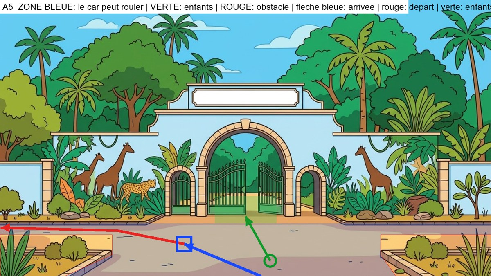

**Analyse du decor** : Chemin de sable vers la grille. Deux massifs dans les coins du bas (x<365 et x>1240, y>765). Entre le mur (y 720) et les massifs (y 765) il reste un couloir de sable qui mene hors du cadre : le car repart par la.

**Plan de mise en scene** (a valider avant de generer) :
- Type : **l'axe du decor va vers le fond : le car entre par le bas du cadre, vu de dos**
- Le car arrive : from the bottom edge, center-right, driving away from the camera
- Il s'arrete : on the left part of the path, well clear of the open gate
- Il repart : forward, then turning left into the narrow strip of sand between the wall and the left flowerbed, getting tiny and leaving the frame on the left
- Les enfants se tiennent : on the sandy path to the right of the car, toward the camera
- Ils marchent : straight along the path toward the open green gate
- A eviter : the two corner flowerbeds with their shrubs and the gate itself

### Images-cles (a generer avec Antigravity)

#### Image-cle K1 : le car vient de s'arreter (plan large)
- **Enregistrer sous** : `frontend/public/images/parcours1012/keyframes/a5/k1_car-arrete.png`
- **A donner a Antigravity** :
   - `frontend/public/images/parcours1012/decors/parc-hann-exterieur.png`
   - `frontend/public/images/parcours1012/references/03_car-rapide_reference.png`
   - `frontend/public/images/parcours1012/references/05_car-profil-gauche_reference.jpg`
   - `frontend/public/images/parcours1012/references/05_car-face-arriere_reference.jpg`

```text
STYLE AND SCALE LOCK. 2D flat-vector animation illustration, 16:9 (1920x1080), clean dark-brown outlines, warm saturated colors, exactly the style of the reference images. Use the reference images as the ONLY source for faces, bodies, outfits and the vehicle, and use the background reference as the exact setting (same architecture, colors, light). Do not redesign anything. RELATIVE HEIGHTS (standing, same distance from the camera): Moussa 100% (11-year-old boy), Fatou 97% (11-year-old girl), Palou the lion 85% (a friend of the same age: his big mane top reaches Moussa's nose; slightly shorter than the children, NEVER taller, always upright on two legs, not a baby, not an adult lion), Papa Ibou 125% (adult). Characters keep these ratios and shrink with distance as real perspective requires. The vehicle is the Car Rapide of the references: tall boxy vintage Dakar minibus, yellow upper body, blue lower body, painted geometric patterns, painted eye and lion, roof rack with luggage, rear ladder, rear opening door; its roof is about 1.6 times Moussa's height. It is NOT a taxi, NOT a car, NOT a modern van. No text, no logo, no signs with writing.

Wide establishing shot. Background: the entrance of Hann Park: a wide sandy path leading straight to a pale blue wall with giraffe and leopard murals and an open arched green gate; dense green trees behind; a flowerbed with shrubs in each bottom corner. Place the Car Rapide seen from behind (rear view, rear door facing the camera), stopped on the left part of the path, well clear of the open gate. Nobody is outside. The car is drawn with correct perspective and scale for that spot. Avoid: the two corner flowerbeds with their shrubs and the gate itself.
```

#### Image-cle K2 : la porte arriere s'ouvre (debut du plan 2)
- **Enregistrer sous** : `frontend/public/images/parcours1012/keyframes/a5/k2_porte-ouverte.png`
- **A donner a Antigravity** :
   - `frontend/public/images/parcours1012/decors/parc-hann-exterieur.png`
   - `frontend/public/images/parcours1012/references/03_car-rapide_reference.png`
   - `frontend/public/images/parcours1012/references/05_car-profil-gauche_reference.jpg`
   - `frontend/public/images/parcours1012/references/05_car-face-arriere_reference.jpg`

```text
STYLE AND SCALE LOCK. 2D flat-vector animation illustration, 16:9 (1920x1080), clean dark-brown outlines, warm saturated colors, exactly the style of the reference images. Use the reference images as the ONLY source for faces, bodies, outfits and the vehicle, and use the background reference as the exact setting (same architecture, colors, light). Do not redesign anything. RELATIVE HEIGHTS (standing, same distance from the camera): Moussa 100% (11-year-old boy), Fatou 97% (11-year-old girl), Palou the lion 85% (a friend of the same age: his big mane top reaches Moussa's nose; slightly shorter than the children, NEVER taller, always upright on two legs, not a baby, not an adult lion), Papa Ibou 125% (adult). Characters keep these ratios and shrink with distance as real perspective requires. The vehicle is the Car Rapide of the references: tall boxy vintage Dakar minibus, yellow upper body, blue lower body, painted geometric patterns, painted eye and lion, roof rack with luggage, rear ladder, rear opening door; its roof is about 1.6 times Moussa's height. It is NOT a taxi, NOT a car, NOT a modern van. No text, no logo, no signs with writing.

Medium shot, the camera is low, in front of the car's rear, slightly to the left. Same place and same setting as image K1. The Car Rapide's rear door is wide open and the empty interior with its seats is visible. Nobody has got out yet. No people in the frame.
```

#### Image-cle K3 : les trois sont descendus (fin du plan 2)
- **Enregistrer sous** : `frontend/public/images/parcours1012/keyframes/a5/k3_trois-descendus.png`
- **A donner a Antigravity** :
   - `frontend/public/images/parcours1012/decors/parc-hann-exterieur.png`
   - `frontend/public/images/parcours1012/references/04_scene3_enfants-salut-face_reference.jpg` (planche des trois : tailles relatives)
   - `frontend/public/images/parcours1012/references/02_moussa-11_reference.png`
   - `frontend/public/images/parcours1012/references/02_fatou-11_reference.png`
   - `frontend/public/images/parcours1012/references/01_palou-1012_reference.png`
   - `frontend/public/images/parcours1012/references/03_car-rapide_reference.png`

```text
STYLE AND SCALE LOCK. 2D flat-vector animation illustration, 16:9 (1920x1080), clean dark-brown outlines, warm saturated colors, exactly the style of the reference images. Use the reference images as the ONLY source for faces, bodies, outfits and the vehicle, and use the background reference as the exact setting (same architecture, colors, light). Do not redesign anything. RELATIVE HEIGHTS (standing, same distance from the camera): Moussa 100% (11-year-old boy), Fatou 97% (11-year-old girl), Palou the lion 85% (a friend of the same age: his big mane top reaches Moussa's nose; slightly shorter than the children, NEVER taller, always upright on two legs, not a baby, not an adult lion), Papa Ibou 125% (adult). Characters keep these ratios and shrink with distance as real perspective requires. The vehicle is the Car Rapide of the references: tall boxy vintage Dakar minibus, yellow upper body, blue lower body, painted geometric patterns, painted eye and lion, roof rack with luggage, rear ladder, rear opening door; its roof is about 1.6 times Moussa's height. It is NOT a taxi, NOT a car, NOT a modern van. No text, no logo, no signs with writing.

Same framing as image K2. The rear door is open. Moussa, Palou and Fatou, all full body and clearly visible, stand on the ground on the sandy path to the right of the car, toward the camera, side by side, smiling, looking toward the driver's side of the car. Moussa: yellow t-shirt, orange cargo shorts, blue backpack, white socks, orange-red sneakers. Fatou: royal-blue dress, green ribbon on braided bun, brown satchel, blue sandals. Palou: golden fur, orange mane, white diamond on chest, tufted tail. Papa Ibou: green cap, orange-yellow checkered shirt, moustache. Correct relative heights: Palou slightly shorter than Moussa and Fatou. Avoid: the two corner flowerbeds with their shrubs and the gate itself.
```

#### Image-cle K4 : gros plan de Papa Ibou qui salue (plan 3)
- **Enregistrer sous** : `frontend/public/images/parcours1012/keyframes/a5/k4_papa-ibou-salue.png`
- **A donner a Antigravity** :
   - `frontend/public/images/parcours1012/references/02_papa-ibou_reference.png`
   - `frontend/public/images/parcours1012/references/06_papa-ibou-volant-gauche_reference.jpg`
   - `frontend/public/images/parcours1012/references/03_car-rapide_reference.png`

```text
STYLE AND SCALE LOCK. 2D flat-vector animation illustration, 16:9 (1920x1080), clean dark-brown outlines, warm saturated colors, exactly the style of the reference images. Use the reference images as the ONLY source for faces, bodies, outfits and the vehicle, and use the background reference as the exact setting (same architecture, colors, light). Do not redesign anything. RELATIVE HEIGHTS (standing, same distance from the camera): Moussa 100% (11-year-old boy), Fatou 97% (11-year-old girl), Palou the lion 85% (a friend of the same age: his big mane top reaches Moussa's nose; slightly shorter than the children, NEVER taller, always upright on two legs, not a baby, not an adult lion), Papa Ibou 125% (adult). Characters keep these ratios and shrink with distance as real perspective requires. The vehicle is the Car Rapide of the references: tall boxy vintage Dakar minibus, yellow upper body, blue lower body, painted geometric patterns, painted eye and lion, roof rack with luggage, rear ladder, rear opening door; its roof is about 1.6 times Moussa's height. It is NOT a taxi, NOT a car, NOT a modern van. No text, no logo, no signs with writing.

Close-up of Papa Ibou at the open driver's window of the Car Rapide, smiling warmly and waving his right hand, the yellow door with painted patterns around him. The background outside the window is a soft blurred version of the colors of the setting: the entrance of Hann Park: a wide sandy path leading straight to a pale blue wall with giraffe and leopard murals and an open arched green gate; dense green trees behind; a flowerbed with shrubs in each bottom corner. Same style as a cinematic close-up of a cartoon.
```

#### Image-cle K5 : les enfants font au revoir, le car est a cote (debut du plan 4)
- **Enregistrer sous** : `frontend/public/images/parcours1012/keyframes/a5/k5_au-revoir.png`
- **A donner a Antigravity** :
   - `frontend/public/images/parcours1012/decors/parc-hann-exterieur.png`
   - `frontend/public/images/parcours1012/references/04_scene3_enfants-salut-face_reference.jpg` (planche des trois : tailles relatives)
   - `frontend/public/images/parcours1012/references/02_moussa-11_reference.png`
   - `frontend/public/images/parcours1012/references/02_fatou-11_reference.png`
   - `frontend/public/images/parcours1012/references/01_palou-1012_reference.png`
   - `frontend/public/images/parcours1012/references/03_car-rapide_reference.png`
   - `frontend/public/images/parcours1012/references/05_car-profil-gauche_reference.jpg`

```text
STYLE AND SCALE LOCK. 2D flat-vector animation illustration, 16:9 (1920x1080), clean dark-brown outlines, warm saturated colors, exactly the style of the reference images. Use the reference images as the ONLY source for faces, bodies, outfits and the vehicle, and use the background reference as the exact setting (same architecture, colors, light). Do not redesign anything. RELATIVE HEIGHTS (standing, same distance from the camera): Moussa 100% (11-year-old boy), Fatou 97% (11-year-old girl), Palou the lion 85% (a friend of the same age: his big mane top reaches Moussa's nose; slightly shorter than the children, NEVER taller, always upright on two legs, not a baby, not an adult lion), Papa Ibou 125% (adult). Characters keep these ratios and shrink with distance as real perspective requires. The vehicle is the Car Rapide of the references: tall boxy vintage Dakar minibus, yellow upper body, blue lower body, painted geometric patterns, painted eye and lion, roof rack with luggage, rear ladder, rear opening door; its roof is about 1.6 times Moussa's height. It is NOT a taxi, NOT a car, NOT a modern van. No text, no logo, no signs with writing.

Medium-wide shot from behind. In the foreground the three friends (seen from behind, 3/4 back) stand on the sandy path to the right of the car, toward the camera and wave goodbye with one raised hand; beyond them the Car Rapide is stopped on the left part of the path, well clear of the open gate, seen from behind, with Papa Ibou's arm waving out of the driver's window. Moussa: yellow t-shirt, orange cargo shorts, blue backpack, white socks, orange-red sneakers. Fatou: royal-blue dress, green ribbon on braided bun, brown satchel, blue sandals. Palou: golden fur, orange mane, white diamond on chest, tufted tail. Papa Ibou: green cap, orange-yellow checkered shirt, moustache. Palou is slightly shorter than the children. Avoid: the two corner flowerbeds with their shrubs and the gate itself.
```

#### Image-cle K6 : les enfants marchent vers le lieu (debut du plan 5)
- **Enregistrer sous** : `frontend/public/images/parcours1012/keyframes/a5/k6_marche.png`
- **A donner a Antigravity** :
   - `frontend/public/images/parcours1012/decors/parc-hann-exterieur.png`
   - `frontend/public/images/parcours1012/references/04_scene3_enfants-salut-face_reference.jpg` (planche des trois : tailles relatives)
   - `frontend/public/images/parcours1012/references/02_moussa-11_reference.png`
   - `frontend/public/images/parcours1012/references/02_fatou-11_reference.png`
   - `frontend/public/images/parcours1012/references/01_palou-1012_reference.png`

```text
STYLE AND SCALE LOCK. 2D flat-vector animation illustration, 16:9 (1920x1080), clean dark-brown outlines, warm saturated colors, exactly the style of the reference images. Use the reference images as the ONLY source for faces, bodies, outfits and the vehicle, and use the background reference as the exact setting (same architecture, colors, light). Do not redesign anything. RELATIVE HEIGHTS (standing, same distance from the camera): Moussa 100% (11-year-old boy), Fatou 97% (11-year-old girl), Palou the lion 85% (a friend of the same age: his big mane top reaches Moussa's nose; slightly shorter than the children, NEVER taller, always upright on two legs, not a baby, not an adult lion), Papa Ibou 125% (adult). Characters keep these ratios and shrink with distance as real perspective requires. The vehicle is the Car Rapide of the references: tall boxy vintage Dakar minibus, yellow upper body, blue lower body, painted geometric patterns, painted eye and lion, roof rack with luggage, rear ladder, rear opening door; its roof is about 1.6 times Moussa's height. It is NOT a taxi, NOT a car, NOT a modern van. No text, no logo, no signs with writing.

Wide shot in correct perspective. The Car Rapide has gone: it is not in the frame. The three friends, full body and seen from behind, walk side by side straight along the path toward the open green gate. Moussa: yellow t-shirt, orange cargo shorts, blue backpack, white socks, orange-red sneakers. Fatou: royal-blue dress, green ribbon on braided bun, brown satchel, blue sandals. Palou: golden fur, orange mane, white diamond on chest, tufted tail. Papa Ibou: green cap, orange-yellow checkered shirt, moustache. Palou slightly shorter than the children, walking upright on two legs. Avoid: the two corner flowerbeds with their shrubs and the gate itself.
```

### Plans video (Flow, Frames to video, 4 s chacun)

#### Plan 1 : le car arrive (4 s)
- **Flow, mode Frames to video** : image de debut `frontend/public/images/parcours1012/decors/parc-hann-exterieur.png`
- **Image de fin** : `frontend/public/images/parcours1012/keyframes/a5/k1_car-arrete.png`

```text
Animate the provided frame(s) like a 2D flat-vector cartoon. Keep every character, outfit, face and the Car Rapide EXACTLY as drawn; do not redraw or resize anything; Palou stays slightly shorter than the children. Natural, smooth, readable motion. No text, no speech, no music. Static wide shot of the empty setting. The Car Rapide enters from the bottom edge, center-right, driving away from the camera and slowly stops on the left part of the path, well clear of the open gate, ending exactly like the last frame. Avoid: the two corner flowerbeds with their shrubs and the gate itself.
```

#### Plan 2 : les trois descendent (4 s)
- **Flow, mode Frames to video** : image de debut `frontend/public/images/parcours1012/keyframes/a5/k2_porte-ouverte.png`
- **Image de fin** : `frontend/public/images/parcours1012/keyframes/a5/k3_trois-descendus.png`

```text
Animate the provided frame(s) like a 2D flat-vector cartoon. Keep every character, outfit, face and the Car Rapide EXACTLY as drawn; do not redraw or resize anything; Palou stays slightly shorter than the children. Natural, smooth, readable motion. No text, no speech, no music. Moussa steps down from the open rear door, then Palou hops down, then Fatou; they come to stand where the last frame shows them. The minibus does not move.
```

#### Plan 3 : Papa Ibou salue (gros plan) (4 s, a couper a 2,5 s au montage)
- **Flow, mode Frames to video** : image de debut `frontend/public/images/parcours1012/keyframes/a5/k4_papa-ibou-salue.png`

```text
Animate the provided frame(s) like a 2D flat-vector cartoon. Keep every character, outfit, face and the Car Rapide EXACTLY as drawn; do not redraw or resize anything; Palou stays slightly shorter than the children. Natural, smooth, readable motion. No text, no speech, no music. Close-up: Papa Ibou smiles and waves his hand warmly, a small head tilt, blinks; the background stays softly blurred.
```

#### Plan 4 : au revoir, le car repart (4 s)
- **Flow, mode Frames to video** : image de debut `frontend/public/images/parcours1012/keyframes/a5/k5_au-revoir.png`

```text
Animate the provided frame(s) like a 2D flat-vector cartoon. Keep every character, outfit, face and the Car Rapide EXACTLY as drawn; do not redraw or resize anything; Palou stays slightly shorter than the children. Natural, smooth, readable motion. No text, no speech, no music. The three children wave goodbye; Papa Ibou waves back; then the Car Rapide pulls away smoothly: it goes forward, then turning left into the narrow strip of sand between the wall and the left flowerbed, getting tiny and leaving the frame on the left, getting smaller with distance until it leaves the frame. The children keep waving, then lower their arms. Avoid: the two corner flowerbeds with their shrubs and the gate itself.
```

#### Plan 5 : ils marchent vers le lieu, fondu au noir (4 s)
- **Flow, mode Frames to video** : image de debut `frontend/public/images/parcours1012/keyframes/a5/k6_marche.png`

```text
Animate the provided frame(s) like a 2D flat-vector cartoon. Keep every character, outfit, face and the Car Rapide EXACTLY as drawn; do not redraw or resize anything; Palou stays slightly shorter than the children. Natural, smooth, readable motion. No text, no speech, no music. The three friends walk side by side straight along the path toward the open green gate with a natural walking cycle, getting slightly smaller with distance. Static camera. In the last second the image fades smoothly to black.
```

---

## Module a6 - Laboratoire de langues

**Fichier cible** : `arrivee-a6.mp4` (environ 18 s) - **Decor** : `frontend/public/images/parcours1012/decors/labo-langues-exterieur.png`

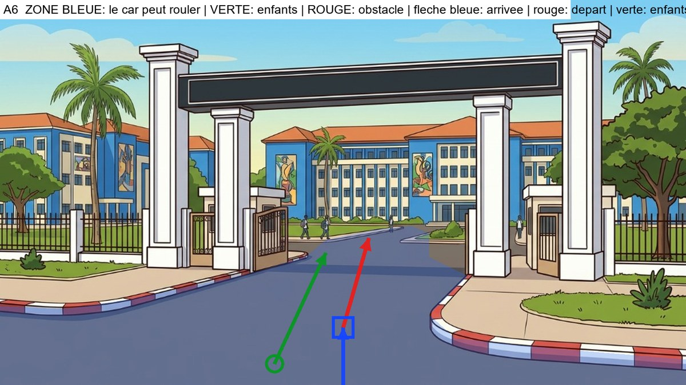

**Analyse du decor** : Route d'asphalte bordee de bordures rouge et blanc, qui monte tout droit vers le portail et le campus. Trottoirs et pelouses de chaque cote : le car reste sur l'asphalte et repart tout droit.

**Plan de mise en scene** (a valider avant de generer) :
- Type : **l'axe du decor va vers le fond : le car entre par le bas du cadre, vu de dos**
- Le car arrive : from the bottom edge, center, driving away from the camera along the road
- Il s'arrete : in the middle of the road before the gate
- Il repart : straight ahead along the middle of the road toward the gate, getting smaller, then through the gap between the pillars, into the distance
- Les enfants se tiennent : on the asphalt to the left of the car, toward the camera
- Ils marchent : up the left side of the road toward the gate and the campus
- A eviter : the red-and-white curbs, the sidewalks and lawns, the gate pillars

### Images-cles (a generer avec Antigravity)

#### Image-cle K1 : le car vient de s'arreter (plan large)
- **Enregistrer sous** : `frontend/public/images/parcours1012/keyframes/a6/k1_car-arrete.png`
- **A donner a Antigravity** :
   - `frontend/public/images/parcours1012/decors/labo-langues-exterieur.png`
   - `frontend/public/images/parcours1012/references/03_car-rapide_reference.png`
   - `frontend/public/images/parcours1012/references/05_car-profil-gauche_reference.jpg`
   - `frontend/public/images/parcours1012/references/05_car-face-arriere_reference.jpg`

```text
STYLE AND SCALE LOCK. 2D flat-vector animation illustration, 16:9 (1920x1080), clean dark-brown outlines, warm saturated colors, exactly the style of the reference images. Use the reference images as the ONLY source for faces, bodies, outfits and the vehicle, and use the background reference as the exact setting (same architecture, colors, light). Do not redesign anything. RELATIVE HEIGHTS (standing, same distance from the camera): Moussa 100% (11-year-old boy), Fatou 97% (11-year-old girl), Palou the lion 85% (a friend of the same age: his big mane top reaches Moussa's nose; slightly shorter than the children, NEVER taller, always upright on two legs, not a baby, not an adult lion), Papa Ibou 125% (adult). Characters keep these ratios and shrink with distance as real perspective requires. The vehicle is the Car Rapide of the references: tall boxy vintage Dakar minibus, yellow upper body, blue lower body, painted geometric patterns, painted eye and lion, roof rack with luggage, rear ladder, rear opening door; its roof is about 1.6 times Moussa's height. It is NOT a taxi, NOT a car, NOT a modern van. No text, no logo, no signs with writing.

Wide establishing shot. Background: the entrance of a university campus: a wide asphalt road with red-and-white curbs rising straight to a gap between big white gate pillars, with blue university buildings and a few students beyond; sidewalks and lawns on both sides. Place the Car Rapide seen from behind (rear view, rear door facing the camera), stopped in the middle of the road before the gate. Nobody is outside. The car is drawn with correct perspective and scale for that spot. Avoid: the red-and-white curbs, the sidewalks and lawns, the gate pillars.
```

#### Image-cle K2 : la porte arriere s'ouvre (debut du plan 2)
- **Enregistrer sous** : `frontend/public/images/parcours1012/keyframes/a6/k2_porte-ouverte.png`
- **A donner a Antigravity** :
   - `frontend/public/images/parcours1012/decors/labo-langues-exterieur.png`
   - `frontend/public/images/parcours1012/references/03_car-rapide_reference.png`
   - `frontend/public/images/parcours1012/references/05_car-profil-gauche_reference.jpg`
   - `frontend/public/images/parcours1012/references/05_car-face-arriere_reference.jpg`

```text
STYLE AND SCALE LOCK. 2D flat-vector animation illustration, 16:9 (1920x1080), clean dark-brown outlines, warm saturated colors, exactly the style of the reference images. Use the reference images as the ONLY source for faces, bodies, outfits and the vehicle, and use the background reference as the exact setting (same architecture, colors, light). Do not redesign anything. RELATIVE HEIGHTS (standing, same distance from the camera): Moussa 100% (11-year-old boy), Fatou 97% (11-year-old girl), Palou the lion 85% (a friend of the same age: his big mane top reaches Moussa's nose; slightly shorter than the children, NEVER taller, always upright on two legs, not a baby, not an adult lion), Papa Ibou 125% (adult). Characters keep these ratios and shrink with distance as real perspective requires. The vehicle is the Car Rapide of the references: tall boxy vintage Dakar minibus, yellow upper body, blue lower body, painted geometric patterns, painted eye and lion, roof rack with luggage, rear ladder, rear opening door; its roof is about 1.6 times Moussa's height. It is NOT a taxi, NOT a car, NOT a modern van. No text, no logo, no signs with writing.

Medium shot, the camera is low, in front of the car's rear, slightly to the left. Same place and same setting as image K1. The Car Rapide's rear door is wide open and the empty interior with its seats is visible. Nobody has got out yet. No people in the frame.
```

#### Image-cle K3 : les trois sont descendus (fin du plan 2)
- **Enregistrer sous** : `frontend/public/images/parcours1012/keyframes/a6/k3_trois-descendus.png`
- **A donner a Antigravity** :
   - `frontend/public/images/parcours1012/decors/labo-langues-exterieur.png`
   - `frontend/public/images/parcours1012/references/04_scene3_enfants-salut-face_reference.jpg` (planche des trois : tailles relatives)
   - `frontend/public/images/parcours1012/references/02_moussa-11_reference.png`
   - `frontend/public/images/parcours1012/references/02_fatou-11_reference.png`
   - `frontend/public/images/parcours1012/references/01_palou-1012_reference.png`
   - `frontend/public/images/parcours1012/references/03_car-rapide_reference.png`

```text
STYLE AND SCALE LOCK. 2D flat-vector animation illustration, 16:9 (1920x1080), clean dark-brown outlines, warm saturated colors, exactly the style of the reference images. Use the reference images as the ONLY source for faces, bodies, outfits and the vehicle, and use the background reference as the exact setting (same architecture, colors, light). Do not redesign anything. RELATIVE HEIGHTS (standing, same distance from the camera): Moussa 100% (11-year-old boy), Fatou 97% (11-year-old girl), Palou the lion 85% (a friend of the same age: his big mane top reaches Moussa's nose; slightly shorter than the children, NEVER taller, always upright on two legs, not a baby, not an adult lion), Papa Ibou 125% (adult). Characters keep these ratios and shrink with distance as real perspective requires. The vehicle is the Car Rapide of the references: tall boxy vintage Dakar minibus, yellow upper body, blue lower body, painted geometric patterns, painted eye and lion, roof rack with luggage, rear ladder, rear opening door; its roof is about 1.6 times Moussa's height. It is NOT a taxi, NOT a car, NOT a modern van. No text, no logo, no signs with writing.

Same framing as image K2. The rear door is open. Moussa, Palou and Fatou, all full body and clearly visible, stand on the ground on the asphalt to the left of the car, toward the camera, side by side, smiling, looking toward the driver's side of the car. Moussa: yellow t-shirt, orange cargo shorts, blue backpack, white socks, orange-red sneakers. Fatou: royal-blue dress, green ribbon on braided bun, brown satchel, blue sandals. Palou: golden fur, orange mane, white diamond on chest, tufted tail. Papa Ibou: green cap, orange-yellow checkered shirt, moustache. Correct relative heights: Palou slightly shorter than Moussa and Fatou. Avoid: the red-and-white curbs, the sidewalks and lawns, the gate pillars.
```

#### Image-cle K4 : gros plan de Papa Ibou qui salue (plan 3)
- **Enregistrer sous** : `frontend/public/images/parcours1012/keyframes/a6/k4_papa-ibou-salue.png`
- **A donner a Antigravity** :
   - `frontend/public/images/parcours1012/references/02_papa-ibou_reference.png`
   - `frontend/public/images/parcours1012/references/06_papa-ibou-volant-gauche_reference.jpg`
   - `frontend/public/images/parcours1012/references/03_car-rapide_reference.png`

```text
STYLE AND SCALE LOCK. 2D flat-vector animation illustration, 16:9 (1920x1080), clean dark-brown outlines, warm saturated colors, exactly the style of the reference images. Use the reference images as the ONLY source for faces, bodies, outfits and the vehicle, and use the background reference as the exact setting (same architecture, colors, light). Do not redesign anything. RELATIVE HEIGHTS (standing, same distance from the camera): Moussa 100% (11-year-old boy), Fatou 97% (11-year-old girl), Palou the lion 85% (a friend of the same age: his big mane top reaches Moussa's nose; slightly shorter than the children, NEVER taller, always upright on two legs, not a baby, not an adult lion), Papa Ibou 125% (adult). Characters keep these ratios and shrink with distance as real perspective requires. The vehicle is the Car Rapide of the references: tall boxy vintage Dakar minibus, yellow upper body, blue lower body, painted geometric patterns, painted eye and lion, roof rack with luggage, rear ladder, rear opening door; its roof is about 1.6 times Moussa's height. It is NOT a taxi, NOT a car, NOT a modern van. No text, no logo, no signs with writing.

Close-up of Papa Ibou at the open driver's window of the Car Rapide, smiling warmly and waving his right hand, the yellow door with painted patterns around him. The background outside the window is a soft blurred version of the colors of the setting: the entrance of a university campus: a wide asphalt road with red-and-white curbs rising straight to a gap between big white gate pillars, with blue university buildings and a few students beyond; sidewalks and lawns on both sides. Same style as a cinematic close-up of a cartoon.
```

#### Image-cle K5 : les enfants font au revoir, le car est a cote (debut du plan 4)
- **Enregistrer sous** : `frontend/public/images/parcours1012/keyframes/a6/k5_au-revoir.png`
- **A donner a Antigravity** :
   - `frontend/public/images/parcours1012/decors/labo-langues-exterieur.png`
   - `frontend/public/images/parcours1012/references/04_scene3_enfants-salut-face_reference.jpg` (planche des trois : tailles relatives)
   - `frontend/public/images/parcours1012/references/02_moussa-11_reference.png`
   - `frontend/public/images/parcours1012/references/02_fatou-11_reference.png`
   - `frontend/public/images/parcours1012/references/01_palou-1012_reference.png`
   - `frontend/public/images/parcours1012/references/03_car-rapide_reference.png`
   - `frontend/public/images/parcours1012/references/05_car-profil-gauche_reference.jpg`

```text
STYLE AND SCALE LOCK. 2D flat-vector animation illustration, 16:9 (1920x1080), clean dark-brown outlines, warm saturated colors, exactly the style of the reference images. Use the reference images as the ONLY source for faces, bodies, outfits and the vehicle, and use the background reference as the exact setting (same architecture, colors, light). Do not redesign anything. RELATIVE HEIGHTS (standing, same distance from the camera): Moussa 100% (11-year-old boy), Fatou 97% (11-year-old girl), Palou the lion 85% (a friend of the same age: his big mane top reaches Moussa's nose; slightly shorter than the children, NEVER taller, always upright on two legs, not a baby, not an adult lion), Papa Ibou 125% (adult). Characters keep these ratios and shrink with distance as real perspective requires. The vehicle is the Car Rapide of the references: tall boxy vintage Dakar minibus, yellow upper body, blue lower body, painted geometric patterns, painted eye and lion, roof rack with luggage, rear ladder, rear opening door; its roof is about 1.6 times Moussa's height. It is NOT a taxi, NOT a car, NOT a modern van. No text, no logo, no signs with writing.

Medium-wide shot from behind. In the foreground the three friends (seen from behind, 3/4 back) stand on the asphalt to the left of the car, toward the camera and wave goodbye with one raised hand; beyond them the Car Rapide is stopped in the middle of the road before the gate, seen from behind, with Papa Ibou's arm waving out of the driver's window. Moussa: yellow t-shirt, orange cargo shorts, blue backpack, white socks, orange-red sneakers. Fatou: royal-blue dress, green ribbon on braided bun, brown satchel, blue sandals. Palou: golden fur, orange mane, white diamond on chest, tufted tail. Papa Ibou: green cap, orange-yellow checkered shirt, moustache. Palou is slightly shorter than the children. Avoid: the red-and-white curbs, the sidewalks and lawns, the gate pillars.
```

#### Image-cle K6 : les enfants marchent vers le lieu (debut du plan 5)
- **Enregistrer sous** : `frontend/public/images/parcours1012/keyframes/a6/k6_marche.png`
- **A donner a Antigravity** :
   - `frontend/public/images/parcours1012/decors/labo-langues-exterieur.png`
   - `frontend/public/images/parcours1012/references/04_scene3_enfants-salut-face_reference.jpg` (planche des trois : tailles relatives)
   - `frontend/public/images/parcours1012/references/02_moussa-11_reference.png`
   - `frontend/public/images/parcours1012/references/02_fatou-11_reference.png`
   - `frontend/public/images/parcours1012/references/01_palou-1012_reference.png`

```text
STYLE AND SCALE LOCK. 2D flat-vector animation illustration, 16:9 (1920x1080), clean dark-brown outlines, warm saturated colors, exactly the style of the reference images. Use the reference images as the ONLY source for faces, bodies, outfits and the vehicle, and use the background reference as the exact setting (same architecture, colors, light). Do not redesign anything. RELATIVE HEIGHTS (standing, same distance from the camera): Moussa 100% (11-year-old boy), Fatou 97% (11-year-old girl), Palou the lion 85% (a friend of the same age: his big mane top reaches Moussa's nose; slightly shorter than the children, NEVER taller, always upright on two legs, not a baby, not an adult lion), Papa Ibou 125% (adult). Characters keep these ratios and shrink with distance as real perspective requires. The vehicle is the Car Rapide of the references: tall boxy vintage Dakar minibus, yellow upper body, blue lower body, painted geometric patterns, painted eye and lion, roof rack with luggage, rear ladder, rear opening door; its roof is about 1.6 times Moussa's height. It is NOT a taxi, NOT a car, NOT a modern van. No text, no logo, no signs with writing.

Wide shot in correct perspective. The Car Rapide has gone: it is not in the frame. The three friends, full body and seen from behind, walk side by side up the left side of the road toward the gate and the campus. Moussa: yellow t-shirt, orange cargo shorts, blue backpack, white socks, orange-red sneakers. Fatou: royal-blue dress, green ribbon on braided bun, brown satchel, blue sandals. Palou: golden fur, orange mane, white diamond on chest, tufted tail. Papa Ibou: green cap, orange-yellow checkered shirt, moustache. Palou slightly shorter than the children, walking upright on two legs. Avoid: the red-and-white curbs, the sidewalks and lawns, the gate pillars.
```

### Plans video (Flow, Frames to video, 4 s chacun)

#### Plan 1 : le car arrive (4 s)
- **Flow, mode Frames to video** : image de debut `frontend/public/images/parcours1012/decors/labo-langues-exterieur.png`
- **Image de fin** : `frontend/public/images/parcours1012/keyframes/a6/k1_car-arrete.png`

```text
Animate the provided frame(s) like a 2D flat-vector cartoon. Keep every character, outfit, face and the Car Rapide EXACTLY as drawn; do not redraw or resize anything; Palou stays slightly shorter than the children. Natural, smooth, readable motion. No text, no speech, no music. Static wide shot of the empty setting. The Car Rapide enters from the bottom edge, center, driving away from the camera along the road and slowly stops in the middle of the road before the gate, ending exactly like the last frame. Avoid: the red-and-white curbs, the sidewalks and lawns, the gate pillars.
```

#### Plan 2 : les trois descendent (4 s)
- **Flow, mode Frames to video** : image de debut `frontend/public/images/parcours1012/keyframes/a6/k2_porte-ouverte.png`
- **Image de fin** : `frontend/public/images/parcours1012/keyframes/a6/k3_trois-descendus.png`

```text
Animate the provided frame(s) like a 2D flat-vector cartoon. Keep every character, outfit, face and the Car Rapide EXACTLY as drawn; do not redraw or resize anything; Palou stays slightly shorter than the children. Natural, smooth, readable motion. No text, no speech, no music. Moussa steps down from the open rear door, then Palou hops down, then Fatou; they come to stand where the last frame shows them. The minibus does not move.
```

#### Plan 3 : Papa Ibou salue (gros plan) (4 s, a couper a 2,5 s au montage)
- **Flow, mode Frames to video** : image de debut `frontend/public/images/parcours1012/keyframes/a6/k4_papa-ibou-salue.png`

```text
Animate the provided frame(s) like a 2D flat-vector cartoon. Keep every character, outfit, face and the Car Rapide EXACTLY as drawn; do not redraw or resize anything; Palou stays slightly shorter than the children. Natural, smooth, readable motion. No text, no speech, no music. Close-up: Papa Ibou smiles and waves his hand warmly, a small head tilt, blinks; the background stays softly blurred.
```

#### Plan 4 : au revoir, le car repart (4 s)
- **Flow, mode Frames to video** : image de debut `frontend/public/images/parcours1012/keyframes/a6/k5_au-revoir.png`

```text
Animate the provided frame(s) like a 2D flat-vector cartoon. Keep every character, outfit, face and the Car Rapide EXACTLY as drawn; do not redraw or resize anything; Palou stays slightly shorter than the children. Natural, smooth, readable motion. No text, no speech, no music. The three children wave goodbye; Papa Ibou waves back; then the Car Rapide pulls away smoothly: it goes straight ahead along the middle of the road toward the gate, getting smaller, then through the gap between the pillars, into the distance, getting smaller with distance until it leaves the frame. The children keep waving, then lower their arms. Avoid: the red-and-white curbs, the sidewalks and lawns, the gate pillars.
```

#### Plan 5 : ils marchent vers le lieu, fondu au noir (4 s)
- **Flow, mode Frames to video** : image de debut `frontend/public/images/parcours1012/keyframes/a6/k6_marche.png`

```text
Animate the provided frame(s) like a 2D flat-vector cartoon. Keep every character, outfit, face and the Car Rapide EXACTLY as drawn; do not redraw or resize anything; Palou stays slightly shorter than the children. Natural, smooth, readable motion. No text, no speech, no music. The three friends walk side by side up the left side of the road toward the gate and the campus with a natural walking cycle, getting slightly smaller with distance. Static camera. In the last second the image fades smoothly to black.
```

---

## Module a7 - Ile de Goree (exception : pas de car, les enfants descendent de la chaloupe)

**Fichier cible** : `arrivee-a7.mp4` (environ 18 s) - **Decor** : `frontend/public/images/parcours1012/decors/goree-port-exterieur.png`

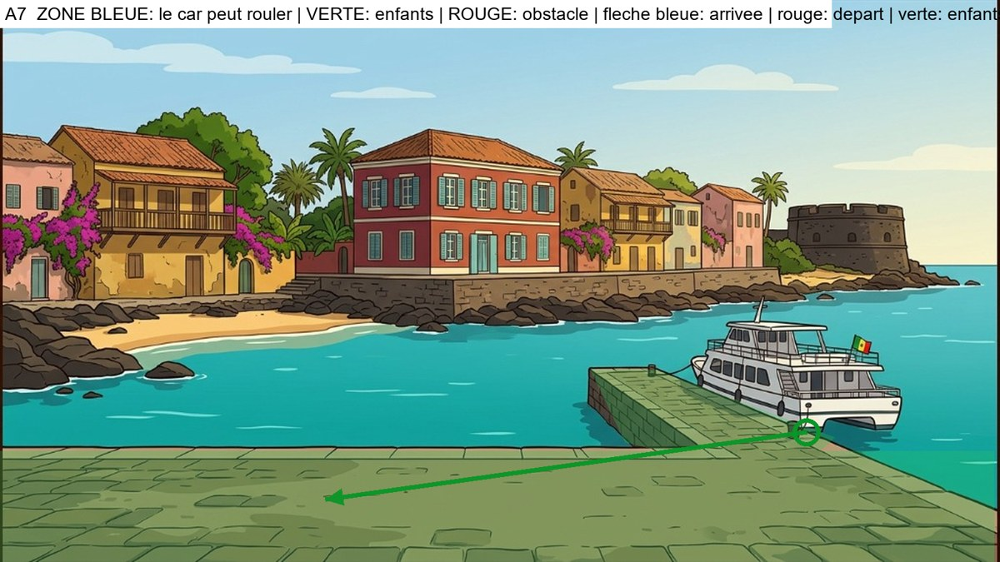

**Analyse du decor** : PAS DE CAR. La chaloupe est amarree a la jetee (a droite). Papa Ibou est a bord. Les enfants descendent de la chaloupe sur la jetee, saluent Papa Ibou, remontent la jetee jusqu'au quai, puis marchent vers la gauche le long du quai. Jamais dans l'eau.

**Plan de mise en scene** (a valider avant de generer) :
- **Pas de car dans cette video.** La chaloupe est amarree a la jetee, a droite. Papa Ibou est a bord. Les trois enfants sont sur le pont.
- Les enfants descendent de la chaloupe sur la jetee, se retournent pour saluer Papa Ibou, qui leur repond depuis le bord. La chaloupe s'eloigne tout doucement.
- Les enfants remontent la jetee jusqu'au quai, puis marchent le long du quai vers la gauche. Fondu au noir.
- A eviter : l'eau de chaque cote de la jetee.

### Images-cles (a generer avec Antigravity)

#### Image-cle K1 : la chaloupe amarree, tout le monde a bord (plan large)
- **Enregistrer sous** : `frontend/public/images/parcours1012/keyframes/a7/k1_chaloupe.png`
- **A donner a Antigravity** :
   - `frontend/public/images/parcours1012/decors/goree-port-exterieur.png`
   - `frontend/public/images/parcours1012/references/04_scene3_enfants-salut-face_reference.jpg` (planche des trois : tailles relatives)
   - `frontend/public/images/parcours1012/references/02_moussa-11_reference.png`
   - `frontend/public/images/parcours1012/references/02_fatou-11_reference.png`
   - `frontend/public/images/parcours1012/references/01_palou-1012_reference.png`
   - `frontend/public/images/parcours1012/references/02_papa-ibou_reference.png`
   - `frontend/public/images/parcours1012/references/06_papa-ibou-volant-gauche_reference.jpg`

```text
STYLE AND SCALE LOCK. 2D flat-vector animation illustration, 16:9 (1920x1080), clean dark-brown outlines, warm saturated colors, exactly the style of the reference images. Use the reference images as the ONLY source for faces, bodies, outfits and the vehicle, and use the background reference as the exact setting (same architecture, colors, light). Do not redesign anything. RELATIVE HEIGHTS (standing, same distance from the camera): Moussa 100% (11-year-old boy), Fatou 97% (11-year-old girl), Palou the lion 85% (a friend of the same age: his big mane top reaches Moussa's nose; slightly shorter than the children, NEVER taller, always upright on two legs, not a baby, not an adult lion), Papa Ibou 125% (adult). Characters keep these ratios and shrink with distance as real perspective requires. The vehicle is the Car Rapide of the references: tall boxy vintage Dakar minibus, yellow upper body, blue lower body, painted geometric patterns, painted eye and lion, roof rack with luggage, rear ladder, rear opening door; its roof is about 1.6 times Moussa's height. It is NOT a taxi, NOT a car, NOT a modern van. No text, no logo, no signs with writing.

Wide establishing shot. Background: the paved quay of Goree in the foreground, turquoise water, a stone jetty going out into the water on the right with a white two-deck passenger ferry (chaloupe) with a small Senegalese flag moored along it, and across the water the colorful colonial houses, bougainvillea and the old round fort of the island. On the upper deck of the moored ferry, small but recognizable and full body: Papa Ibou (green cap, checkered shirt) at the railing, and Moussa, Palou and Fatou standing together ready to get off, backpacks and satchel on. The quay and the jetty are empty. No car. Moussa: yellow t-shirt, orange cargo shorts, blue backpack, white socks, orange-red sneakers. Fatou: royal-blue dress, green ribbon on braided bun, brown satchel, blue sandals. Palou: golden fur, orange mane, white diamond on chest, tufted tail. Papa Ibou: green cap, orange-yellow checkered shirt, moustache.
```

#### Image-cle K2 : les enfants a la passerelle (debut du plan 2)
- **Enregistrer sous** : `frontend/public/images/parcours1012/keyframes/a7/k2_passerelle.png`
- **A donner a Antigravity** :
   - `frontend/public/images/parcours1012/decors/goree-port-exterieur.png`
   - `frontend/public/images/parcours1012/references/04_scene3_enfants-salut-face_reference.jpg` (planche des trois : tailles relatives)
   - `frontend/public/images/parcours1012/references/02_moussa-11_reference.png`
   - `frontend/public/images/parcours1012/references/02_fatou-11_reference.png`
   - `frontend/public/images/parcours1012/references/01_palou-1012_reference.png`

```text
STYLE AND SCALE LOCK. 2D flat-vector animation illustration, 16:9 (1920x1080), clean dark-brown outlines, warm saturated colors, exactly the style of the reference images. Use the reference images as the ONLY source for faces, bodies, outfits and the vehicle, and use the background reference as the exact setting (same architecture, colors, light). Do not redesign anything. RELATIVE HEIGHTS (standing, same distance from the camera): Moussa 100% (11-year-old boy), Fatou 97% (11-year-old girl), Palou the lion 85% (a friend of the same age: his big mane top reaches Moussa's nose; slightly shorter than the children, NEVER taller, always upright on two legs, not a baby, not an adult lion), Papa Ibou 125% (adult). Characters keep these ratios and shrink with distance as real perspective requires. The vehicle is the Car Rapide of the references: tall boxy vintage Dakar minibus, yellow upper body, blue lower body, painted geometric patterns, painted eye and lion, roof rack with luggage, rear ladder, rear opening door; its roof is about 1.6 times Moussa's height. It is NOT a taxi, NOT a car, NOT a modern van. No text, no logo, no signs with writing.

Medium shot on the end of the jetty next to the ferry's boarding step. Moussa, Palou and Fatou, full body, are at the edge of the ferry deck about to step down onto the jetty, smiling. Papa Ibou's arm is visible at the railing behind them. Same setting as image K1, closer. Moussa: yellow t-shirt, orange cargo shorts, blue backpack, white socks, orange-red sneakers. Fatou: royal-blue dress, green ribbon on braided bun, brown satchel, blue sandals. Palou: golden fur, orange mane, white diamond on chest, tufted tail. Papa Ibou: green cap, orange-yellow checkered shirt, moustache. Palou slightly shorter than the children.
```

#### Image-cle K3 : les trois sont sur la jetee (fin du plan 2)
- **Enregistrer sous** : `frontend/public/images/parcours1012/keyframes/a7/k3_jetee.png`
- **A donner a Antigravity** :
   - `frontend/public/images/parcours1012/decors/goree-port-exterieur.png`
   - `frontend/public/images/parcours1012/references/04_scene3_enfants-salut-face_reference.jpg` (planche des trois : tailles relatives)
   - `frontend/public/images/parcours1012/references/02_moussa-11_reference.png`
   - `frontend/public/images/parcours1012/references/02_fatou-11_reference.png`
   - `frontend/public/images/parcours1012/references/01_palou-1012_reference.png`

```text
STYLE AND SCALE LOCK. 2D flat-vector animation illustration, 16:9 (1920x1080), clean dark-brown outlines, warm saturated colors, exactly the style of the reference images. Use the reference images as the ONLY source for faces, bodies, outfits and the vehicle, and use the background reference as the exact setting (same architecture, colors, light). Do not redesign anything. RELATIVE HEIGHTS (standing, same distance from the camera): Moussa 100% (11-year-old boy), Fatou 97% (11-year-old girl), Palou the lion 85% (a friend of the same age: his big mane top reaches Moussa's nose; slightly shorter than the children, NEVER taller, always upright on two legs, not a baby, not an adult lion), Papa Ibou 125% (adult). Characters keep these ratios and shrink with distance as real perspective requires. The vehicle is the Car Rapide of the references: tall boxy vintage Dakar minibus, yellow upper body, blue lower body, painted geometric patterns, painted eye and lion, roof rack with luggage, rear ladder, rear opening door; its roof is about 1.6 times Moussa's height. It is NOT a taxi, NOT a car, NOT a modern van. No text, no logo, no signs with writing.

Same framing as image K2. The three friends, full body, now stand on the stone jetty beside the ferry, side by side, smiling and turning to look back at the ferry. Moussa: yellow t-shirt, orange cargo shorts, blue backpack, white socks, orange-red sneakers. Fatou: royal-blue dress, green ribbon on braided bun, brown satchel, blue sandals. Palou: golden fur, orange mane, white diamond on chest, tufted tail. Papa Ibou: green cap, orange-yellow checkered shirt, moustache. Palou slightly shorter than the children. Avoid: the water on both sides.
```

#### Image-cle K4 : gros plan de Papa Ibou qui salue (plan 3)
- **Enregistrer sous** : `frontend/public/images/parcours1012/keyframes/a7/k4_papa-ibou-salue.png`
- **A donner a Antigravity** :
   - `frontend/public/images/parcours1012/references/02_papa-ibou_reference.png`
   - `frontend/public/images/parcours1012/references/06_papa-ibou-volant-gauche_reference.jpg`

```text
STYLE AND SCALE LOCK. 2D flat-vector animation illustration, 16:9 (1920x1080), clean dark-brown outlines, warm saturated colors, exactly the style of the reference images. Use the reference images as the ONLY source for faces, bodies, outfits and the vehicle, and use the background reference as the exact setting (same architecture, colors, light). Do not redesign anything. RELATIVE HEIGHTS (standing, same distance from the camera): Moussa 100% (11-year-old boy), Fatou 97% (11-year-old girl), Palou the lion 85% (a friend of the same age: his big mane top reaches Moussa's nose; slightly shorter than the children, NEVER taller, always upright on two legs, not a baby, not an adult lion), Papa Ibou 125% (adult). Characters keep these ratios and shrink with distance as real perspective requires. The vehicle is the Car Rapide of the references: tall boxy vintage Dakar minibus, yellow upper body, blue lower body, painted geometric patterns, painted eye and lion, roof rack with luggage, rear ladder, rear opening door; its roof is about 1.6 times Moussa's height. It is NOT a taxi, NOT a car, NOT a modern van. No text, no logo, no signs with writing.

Close-up of Papa Ibou at the railing of the ferry, smiling warmly and waving his right hand, wearing his green cap and checkered shirt. The background is a soft blurred turquoise sea and sky. Same style as a cinematic close-up of a cartoon.
```

#### Image-cle K5 : au revoir, la chaloupe est a quai (debut du plan 4)
- **Enregistrer sous** : `frontend/public/images/parcours1012/keyframes/a7/k5_au-revoir.png`
- **A donner a Antigravity** :
   - `frontend/public/images/parcours1012/decors/goree-port-exterieur.png`
   - `frontend/public/images/parcours1012/references/04_scene3_enfants-salut-face_reference.jpg` (planche des trois : tailles relatives)
   - `frontend/public/images/parcours1012/references/02_moussa-11_reference.png`
   - `frontend/public/images/parcours1012/references/02_fatou-11_reference.png`
   - `frontend/public/images/parcours1012/references/01_palou-1012_reference.png`
   - `frontend/public/images/parcours1012/references/02_papa-ibou_reference.png`
   - `frontend/public/images/parcours1012/references/06_papa-ibou-volant-gauche_reference.jpg`

```text
STYLE AND SCALE LOCK. 2D flat-vector animation illustration, 16:9 (1920x1080), clean dark-brown outlines, warm saturated colors, exactly the style of the reference images. Use the reference images as the ONLY source for faces, bodies, outfits and the vehicle, and use the background reference as the exact setting (same architecture, colors, light). Do not redesign anything. RELATIVE HEIGHTS (standing, same distance from the camera): Moussa 100% (11-year-old boy), Fatou 97% (11-year-old girl), Palou the lion 85% (a friend of the same age: his big mane top reaches Moussa's nose; slightly shorter than the children, NEVER taller, always upright on two legs, not a baby, not an adult lion), Papa Ibou 125% (adult). Characters keep these ratios and shrink with distance as real perspective requires. The vehicle is the Car Rapide of the references: tall boxy vintage Dakar minibus, yellow upper body, blue lower body, painted geometric patterns, painted eye and lion, roof rack with luggage, rear ladder, rear opening door; its roof is about 1.6 times Moussa's height. It is NOT a taxi, NOT a car, NOT a modern van. No text, no logo, no signs with writing.

Medium-wide shot. In the foreground the three friends, seen from behind (3/4 back) on the jetty, wave goodbye with one raised hand toward the moored ferry; on its upper deck Papa Ibou waves back from the railing. Moussa: yellow t-shirt, orange cargo shorts, blue backpack, white socks, orange-red sneakers. Fatou: royal-blue dress, green ribbon on braided bun, brown satchel, blue sandals. Palou: golden fur, orange mane, white diamond on chest, tufted tail. Papa Ibou: green cap, orange-yellow checkered shirt, moustache. Palou slightly shorter than the children.
```

#### Image-cle K6 : ils marchent sur le quai (debut du plan 5)
- **Enregistrer sous** : `frontend/public/images/parcours1012/keyframes/a7/k6_quai.png`
- **A donner a Antigravity** :
   - `frontend/public/images/parcours1012/decors/goree-port-exterieur.png`
   - `frontend/public/images/parcours1012/references/04_scene3_enfants-salut-face_reference.jpg` (planche des trois : tailles relatives)
   - `frontend/public/images/parcours1012/references/02_moussa-11_reference.png`
   - `frontend/public/images/parcours1012/references/02_fatou-11_reference.png`
   - `frontend/public/images/parcours1012/references/01_palou-1012_reference.png`

```text
STYLE AND SCALE LOCK. 2D flat-vector animation illustration, 16:9 (1920x1080), clean dark-brown outlines, warm saturated colors, exactly the style of the reference images. Use the reference images as the ONLY source for faces, bodies, outfits and the vehicle, and use the background reference as the exact setting (same architecture, colors, light). Do not redesign anything. RELATIVE HEIGHTS (standing, same distance from the camera): Moussa 100% (11-year-old boy), Fatou 97% (11-year-old girl), Palou the lion 85% (a friend of the same age: his big mane top reaches Moussa's nose; slightly shorter than the children, NEVER taller, always upright on two legs, not a baby, not an adult lion), Papa Ibou 125% (adult). Characters keep these ratios and shrink with distance as real perspective requires. The vehicle is the Car Rapide of the references: tall boxy vintage Dakar minibus, yellow upper body, blue lower body, painted geometric patterns, painted eye and lion, roof rack with luggage, rear ladder, rear opening door; its roof is about 1.6 times Moussa's height. It is NOT a taxi, NOT a car, NOT a modern van. No text, no logo, no signs with writing.

Wide shot of the paved quay. The ferry is no longer at the jetty; the water is empty. The three friends, full body and seen from behind, walk side by side along the quay toward the left, small in perspective, with the colorful houses across the water. Moussa: yellow t-shirt, orange cargo shorts, blue backpack, white socks, orange-red sneakers. Fatou: royal-blue dress, green ribbon on braided bun, brown satchel, blue sandals. Palou: golden fur, orange mane, white diamond on chest, tufted tail. Papa Ibou: green cap, orange-yellow checkered shirt, moustache. Palou slightly shorter than the children. Avoid: the water.
```

### Plans video (Flow, Frames to video, 4 s chacun)

#### Plan 1 : la chaloupe est a quai (4 s)
- **Flow, mode Frames to video** : image de debut `frontend/public/images/parcours1012/keyframes/a7/k1_chaloupe.png`

```text
Animate the provided frame(s) like a 2D flat-vector cartoon. Keep every character, outfit, face and the Car Rapide EXACTLY as drawn; do not redraw or resize anything; Palou stays slightly shorter than the children. Natural, smooth, readable motion. No text, no speech, no music. Static wide shot. The ferry sways very gently at the jetty, the water ripples, the flag moves; Papa Ibou and the three friends stir slightly on the deck, getting ready to disembark.
```

#### Plan 2 : les trois descendent de la chaloupe (4 s)
- **Flow, mode Frames to video** : image de debut `frontend/public/images/parcours1012/keyframes/a7/k2_passerelle.png`
- **Image de fin** : `frontend/public/images/parcours1012/keyframes/a7/k3_jetee.png`

```text
Animate the provided frame(s) like a 2D flat-vector cartoon. Keep every character, outfit, face and the Car Rapide EXACTLY as drawn; do not redraw or resize anything; Palou stays slightly shorter than the children. Natural, smooth, readable motion. No text, no speech, no music. Moussa steps down from the ferry deck onto the jetty, then Palou, then Fatou; they stand side by side and turn to look back, ending exactly like the last frame.
```

#### Plan 3 : Papa Ibou salue (gros plan) (4 s, a couper a 2,5 s)
- **Flow, mode Frames to video** : image de debut `frontend/public/images/parcours1012/keyframes/a7/k4_papa-ibou-salue.png`

```text
Animate the provided frame(s) like a 2D flat-vector cartoon. Keep every character, outfit, face and the Car Rapide EXACTLY as drawn; do not redraw or resize anything; Palou stays slightly shorter than the children. Natural, smooth, readable motion. No text, no speech, no music. Close-up: Papa Ibou smiles and waves warmly, a small head tilt, blinks; the sea behind stays softly blurred.
```

#### Plan 4 : au revoir, la chaloupe s'eloigne (4 s)
- **Flow, mode Frames to video** : image de debut `frontend/public/images/parcours1012/keyframes/a7/k5_au-revoir.png`

```text
Animate the provided frame(s) like a 2D flat-vector cartoon. Keep every character, outfit, face and the Car Rapide EXACTLY as drawn; do not redraw or resize anything; Palou stays slightly shorter than the children. Natural, smooth, readable motion. No text, no speech, no music. The three friends wave goodbye; Papa Ibou waves back from the railing; the ferry then slowly pulls away from the jetty across the calm water, getting smaller. The friends lower their arms.
```

#### Plan 5 : ils marchent sur le quai, fondu au noir (4 s)
- **Flow, mode Frames to video** : image de debut `frontend/public/images/parcours1012/keyframes/a7/k6_quai.png`

```text
Animate the provided frame(s) like a 2D flat-vector cartoon. Keep every character, outfit, face and the Car Rapide EXACTLY as drawn; do not redraw or resize anything; Palou stays slightly shorter than the children. Natural, smooth, readable motion. No text, no speech, no music. The three friends walk side by side along the quay toward the left with a natural walking cycle, getting slightly smaller with distance. Static camera. In the last second the image fades smoothly to black.
```

---

## Module a8 - Musee des Civilisations noires

**Fichier cible** : `arrivee-a8.mp4` (environ 18 s) - **Decor** : `frontend/public/images/parcours1012/decors/musee-exterieur.png`

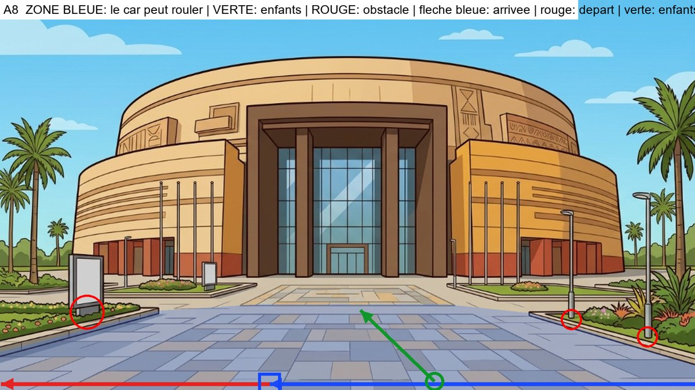

**Analyse du decor** : Esplanade dallee. Jardinieres aux deux cotes (bord diagonal), panneau a gauche (x 160-240), deux lampadaires a droite (x 1315 et 1490). Le car longe le devant de l'esplanade, sur le dallage libre.

**Plan de mise en scene** (a valider avant de generer) :
- Type : **voie horizontale : le car entre par la droite, vu de profil, et roule vers la gauche**
- Le car arrive : from the right edge, driving left along the paved band at the very front of the esplanade
- Il s'arrete : in the left-center of the front paved band, in front of the museum
- Il repart : continuing left along the same band, out of frame
- Les enfants se tiennent : on the paving to the right of the car, near its rear
- Ils marchent : straight across the esplanade toward the central glass entrance
- A eviter : the planters on both sides, the signboard and the two lampposts

### Images-cles (a generer avec Antigravity)

#### Image-cle K1 : le car vient de s'arreter (plan large)
- **Enregistrer sous** : `frontend/public/images/parcours1012/keyframes/a8/k1_car-arrete.png`
- **A donner a Antigravity** :
   - `frontend/public/images/parcours1012/decors/musee-exterieur.png`
   - `frontend/public/images/parcours1012/references/03_car-rapide_reference.png`
   - `frontend/public/images/parcours1012/references/05_car-profil-gauche_reference.jpg`
   - `frontend/public/images/parcours1012/references/05_car-face-arriere_reference.jpg`

```text
STYLE AND SCALE LOCK. 2D flat-vector animation illustration, 16:9 (1920x1080), clean dark-brown outlines, warm saturated colors, exactly the style of the reference images. Use the reference images as the ONLY source for faces, bodies, outfits and the vehicle, and use the background reference as the exact setting (same architecture, colors, light). Do not redesign anything. RELATIVE HEIGHTS (standing, same distance from the camera): Moussa 100% (11-year-old boy), Fatou 97% (11-year-old girl), Palou the lion 85% (a friend of the same age: his big mane top reaches Moussa's nose; slightly shorter than the children, NEVER taller, always upright on two legs, not a baby, not an adult lion), Papa Ibou 125% (adult). Characters keep these ratios and shrink with distance as real perspective requires. The vehicle is the Car Rapide of the references: tall boxy vintage Dakar minibus, yellow upper body, blue lower body, painted geometric patterns, painted eye and lion, roof rack with luggage, rear ladder, rear opening door; its roof is about 1.6 times Moussa's height. It is NOT a taxi, NOT a car, NOT a modern van. No text, no logo, no signs with writing.

Wide establishing shot. Background: the round ochre facade of the Museum of Black Civilizations with its tall glass entrance, and a wide patterned paved esplanade in the foreground with a planter and a signboard on the left and two lampposts in a planter on the right. Place the Car Rapide in side view facing left, stopped in the left-center of the front paved band, in front of the museum. Nobody is outside. The car is drawn with correct perspective and scale for that spot. Avoid: the planters on both sides, the signboard and the two lampposts.
```

#### Image-cle K2 : la porte arriere s'ouvre (debut du plan 2)
- **Enregistrer sous** : `frontend/public/images/parcours1012/keyframes/a8/k2_porte-ouverte.png`
- **A donner a Antigravity** :
   - `frontend/public/images/parcours1012/decors/musee-exterieur.png`
   - `frontend/public/images/parcours1012/references/03_car-rapide_reference.png`
   - `frontend/public/images/parcours1012/references/05_car-profil-gauche_reference.jpg`
   - `frontend/public/images/parcours1012/references/05_car-face-arriere_reference.jpg`

```text
STYLE AND SCALE LOCK. 2D flat-vector animation illustration, 16:9 (1920x1080), clean dark-brown outlines, warm saturated colors, exactly the style of the reference images. Use the reference images as the ONLY source for faces, bodies, outfits and the vehicle, and use the background reference as the exact setting (same architecture, colors, light). Do not redesign anything. RELATIVE HEIGHTS (standing, same distance from the camera): Moussa 100% (11-year-old boy), Fatou 97% (11-year-old girl), Palou the lion 85% (a friend of the same age: his big mane top reaches Moussa's nose; slightly shorter than the children, NEVER taller, always upright on two legs, not a baby, not an adult lion), Papa Ibou 125% (adult). Characters keep these ratios and shrink with distance as real perspective requires. The vehicle is the Car Rapide of the references: tall boxy vintage Dakar minibus, yellow upper body, blue lower body, painted geometric patterns, painted eye and lion, roof rack with luggage, rear ladder, rear opening door; its roof is about 1.6 times Moussa's height. It is NOT a taxi, NOT a car, NOT a modern van. No text, no logo, no signs with writing.

Medium shot, 3/4 rear view from the right of the car, the car facing left, the rear door on the right side of the frame. Same place and same setting as image K1. The Car Rapide's rear door is wide open and the empty interior with its seats is visible. Nobody has got out yet. No people in the frame.
```

#### Image-cle K3 : les trois sont descendus (fin du plan 2)
- **Enregistrer sous** : `frontend/public/images/parcours1012/keyframes/a8/k3_trois-descendus.png`
- **A donner a Antigravity** :
   - `frontend/public/images/parcours1012/decors/musee-exterieur.png`
   - `frontend/public/images/parcours1012/references/04_scene3_enfants-salut-face_reference.jpg` (planche des trois : tailles relatives)
   - `frontend/public/images/parcours1012/references/02_moussa-11_reference.png`
   - `frontend/public/images/parcours1012/references/02_fatou-11_reference.png`
   - `frontend/public/images/parcours1012/references/01_palou-1012_reference.png`
   - `frontend/public/images/parcours1012/references/03_car-rapide_reference.png`

```text
STYLE AND SCALE LOCK. 2D flat-vector animation illustration, 16:9 (1920x1080), clean dark-brown outlines, warm saturated colors, exactly the style of the reference images. Use the reference images as the ONLY source for faces, bodies, outfits and the vehicle, and use the background reference as the exact setting (same architecture, colors, light). Do not redesign anything. RELATIVE HEIGHTS (standing, same distance from the camera): Moussa 100% (11-year-old boy), Fatou 97% (11-year-old girl), Palou the lion 85% (a friend of the same age: his big mane top reaches Moussa's nose; slightly shorter than the children, NEVER taller, always upright on two legs, not a baby, not an adult lion), Papa Ibou 125% (adult). Characters keep these ratios and shrink with distance as real perspective requires. The vehicle is the Car Rapide of the references: tall boxy vintage Dakar minibus, yellow upper body, blue lower body, painted geometric patterns, painted eye and lion, roof rack with luggage, rear ladder, rear opening door; its roof is about 1.6 times Moussa's height. It is NOT a taxi, NOT a car, NOT a modern van. No text, no logo, no signs with writing.

Same framing as image K2. The rear door is open. Moussa, Palou and Fatou, all full body and clearly visible, stand on the ground on the paving to the right of the car, near its rear, side by side, smiling, looking toward the driver's side of the car. Moussa: yellow t-shirt, orange cargo shorts, blue backpack, white socks, orange-red sneakers. Fatou: royal-blue dress, green ribbon on braided bun, brown satchel, blue sandals. Palou: golden fur, orange mane, white diamond on chest, tufted tail. Papa Ibou: green cap, orange-yellow checkered shirt, moustache. Correct relative heights: Palou slightly shorter than Moussa and Fatou. Avoid: the planters on both sides, the signboard and the two lampposts.
```

#### Image-cle K4 : gros plan de Papa Ibou qui salue (plan 3)
- **Enregistrer sous** : `frontend/public/images/parcours1012/keyframes/a8/k4_papa-ibou-salue.png`
- **A donner a Antigravity** :
   - `frontend/public/images/parcours1012/references/02_papa-ibou_reference.png`
   - `frontend/public/images/parcours1012/references/06_papa-ibou-volant-gauche_reference.jpg`
   - `frontend/public/images/parcours1012/references/03_car-rapide_reference.png`

```text
STYLE AND SCALE LOCK. 2D flat-vector animation illustration, 16:9 (1920x1080), clean dark-brown outlines, warm saturated colors, exactly the style of the reference images. Use the reference images as the ONLY source for faces, bodies, outfits and the vehicle, and use the background reference as the exact setting (same architecture, colors, light). Do not redesign anything. RELATIVE HEIGHTS (standing, same distance from the camera): Moussa 100% (11-year-old boy), Fatou 97% (11-year-old girl), Palou the lion 85% (a friend of the same age: his big mane top reaches Moussa's nose; slightly shorter than the children, NEVER taller, always upright on two legs, not a baby, not an adult lion), Papa Ibou 125% (adult). Characters keep these ratios and shrink with distance as real perspective requires. The vehicle is the Car Rapide of the references: tall boxy vintage Dakar minibus, yellow upper body, blue lower body, painted geometric patterns, painted eye and lion, roof rack with luggage, rear ladder, rear opening door; its roof is about 1.6 times Moussa's height. It is NOT a taxi, NOT a car, NOT a modern van. No text, no logo, no signs with writing.

Close-up of Papa Ibou at the open driver's window of the Car Rapide, smiling warmly and waving his right hand, the yellow door with painted patterns around him. The background outside the window is a soft blurred version of the colors of the setting: the round ochre facade of the Museum of Black Civilizations with its tall glass entrance, and a wide patterned paved esplanade in the foreground with a planter and a signboard on the left and two lampposts in a planter on the right. Same style as a cinematic close-up of a cartoon.
```

#### Image-cle K5 : les enfants font au revoir, le car est a cote (debut du plan 4)
- **Enregistrer sous** : `frontend/public/images/parcours1012/keyframes/a8/k5_au-revoir.png`
- **A donner a Antigravity** :
   - `frontend/public/images/parcours1012/decors/musee-exterieur.png`
   - `frontend/public/images/parcours1012/references/04_scene3_enfants-salut-face_reference.jpg` (planche des trois : tailles relatives)
   - `frontend/public/images/parcours1012/references/02_moussa-11_reference.png`
   - `frontend/public/images/parcours1012/references/02_fatou-11_reference.png`
   - `frontend/public/images/parcours1012/references/01_palou-1012_reference.png`
   - `frontend/public/images/parcours1012/references/03_car-rapide_reference.png`
   - `frontend/public/images/parcours1012/references/05_car-profil-gauche_reference.jpg`

```text
STYLE AND SCALE LOCK. 2D flat-vector animation illustration, 16:9 (1920x1080), clean dark-brown outlines, warm saturated colors, exactly the style of the reference images. Use the reference images as the ONLY source for faces, bodies, outfits and the vehicle, and use the background reference as the exact setting (same architecture, colors, light). Do not redesign anything. RELATIVE HEIGHTS (standing, same distance from the camera): Moussa 100% (11-year-old boy), Fatou 97% (11-year-old girl), Palou the lion 85% (a friend of the same age: his big mane top reaches Moussa's nose; slightly shorter than the children, NEVER taller, always upright on two legs, not a baby, not an adult lion), Papa Ibou 125% (adult). Characters keep these ratios and shrink with distance as real perspective requires. The vehicle is the Car Rapide of the references: tall boxy vintage Dakar minibus, yellow upper body, blue lower body, painted geometric patterns, painted eye and lion, roof rack with luggage, rear ladder, rear opening door; its roof is about 1.6 times Moussa's height. It is NOT a taxi, NOT a car, NOT a modern van. No text, no logo, no signs with writing.

Medium-wide shot. The three friends, seen from behind (3/4 back) on the paving to the right of the car, near its rear, wave goodbye with one raised hand toward the Car Rapide, which is stopped on the left in side view facing left, with Papa Ibou waving from the driver's window. Moussa: yellow t-shirt, orange cargo shorts, blue backpack, white socks, orange-red sneakers. Fatou: royal-blue dress, green ribbon on braided bun, brown satchel, blue sandals. Palou: golden fur, orange mane, white diamond on chest, tufted tail. Papa Ibou: green cap, orange-yellow checkered shirt, moustache. Palou is slightly shorter than the children. Avoid: the planters on both sides, the signboard and the two lampposts.
```

#### Image-cle K6 : les enfants marchent vers le lieu (debut du plan 5)
- **Enregistrer sous** : `frontend/public/images/parcours1012/keyframes/a8/k6_marche.png`
- **A donner a Antigravity** :
   - `frontend/public/images/parcours1012/decors/musee-exterieur.png`
   - `frontend/public/images/parcours1012/references/04_scene3_enfants-salut-face_reference.jpg` (planche des trois : tailles relatives)
   - `frontend/public/images/parcours1012/references/02_moussa-11_reference.png`
   - `frontend/public/images/parcours1012/references/02_fatou-11_reference.png`
   - `frontend/public/images/parcours1012/references/01_palou-1012_reference.png`

```text
STYLE AND SCALE LOCK. 2D flat-vector animation illustration, 16:9 (1920x1080), clean dark-brown outlines, warm saturated colors, exactly the style of the reference images. Use the reference images as the ONLY source for faces, bodies, outfits and the vehicle, and use the background reference as the exact setting (same architecture, colors, light). Do not redesign anything. RELATIVE HEIGHTS (standing, same distance from the camera): Moussa 100% (11-year-old boy), Fatou 97% (11-year-old girl), Palou the lion 85% (a friend of the same age: his big mane top reaches Moussa's nose; slightly shorter than the children, NEVER taller, always upright on two legs, not a baby, not an adult lion), Papa Ibou 125% (adult). Characters keep these ratios and shrink with distance as real perspective requires. The vehicle is the Car Rapide of the references: tall boxy vintage Dakar minibus, yellow upper body, blue lower body, painted geometric patterns, painted eye and lion, roof rack with luggage, rear ladder, rear opening door; its roof is about 1.6 times Moussa's height. It is NOT a taxi, NOT a car, NOT a modern van. No text, no logo, no signs with writing.

Wide shot in correct perspective. The Car Rapide has gone: it is not in the frame. The three friends, full body and seen from behind, walk side by side straight across the esplanade toward the central glass entrance. Moussa: yellow t-shirt, orange cargo shorts, blue backpack, white socks, orange-red sneakers. Fatou: royal-blue dress, green ribbon on braided bun, brown satchel, blue sandals. Palou: golden fur, orange mane, white diamond on chest, tufted tail. Papa Ibou: green cap, orange-yellow checkered shirt, moustache. Palou slightly shorter than the children, walking upright on two legs. Avoid: the planters on both sides, the signboard and the two lampposts.
```

### Plans video (Flow, Frames to video, 4 s chacun)

#### Plan 1 : le car arrive (4 s)
- **Flow, mode Frames to video** : image de debut `frontend/public/images/parcours1012/decors/musee-exterieur.png`
- **Image de fin** : `frontend/public/images/parcours1012/keyframes/a8/k1_car-arrete.png`

```text
Animate the provided frame(s) like a 2D flat-vector cartoon. Keep every character, outfit, face and the Car Rapide EXACTLY as drawn; do not redraw or resize anything; Palou stays slightly shorter than the children. Natural, smooth, readable motion. No text, no speech, no music. Static wide shot of the empty setting. The Car Rapide enters from the right edge, driving left along the paved band at the very front of the esplanade and slowly stops in the left-center of the front paved band, in front of the museum, ending exactly like the last frame. Avoid: the planters on both sides, the signboard and the two lampposts.
```

#### Plan 2 : les trois descendent (4 s)
- **Flow, mode Frames to video** : image de debut `frontend/public/images/parcours1012/keyframes/a8/k2_porte-ouverte.png`
- **Image de fin** : `frontend/public/images/parcours1012/keyframes/a8/k3_trois-descendus.png`

```text
Animate the provided frame(s) like a 2D flat-vector cartoon. Keep every character, outfit, face and the Car Rapide EXACTLY as drawn; do not redraw or resize anything; Palou stays slightly shorter than the children. Natural, smooth, readable motion. No text, no speech, no music. Moussa steps down from the open rear door, then Palou hops down, then Fatou; they come to stand where the last frame shows them. The minibus does not move.
```

#### Plan 3 : Papa Ibou salue (gros plan) (4 s, a couper a 2,5 s au montage)
- **Flow, mode Frames to video** : image de debut `frontend/public/images/parcours1012/keyframes/a8/k4_papa-ibou-salue.png`

```text
Animate the provided frame(s) like a 2D flat-vector cartoon. Keep every character, outfit, face and the Car Rapide EXACTLY as drawn; do not redraw or resize anything; Palou stays slightly shorter than the children. Natural, smooth, readable motion. No text, no speech, no music. Close-up: Papa Ibou smiles and waves his hand warmly, a small head tilt, blinks; the background stays softly blurred.
```

#### Plan 4 : au revoir, le car repart (4 s)
- **Flow, mode Frames to video** : image de debut `frontend/public/images/parcours1012/keyframes/a8/k5_au-revoir.png`

```text
Animate the provided frame(s) like a 2D flat-vector cartoon. Keep every character, outfit, face and the Car Rapide EXACTLY as drawn; do not redraw or resize anything; Palou stays slightly shorter than the children. Natural, smooth, readable motion. No text, no speech, no music. The three children wave goodbye; Papa Ibou waves back; then the Car Rapide pulls away smoothly: it goes continuing left along the same band, out of frame, getting smaller with distance until it leaves the frame. The children keep waving, then lower their arms. Avoid: the planters on both sides, the signboard and the two lampposts.
```

#### Plan 5 : ils marchent vers le lieu, fondu au noir (4 s)
- **Flow, mode Frames to video** : image de debut `frontend/public/images/parcours1012/keyframes/a8/k6_marche.png`

```text
Animate the provided frame(s) like a 2D flat-vector cartoon. Keep every character, outfit, face and the Car Rapide EXACTLY as drawn; do not redraw or resize anything; Palou stays slightly shorter than the children. Natural, smooth, readable motion. No text, no speech, no music. The three friends walk side by side straight across the esplanade toward the central glass entrance with a natural walking cycle, getting slightly smaller with distance. Static camera. In the last second the image fades smoothly to black.
```

---

## Module a9 - Dakar Arena

**Fichier cible** : `arrivee-a9.mp4` (environ 18 s) - **Decor** : `frontend/public/images/parcours1012/decors/dakar-arena-exterieur.png`

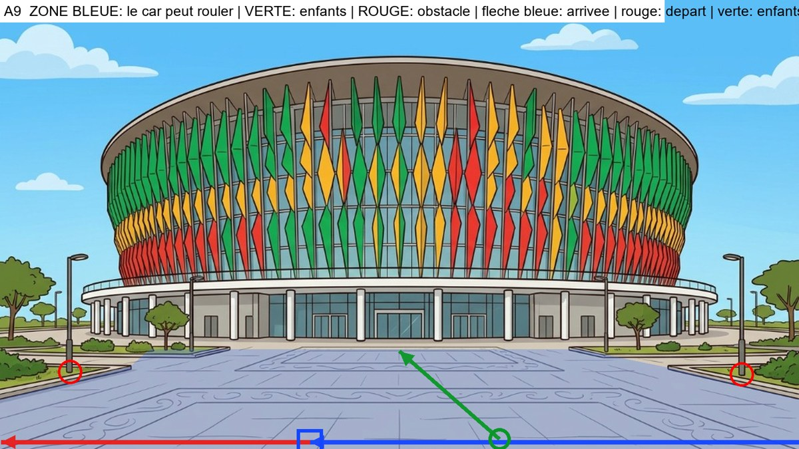

**Analyse du decor** : Parvis dalle. Jardinieres a gauche (x<260) et a droite (x>1340) avec lampadaires. Le car longe le devant du parvis, sur le dallage libre.

**Plan de mise en scene** (a valider avant de generer) :
- Type : **voie horizontale : le car entre par la droite, vu de profil, et roule vers la gauche**
- Le car arrive : from the right edge, driving left along the paved band at the front of the plaza
- Il s'arrete : in the left-center of the plaza front, in front of the arena
- Il repart : continuing left along the same band, out of frame
- Les enfants se tiennent : on the paving to the right of the car, near its rear
- Ils marchent : straight across the plaza toward the glass doors of the arena
- A eviter : the two side planters with their lampposts

### Images-cles (a generer avec Antigravity)

#### Image-cle K1 : le car vient de s'arreter (plan large)
- **Enregistrer sous** : `frontend/public/images/parcours1012/keyframes/a9/k1_car-arrete.png`
- **A donner a Antigravity** :
   - `frontend/public/images/parcours1012/decors/dakar-arena-exterieur.png`
   - `frontend/public/images/parcours1012/references/03_car-rapide_reference.png`
   - `frontend/public/images/parcours1012/references/05_car-profil-gauche_reference.jpg`
   - `frontend/public/images/parcours1012/references/05_car-face-arriere_reference.jpg`

```text
STYLE AND SCALE LOCK. 2D flat-vector animation illustration, 16:9 (1920x1080), clean dark-brown outlines, warm saturated colors, exactly the style of the reference images. Use the reference images as the ONLY source for faces, bodies, outfits and the vehicle, and use the background reference as the exact setting (same architecture, colors, light). Do not redesign anything. RELATIVE HEIGHTS (standing, same distance from the camera): Moussa 100% (11-year-old boy), Fatou 97% (11-year-old girl), Palou the lion 85% (a friend of the same age: his big mane top reaches Moussa's nose; slightly shorter than the children, NEVER taller, always upright on two legs, not a baby, not an adult lion), Papa Ibou 125% (adult). Characters keep these ratios and shrink with distance as real perspective requires. The vehicle is the Car Rapide of the references: tall boxy vintage Dakar minibus, yellow upper body, blue lower body, painted geometric patterns, painted eye and lion, roof rack with luggage, rear ladder, rear opening door; its roof is about 1.6 times Moussa's height. It is NOT a taxi, NOT a car, NOT a modern van. No text, no logo, no signs with writing.

Wide establishing shot. Background: the Dakar Arena with its colorful vertical louvers in green, yellow and red, and a huge paved plaza in the foreground with a lamppost and a planter at each side. Place the Car Rapide in side view facing left, stopped in the left-center of the plaza front, in front of the arena. Nobody is outside. The car is drawn with correct perspective and scale for that spot. Avoid: the two side planters with their lampposts.
```

#### Image-cle K2 : la porte arriere s'ouvre (debut du plan 2)
- **Enregistrer sous** : `frontend/public/images/parcours1012/keyframes/a9/k2_porte-ouverte.png`
- **A donner a Antigravity** :
   - `frontend/public/images/parcours1012/decors/dakar-arena-exterieur.png`
   - `frontend/public/images/parcours1012/references/03_car-rapide_reference.png`
   - `frontend/public/images/parcours1012/references/05_car-profil-gauche_reference.jpg`
   - `frontend/public/images/parcours1012/references/05_car-face-arriere_reference.jpg`

```text
STYLE AND SCALE LOCK. 2D flat-vector animation illustration, 16:9 (1920x1080), clean dark-brown outlines, warm saturated colors, exactly the style of the reference images. Use the reference images as the ONLY source for faces, bodies, outfits and the vehicle, and use the background reference as the exact setting (same architecture, colors, light). Do not redesign anything. RELATIVE HEIGHTS (standing, same distance from the camera): Moussa 100% (11-year-old boy), Fatou 97% (11-year-old girl), Palou the lion 85% (a friend of the same age: his big mane top reaches Moussa's nose; slightly shorter than the children, NEVER taller, always upright on two legs, not a baby, not an adult lion), Papa Ibou 125% (adult). Characters keep these ratios and shrink with distance as real perspective requires. The vehicle is the Car Rapide of the references: tall boxy vintage Dakar minibus, yellow upper body, blue lower body, painted geometric patterns, painted eye and lion, roof rack with luggage, rear ladder, rear opening door; its roof is about 1.6 times Moussa's height. It is NOT a taxi, NOT a car, NOT a modern van. No text, no logo, no signs with writing.

Medium shot, 3/4 rear view from the right of the car, the car facing left, the rear door on the right side of the frame. Same place and same setting as image K1. The Car Rapide's rear door is wide open and the empty interior with its seats is visible. Nobody has got out yet. No people in the frame.
```

#### Image-cle K3 : les trois sont descendus (fin du plan 2)
- **Enregistrer sous** : `frontend/public/images/parcours1012/keyframes/a9/k3_trois-descendus.png`
- **A donner a Antigravity** :
   - `frontend/public/images/parcours1012/decors/dakar-arena-exterieur.png`
   - `frontend/public/images/parcours1012/references/04_scene3_enfants-salut-face_reference.jpg` (planche des trois : tailles relatives)
   - `frontend/public/images/parcours1012/references/02_moussa-11_reference.png`
   - `frontend/public/images/parcours1012/references/02_fatou-11_reference.png`
   - `frontend/public/images/parcours1012/references/01_palou-1012_reference.png`
   - `frontend/public/images/parcours1012/references/03_car-rapide_reference.png`

```text
STYLE AND SCALE LOCK. 2D flat-vector animation illustration, 16:9 (1920x1080), clean dark-brown outlines, warm saturated colors, exactly the style of the reference images. Use the reference images as the ONLY source for faces, bodies, outfits and the vehicle, and use the background reference as the exact setting (same architecture, colors, light). Do not redesign anything. RELATIVE HEIGHTS (standing, same distance from the camera): Moussa 100% (11-year-old boy), Fatou 97% (11-year-old girl), Palou the lion 85% (a friend of the same age: his big mane top reaches Moussa's nose; slightly shorter than the children, NEVER taller, always upright on two legs, not a baby, not an adult lion), Papa Ibou 125% (adult). Characters keep these ratios and shrink with distance as real perspective requires. The vehicle is the Car Rapide of the references: tall boxy vintage Dakar minibus, yellow upper body, blue lower body, painted geometric patterns, painted eye and lion, roof rack with luggage, rear ladder, rear opening door; its roof is about 1.6 times Moussa's height. It is NOT a taxi, NOT a car, NOT a modern van. No text, no logo, no signs with writing.

Same framing as image K2. The rear door is open. Moussa, Palou and Fatou, all full body and clearly visible, stand on the ground on the paving to the right of the car, near its rear, side by side, smiling, looking toward the driver's side of the car. Moussa: yellow t-shirt, orange cargo shorts, blue backpack, white socks, orange-red sneakers. Fatou: royal-blue dress, green ribbon on braided bun, brown satchel, blue sandals. Palou: golden fur, orange mane, white diamond on chest, tufted tail. Papa Ibou: green cap, orange-yellow checkered shirt, moustache. Correct relative heights: Palou slightly shorter than Moussa and Fatou. Avoid: the two side planters with their lampposts.
```

#### Image-cle K4 : gros plan de Papa Ibou qui salue (plan 3)
- **Enregistrer sous** : `frontend/public/images/parcours1012/keyframes/a9/k4_papa-ibou-salue.png`
- **A donner a Antigravity** :
   - `frontend/public/images/parcours1012/references/02_papa-ibou_reference.png`
   - `frontend/public/images/parcours1012/references/06_papa-ibou-volant-gauche_reference.jpg`
   - `frontend/public/images/parcours1012/references/03_car-rapide_reference.png`

```text
STYLE AND SCALE LOCK. 2D flat-vector animation illustration, 16:9 (1920x1080), clean dark-brown outlines, warm saturated colors, exactly the style of the reference images. Use the reference images as the ONLY source for faces, bodies, outfits and the vehicle, and use the background reference as the exact setting (same architecture, colors, light). Do not redesign anything. RELATIVE HEIGHTS (standing, same distance from the camera): Moussa 100% (11-year-old boy), Fatou 97% (11-year-old girl), Palou the lion 85% (a friend of the same age: his big mane top reaches Moussa's nose; slightly shorter than the children, NEVER taller, always upright on two legs, not a baby, not an adult lion), Papa Ibou 125% (adult). Characters keep these ratios and shrink with distance as real perspective requires. The vehicle is the Car Rapide of the references: tall boxy vintage Dakar minibus, yellow upper body, blue lower body, painted geometric patterns, painted eye and lion, roof rack with luggage, rear ladder, rear opening door; its roof is about 1.6 times Moussa's height. It is NOT a taxi, NOT a car, NOT a modern van. No text, no logo, no signs with writing.

Close-up of Papa Ibou at the open driver's window of the Car Rapide, smiling warmly and waving his right hand, the yellow door with painted patterns around him. The background outside the window is a soft blurred version of the colors of the setting: the Dakar Arena with its colorful vertical louvers in green, yellow and red, and a huge paved plaza in the foreground with a lamppost and a planter at each side. Same style as a cinematic close-up of a cartoon.
```

#### Image-cle K5 : les enfants font au revoir, le car est a cote (debut du plan 4)
- **Enregistrer sous** : `frontend/public/images/parcours1012/keyframes/a9/k5_au-revoir.png`
- **A donner a Antigravity** :
   - `frontend/public/images/parcours1012/decors/dakar-arena-exterieur.png`
   - `frontend/public/images/parcours1012/references/04_scene3_enfants-salut-face_reference.jpg` (planche des trois : tailles relatives)
   - `frontend/public/images/parcours1012/references/02_moussa-11_reference.png`
   - `frontend/public/images/parcours1012/references/02_fatou-11_reference.png`
   - `frontend/public/images/parcours1012/references/01_palou-1012_reference.png`
   - `frontend/public/images/parcours1012/references/03_car-rapide_reference.png`
   - `frontend/public/images/parcours1012/references/05_car-profil-gauche_reference.jpg`

```text
STYLE AND SCALE LOCK. 2D flat-vector animation illustration, 16:9 (1920x1080), clean dark-brown outlines, warm saturated colors, exactly the style of the reference images. Use the reference images as the ONLY source for faces, bodies, outfits and the vehicle, and use the background reference as the exact setting (same architecture, colors, light). Do not redesign anything. RELATIVE HEIGHTS (standing, same distance from the camera): Moussa 100% (11-year-old boy), Fatou 97% (11-year-old girl), Palou the lion 85% (a friend of the same age: his big mane top reaches Moussa's nose; slightly shorter than the children, NEVER taller, always upright on two legs, not a baby, not an adult lion), Papa Ibou 125% (adult). Characters keep these ratios and shrink with distance as real perspective requires. The vehicle is the Car Rapide of the references: tall boxy vintage Dakar minibus, yellow upper body, blue lower body, painted geometric patterns, painted eye and lion, roof rack with luggage, rear ladder, rear opening door; its roof is about 1.6 times Moussa's height. It is NOT a taxi, NOT a car, NOT a modern van. No text, no logo, no signs with writing.

Medium-wide shot. The three friends, seen from behind (3/4 back) on the paving to the right of the car, near its rear, wave goodbye with one raised hand toward the Car Rapide, which is stopped on the left in side view facing left, with Papa Ibou waving from the driver's window. Moussa: yellow t-shirt, orange cargo shorts, blue backpack, white socks, orange-red sneakers. Fatou: royal-blue dress, green ribbon on braided bun, brown satchel, blue sandals. Palou: golden fur, orange mane, white diamond on chest, tufted tail. Papa Ibou: green cap, orange-yellow checkered shirt, moustache. Palou is slightly shorter than the children. Avoid: the two side planters with their lampposts.
```

#### Image-cle K6 : les enfants marchent vers le lieu (debut du plan 5)
- **Enregistrer sous** : `frontend/public/images/parcours1012/keyframes/a9/k6_marche.png`
- **A donner a Antigravity** :
   - `frontend/public/images/parcours1012/decors/dakar-arena-exterieur.png`
   - `frontend/public/images/parcours1012/references/04_scene3_enfants-salut-face_reference.jpg` (planche des trois : tailles relatives)
   - `frontend/public/images/parcours1012/references/02_moussa-11_reference.png`
   - `frontend/public/images/parcours1012/references/02_fatou-11_reference.png`
   - `frontend/public/images/parcours1012/references/01_palou-1012_reference.png`

```text
STYLE AND SCALE LOCK. 2D flat-vector animation illustration, 16:9 (1920x1080), clean dark-brown outlines, warm saturated colors, exactly the style of the reference images. Use the reference images as the ONLY source for faces, bodies, outfits and the vehicle, and use the background reference as the exact setting (same architecture, colors, light). Do not redesign anything. RELATIVE HEIGHTS (standing, same distance from the camera): Moussa 100% (11-year-old boy), Fatou 97% (11-year-old girl), Palou the lion 85% (a friend of the same age: his big mane top reaches Moussa's nose; slightly shorter than the children, NEVER taller, always upright on two legs, not a baby, not an adult lion), Papa Ibou 125% (adult). Characters keep these ratios and shrink with distance as real perspective requires. The vehicle is the Car Rapide of the references: tall boxy vintage Dakar minibus, yellow upper body, blue lower body, painted geometric patterns, painted eye and lion, roof rack with luggage, rear ladder, rear opening door; its roof is about 1.6 times Moussa's height. It is NOT a taxi, NOT a car, NOT a modern van. No text, no logo, no signs with writing.

Wide shot in correct perspective. The Car Rapide has gone: it is not in the frame. The three friends, full body and seen from behind, walk side by side straight across the plaza toward the glass doors of the arena. Moussa: yellow t-shirt, orange cargo shorts, blue backpack, white socks, orange-red sneakers. Fatou: royal-blue dress, green ribbon on braided bun, brown satchel, blue sandals. Palou: golden fur, orange mane, white diamond on chest, tufted tail. Papa Ibou: green cap, orange-yellow checkered shirt, moustache. Palou slightly shorter than the children, walking upright on two legs. Avoid: the two side planters with their lampposts.
```

### Plans video (Flow, Frames to video, 4 s chacun)

#### Plan 1 : le car arrive (4 s)
- **Flow, mode Frames to video** : image de debut `frontend/public/images/parcours1012/decors/dakar-arena-exterieur.png`
- **Image de fin** : `frontend/public/images/parcours1012/keyframes/a9/k1_car-arrete.png`

```text
Animate the provided frame(s) like a 2D flat-vector cartoon. Keep every character, outfit, face and the Car Rapide EXACTLY as drawn; do not redraw or resize anything; Palou stays slightly shorter than the children. Natural, smooth, readable motion. No text, no speech, no music. Static wide shot of the empty setting. The Car Rapide enters from the right edge, driving left along the paved band at the front of the plaza and slowly stops in the left-center of the plaza front, in front of the arena, ending exactly like the last frame. Avoid: the two side planters with their lampposts.
```

#### Plan 2 : les trois descendent (4 s)
- **Flow, mode Frames to video** : image de debut `frontend/public/images/parcours1012/keyframes/a9/k2_porte-ouverte.png`
- **Image de fin** : `frontend/public/images/parcours1012/keyframes/a9/k3_trois-descendus.png`

```text
Animate the provided frame(s) like a 2D flat-vector cartoon. Keep every character, outfit, face and the Car Rapide EXACTLY as drawn; do not redraw or resize anything; Palou stays slightly shorter than the children. Natural, smooth, readable motion. No text, no speech, no music. Moussa steps down from the open rear door, then Palou hops down, then Fatou; they come to stand where the last frame shows them. The minibus does not move.
```

#### Plan 3 : Papa Ibou salue (gros plan) (4 s, a couper a 2,5 s au montage)
- **Flow, mode Frames to video** : image de debut `frontend/public/images/parcours1012/keyframes/a9/k4_papa-ibou-salue.png`

```text
Animate the provided frame(s) like a 2D flat-vector cartoon. Keep every character, outfit, face and the Car Rapide EXACTLY as drawn; do not redraw or resize anything; Palou stays slightly shorter than the children. Natural, smooth, readable motion. No text, no speech, no music. Close-up: Papa Ibou smiles and waves his hand warmly, a small head tilt, blinks; the background stays softly blurred.
```

#### Plan 4 : au revoir, le car repart (4 s)
- **Flow, mode Frames to video** : image de debut `frontend/public/images/parcours1012/keyframes/a9/k5_au-revoir.png`

```text
Animate the provided frame(s) like a 2D flat-vector cartoon. Keep every character, outfit, face and the Car Rapide EXACTLY as drawn; do not redraw or resize anything; Palou stays slightly shorter than the children. Natural, smooth, readable motion. No text, no speech, no music. The three children wave goodbye; Papa Ibou waves back; then the Car Rapide pulls away smoothly: it goes continuing left along the same band, out of frame, getting smaller with distance until it leaves the frame. The children keep waving, then lower their arms. Avoid: the two side planters with their lampposts.
```

#### Plan 5 : ils marchent vers le lieu, fondu au noir (4 s)
- **Flow, mode Frames to video** : image de debut `frontend/public/images/parcours1012/keyframes/a9/k6_marche.png`

```text
Animate the provided frame(s) like a 2D flat-vector cartoon. Keep every character, outfit, face and the Car Rapide EXACTLY as drawn; do not redraw or resize anything; Palou stays slightly shorter than the children. Natural, smooth, readable motion. No text, no speech, no music. The three friends walk side by side straight across the plaza toward the glass doors of the arena with a natural walking cycle, getting slightly smaller with distance. Static camera. In the last second the image fades smoothly to black.
```

---

## Module a10 - Phare des Mamelles

**Fichier cible** : `arrivee-a10.mp4` (environ 18 s) - **Decor** : `frontend/public/images/parcours1012/decors/phare-exterieur.png`

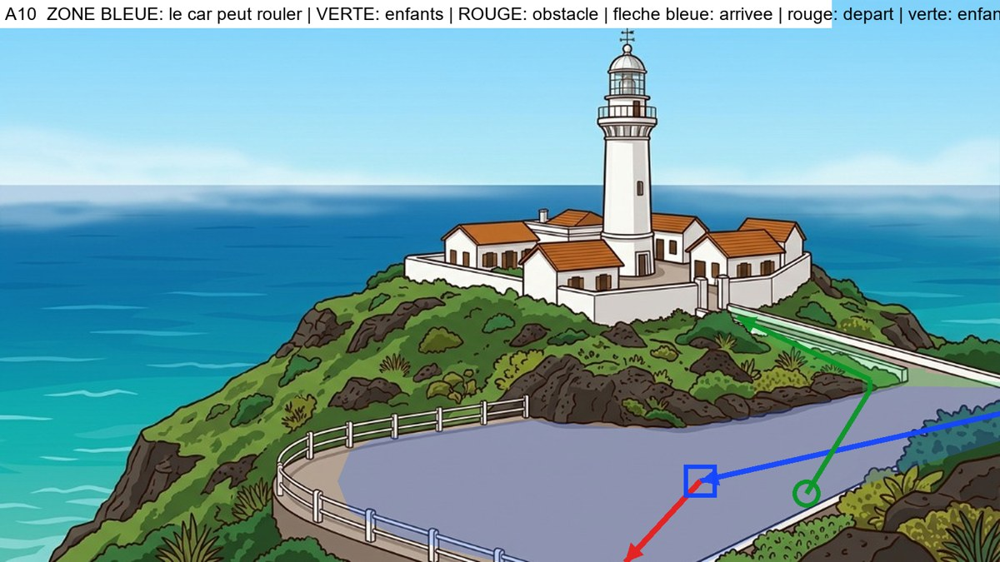

**Analyse du decor** : Route en lacet : falaise et garde-corps blanc a gauche (jamais d'issue de ce cote), rochers au-dessus, vegetation en bas a droite. Le car arrive par la route de droite, s'arrete sur la placette, puis repart tout droit vers la camera par le bas du cadre, loin du garde-corps. Les enfants montent la route a droite vers la grille du phare.

**Plan de mise en scene** (a valider avant de generer) :
- Type : **voie horizontale : le car entre par la droite, vu de profil, et roule vers la gauche**
- Le car arrive : from the right edge, driving left along the road toward the plaza
- Il s'arrete : on the paved plaza, right of center, well inside the guardrail
- Il repart : turning toward the camera and leaving straight down through the bottom-center of the frame on the road, staying well away from the white guardrail and the cliff on the left; it never goes toward the cliff or over the guardrail
- Les enfants se tiennent : on the plaza to the right of the car, near its rear
- Ils marchent : up the road on the right, along the white wall, toward the lighthouse gate
- A eviter : the cliff and the sea behind the guardrail, the rocks, the shrubs on the right

### Images-cles (a generer avec Antigravity)

#### Image-cle K1 : le car vient de s'arreter (plan large)
- **Enregistrer sous** : `frontend/public/images/parcours1012/keyframes/a10/k1_car-arrete.png`
- **A donner a Antigravity** :
   - `frontend/public/images/parcours1012/decors/phare-exterieur.png`
   - `frontend/public/images/parcours1012/references/03_car-rapide_reference.png`
   - `frontend/public/images/parcours1012/references/05_car-profil-gauche_reference.jpg`
   - `frontend/public/images/parcours1012/references/05_car-face-arriere_reference.jpg`

```text
STYLE AND SCALE LOCK. 2D flat-vector animation illustration, 16:9 (1920x1080), clean dark-brown outlines, warm saturated colors, exactly the style of the reference images. Use the reference images as the ONLY source for faces, bodies, outfits and the vehicle, and use the background reference as the exact setting (same architecture, colors, light). Do not redesign anything. RELATIVE HEIGHTS (standing, same distance from the camera): Moussa 100% (11-year-old boy), Fatou 97% (11-year-old girl), Palou the lion 85% (a friend of the same age: his big mane top reaches Moussa's nose; slightly shorter than the children, NEVER taller, always upright on two legs, not a baby, not an adult lion), Papa Ibou 125% (adult). Characters keep these ratios and shrink with distance as real perspective requires. The vehicle is the Car Rapide of the references: tall boxy vintage Dakar minibus, yellow upper body, blue lower body, painted geometric patterns, painted eye and lion, roof rack with luggage, rear ladder, rear opening door; its roof is about 1.6 times Moussa's height. It is NOT a taxi, NOT a car, NOT a modern van. No text, no logo, no signs with writing.

Wide establishing shot. Background: the white lighthouse on its green volcanic hill above the ocean; a paved road with a white guardrail curving around a small paved plaza in the foreground; the cliff and the sea are beyond the guardrail on the left; a road climbs on the right along the white wall to the lighthouse gate. Place the Car Rapide in side view facing left, stopped on the paved plaza, right of center, well inside the guardrail. Nobody is outside. The car is drawn with correct perspective and scale for that spot. Avoid: the cliff and the sea behind the guardrail, the rocks, the shrubs on the right.
```

#### Image-cle K2 : la porte arriere s'ouvre (debut du plan 2)
- **Enregistrer sous** : `frontend/public/images/parcours1012/keyframes/a10/k2_porte-ouverte.png`
- **A donner a Antigravity** :
   - `frontend/public/images/parcours1012/decors/phare-exterieur.png`
   - `frontend/public/images/parcours1012/references/03_car-rapide_reference.png`
   - `frontend/public/images/parcours1012/references/05_car-profil-gauche_reference.jpg`
   - `frontend/public/images/parcours1012/references/05_car-face-arriere_reference.jpg`

```text
STYLE AND SCALE LOCK. 2D flat-vector animation illustration, 16:9 (1920x1080), clean dark-brown outlines, warm saturated colors, exactly the style of the reference images. Use the reference images as the ONLY source for faces, bodies, outfits and the vehicle, and use the background reference as the exact setting (same architecture, colors, light). Do not redesign anything. RELATIVE HEIGHTS (standing, same distance from the camera): Moussa 100% (11-year-old boy), Fatou 97% (11-year-old girl), Palou the lion 85% (a friend of the same age: his big mane top reaches Moussa's nose; slightly shorter than the children, NEVER taller, always upright on two legs, not a baby, not an adult lion), Papa Ibou 125% (adult). Characters keep these ratios and shrink with distance as real perspective requires. The vehicle is the Car Rapide of the references: tall boxy vintage Dakar minibus, yellow upper body, blue lower body, painted geometric patterns, painted eye and lion, roof rack with luggage, rear ladder, rear opening door; its roof is about 1.6 times Moussa's height. It is NOT a taxi, NOT a car, NOT a modern van. No text, no logo, no signs with writing.

Medium shot, 3/4 rear view from the right of the car, the car facing left, the rear door on the right side of the frame. Same place and same setting as image K1. The Car Rapide's rear door is wide open and the empty interior with its seats is visible. Nobody has got out yet. No people in the frame.
```

#### Image-cle K3 : les trois sont descendus (fin du plan 2)
- **Enregistrer sous** : `frontend/public/images/parcours1012/keyframes/a10/k3_trois-descendus.png`
- **A donner a Antigravity** :
   - `frontend/public/images/parcours1012/decors/phare-exterieur.png`
   - `frontend/public/images/parcours1012/references/04_scene3_enfants-salut-face_reference.jpg` (planche des trois : tailles relatives)
   - `frontend/public/images/parcours1012/references/02_moussa-11_reference.png`
   - `frontend/public/images/parcours1012/references/02_fatou-11_reference.png`
   - `frontend/public/images/parcours1012/references/01_palou-1012_reference.png`
   - `frontend/public/images/parcours1012/references/03_car-rapide_reference.png`

```text
STYLE AND SCALE LOCK. 2D flat-vector animation illustration, 16:9 (1920x1080), clean dark-brown outlines, warm saturated colors, exactly the style of the reference images. Use the reference images as the ONLY source for faces, bodies, outfits and the vehicle, and use the background reference as the exact setting (same architecture, colors, light). Do not redesign anything. RELATIVE HEIGHTS (standing, same distance from the camera): Moussa 100% (11-year-old boy), Fatou 97% (11-year-old girl), Palou the lion 85% (a friend of the same age: his big mane top reaches Moussa's nose; slightly shorter than the children, NEVER taller, always upright on two legs, not a baby, not an adult lion), Papa Ibou 125% (adult). Characters keep these ratios and shrink with distance as real perspective requires. The vehicle is the Car Rapide of the references: tall boxy vintage Dakar minibus, yellow upper body, blue lower body, painted geometric patterns, painted eye and lion, roof rack with luggage, rear ladder, rear opening door; its roof is about 1.6 times Moussa's height. It is NOT a taxi, NOT a car, NOT a modern van. No text, no logo, no signs with writing.

Same framing as image K2. The rear door is open. Moussa, Palou and Fatou, all full body and clearly visible, stand on the ground on the plaza to the right of the car, near its rear, side by side, smiling, looking toward the driver's side of the car. Moussa: yellow t-shirt, orange cargo shorts, blue backpack, white socks, orange-red sneakers. Fatou: royal-blue dress, green ribbon on braided bun, brown satchel, blue sandals. Palou: golden fur, orange mane, white diamond on chest, tufted tail. Papa Ibou: green cap, orange-yellow checkered shirt, moustache. Correct relative heights: Palou slightly shorter than Moussa and Fatou. Avoid: the cliff and the sea behind the guardrail, the rocks, the shrubs on the right.
```

#### Image-cle K4 : gros plan de Papa Ibou qui salue (plan 3)
- **Enregistrer sous** : `frontend/public/images/parcours1012/keyframes/a10/k4_papa-ibou-salue.png`
- **A donner a Antigravity** :
   - `frontend/public/images/parcours1012/references/02_papa-ibou_reference.png`
   - `frontend/public/images/parcours1012/references/06_papa-ibou-volant-gauche_reference.jpg`
   - `frontend/public/images/parcours1012/references/03_car-rapide_reference.png`

```text
STYLE AND SCALE LOCK. 2D flat-vector animation illustration, 16:9 (1920x1080), clean dark-brown outlines, warm saturated colors, exactly the style of the reference images. Use the reference images as the ONLY source for faces, bodies, outfits and the vehicle, and use the background reference as the exact setting (same architecture, colors, light). Do not redesign anything. RELATIVE HEIGHTS (standing, same distance from the camera): Moussa 100% (11-year-old boy), Fatou 97% (11-year-old girl), Palou the lion 85% (a friend of the same age: his big mane top reaches Moussa's nose; slightly shorter than the children, NEVER taller, always upright on two legs, not a baby, not an adult lion), Papa Ibou 125% (adult). Characters keep these ratios and shrink with distance as real perspective requires. The vehicle is the Car Rapide of the references: tall boxy vintage Dakar minibus, yellow upper body, blue lower body, painted geometric patterns, painted eye and lion, roof rack with luggage, rear ladder, rear opening door; its roof is about 1.6 times Moussa's height. It is NOT a taxi, NOT a car, NOT a modern van. No text, no logo, no signs with writing.

Close-up of Papa Ibou at the open driver's window of the Car Rapide, smiling warmly and waving his right hand, the yellow door with painted patterns around him. The background outside the window is a soft blurred version of the colors of the setting: the white lighthouse on its green volcanic hill above the ocean; a paved road with a white guardrail curving around a small paved plaza in the foreground; the cliff and the sea are beyond the guardrail on the left; a road climbs on the right along the white wall to the lighthouse gate. Same style as a cinematic close-up of a cartoon.
```

#### Image-cle K5 : les enfants font au revoir, le car est a cote (debut du plan 4)
- **Enregistrer sous** : `frontend/public/images/parcours1012/keyframes/a10/k5_au-revoir.png`
- **A donner a Antigravity** :
   - `frontend/public/images/parcours1012/decors/phare-exterieur.png`
   - `frontend/public/images/parcours1012/references/04_scene3_enfants-salut-face_reference.jpg` (planche des trois : tailles relatives)
   - `frontend/public/images/parcours1012/references/02_moussa-11_reference.png`
   - `frontend/public/images/parcours1012/references/02_fatou-11_reference.png`
   - `frontend/public/images/parcours1012/references/01_palou-1012_reference.png`
   - `frontend/public/images/parcours1012/references/03_car-rapide_reference.png`
   - `frontend/public/images/parcours1012/references/05_car-profil-gauche_reference.jpg`

```text
STYLE AND SCALE LOCK. 2D flat-vector animation illustration, 16:9 (1920x1080), clean dark-brown outlines, warm saturated colors, exactly the style of the reference images. Use the reference images as the ONLY source for faces, bodies, outfits and the vehicle, and use the background reference as the exact setting (same architecture, colors, light). Do not redesign anything. RELATIVE HEIGHTS (standing, same distance from the camera): Moussa 100% (11-year-old boy), Fatou 97% (11-year-old girl), Palou the lion 85% (a friend of the same age: his big mane top reaches Moussa's nose; slightly shorter than the children, NEVER taller, always upright on two legs, not a baby, not an adult lion), Papa Ibou 125% (adult). Characters keep these ratios and shrink with distance as real perspective requires. The vehicle is the Car Rapide of the references: tall boxy vintage Dakar minibus, yellow upper body, blue lower body, painted geometric patterns, painted eye and lion, roof rack with luggage, rear ladder, rear opening door; its roof is about 1.6 times Moussa's height. It is NOT a taxi, NOT a car, NOT a modern van. No text, no logo, no signs with writing.

Medium-wide shot. The three friends, seen from behind (3/4 back) on the plaza to the right of the car, near its rear, wave goodbye with one raised hand toward the Car Rapide, which is stopped on the left in side view facing left, with Papa Ibou waving from the driver's window. Moussa: yellow t-shirt, orange cargo shorts, blue backpack, white socks, orange-red sneakers. Fatou: royal-blue dress, green ribbon on braided bun, brown satchel, blue sandals. Palou: golden fur, orange mane, white diamond on chest, tufted tail. Papa Ibou: green cap, orange-yellow checkered shirt, moustache. Palou is slightly shorter than the children. Avoid: the cliff and the sea behind the guardrail, the rocks, the shrubs on the right.
```

#### Image-cle K6 : les enfants marchent vers le lieu (debut du plan 5)
- **Enregistrer sous** : `frontend/public/images/parcours1012/keyframes/a10/k6_marche.png`
- **A donner a Antigravity** :
   - `frontend/public/images/parcours1012/decors/phare-exterieur.png`
   - `frontend/public/images/parcours1012/references/04_scene3_enfants-salut-face_reference.jpg` (planche des trois : tailles relatives)
   - `frontend/public/images/parcours1012/references/02_moussa-11_reference.png`
   - `frontend/public/images/parcours1012/references/02_fatou-11_reference.png`
   - `frontend/public/images/parcours1012/references/01_palou-1012_reference.png`

```text
STYLE AND SCALE LOCK. 2D flat-vector animation illustration, 16:9 (1920x1080), clean dark-brown outlines, warm saturated colors, exactly the style of the reference images. Use the reference images as the ONLY source for faces, bodies, outfits and the vehicle, and use the background reference as the exact setting (same architecture, colors, light). Do not redesign anything. RELATIVE HEIGHTS (standing, same distance from the camera): Moussa 100% (11-year-old boy), Fatou 97% (11-year-old girl), Palou the lion 85% (a friend of the same age: his big mane top reaches Moussa's nose; slightly shorter than the children, NEVER taller, always upright on two legs, not a baby, not an adult lion), Papa Ibou 125% (adult). Characters keep these ratios and shrink with distance as real perspective requires. The vehicle is the Car Rapide of the references: tall boxy vintage Dakar minibus, yellow upper body, blue lower body, painted geometric patterns, painted eye and lion, roof rack with luggage, rear ladder, rear opening door; its roof is about 1.6 times Moussa's height. It is NOT a taxi, NOT a car, NOT a modern van. No text, no logo, no signs with writing.

Wide shot in correct perspective. The Car Rapide has gone: it is not in the frame. The three friends, full body and seen from behind, walk side by side up the road on the right, along the white wall, toward the lighthouse gate. Moussa: yellow t-shirt, orange cargo shorts, blue backpack, white socks, orange-red sneakers. Fatou: royal-blue dress, green ribbon on braided bun, brown satchel, blue sandals. Palou: golden fur, orange mane, white diamond on chest, tufted tail. Papa Ibou: green cap, orange-yellow checkered shirt, moustache. Palou slightly shorter than the children, walking upright on two legs. Avoid: the cliff and the sea behind the guardrail, the rocks, the shrubs on the right.
```

### Plans video (Flow, Frames to video, 4 s chacun)

#### Plan 1 : le car arrive (4 s)
- **Flow, mode Frames to video** : image de debut `frontend/public/images/parcours1012/decors/phare-exterieur.png`
- **Image de fin** : `frontend/public/images/parcours1012/keyframes/a10/k1_car-arrete.png`

```text
Animate the provided frame(s) like a 2D flat-vector cartoon. Keep every character, outfit, face and the Car Rapide EXACTLY as drawn; do not redraw or resize anything; Palou stays slightly shorter than the children. Natural, smooth, readable motion. No text, no speech, no music. Static wide shot of the empty setting. The Car Rapide enters from the right edge, driving left along the road toward the plaza and slowly stops on the paved plaza, right of center, well inside the guardrail, ending exactly like the last frame. Avoid: the cliff and the sea behind the guardrail, the rocks, the shrubs on the right.
```

#### Plan 2 : les trois descendent (4 s)
- **Flow, mode Frames to video** : image de debut `frontend/public/images/parcours1012/keyframes/a10/k2_porte-ouverte.png`
- **Image de fin** : `frontend/public/images/parcours1012/keyframes/a10/k3_trois-descendus.png`

```text
Animate the provided frame(s) like a 2D flat-vector cartoon. Keep every character, outfit, face and the Car Rapide EXACTLY as drawn; do not redraw or resize anything; Palou stays slightly shorter than the children. Natural, smooth, readable motion. No text, no speech, no music. Moussa steps down from the open rear door, then Palou hops down, then Fatou; they come to stand where the last frame shows them. The minibus does not move.
```

#### Plan 3 : Papa Ibou salue (gros plan) (4 s, a couper a 2,5 s au montage)
- **Flow, mode Frames to video** : image de debut `frontend/public/images/parcours1012/keyframes/a10/k4_papa-ibou-salue.png`

```text
Animate the provided frame(s) like a 2D flat-vector cartoon. Keep every character, outfit, face and the Car Rapide EXACTLY as drawn; do not redraw or resize anything; Palou stays slightly shorter than the children. Natural, smooth, readable motion. No text, no speech, no music. Close-up: Papa Ibou smiles and waves his hand warmly, a small head tilt, blinks; the background stays softly blurred.
```

#### Plan 4 : au revoir, le car repart (4 s)
- **Flow, mode Frames to video** : image de debut `frontend/public/images/parcours1012/keyframes/a10/k5_au-revoir.png`

```text
Animate the provided frame(s) like a 2D flat-vector cartoon. Keep every character, outfit, face and the Car Rapide EXACTLY as drawn; do not redraw or resize anything; Palou stays slightly shorter than the children. Natural, smooth, readable motion. No text, no speech, no music. The three children wave goodbye; Papa Ibou waves back; then the Car Rapide pulls away smoothly: it goes turning toward the camera and leaving straight down through the bottom-center of the frame on the road, staying well away from the white guardrail and the cliff on the left; it never goes toward the cliff or over the guardrail, getting smaller with distance until it leaves the frame. The children keep waving, then lower their arms. Avoid: the cliff and the sea behind the guardrail, the rocks, the shrubs on the right.
```

#### Plan 5 : ils marchent vers le lieu, fondu au noir (4 s)
- **Flow, mode Frames to video** : image de debut `frontend/public/images/parcours1012/keyframes/a10/k6_marche.png`

```text
Animate the provided frame(s) like a 2D flat-vector cartoon. Keep every character, outfit, face and the Car Rapide EXACTLY as drawn; do not redraw or resize anything; Palou stays slightly shorter than the children. Natural, smooth, readable motion. No text, no speech, no music. The three friends walk side by side up the road on the right, along the white wall, toward the lighthouse gate with a natural walking cycle, getting slightly smaller with distance. Static camera. In the last second the image fades smoothly to black.
```

---

## Module a11 - Palais de la Republique

**Fichier cible** : `arrivee-a11.mp4` (environ 18 s) - **Decor** : `frontend/public/images/parcours1012/decors/palais-exterieur.png`

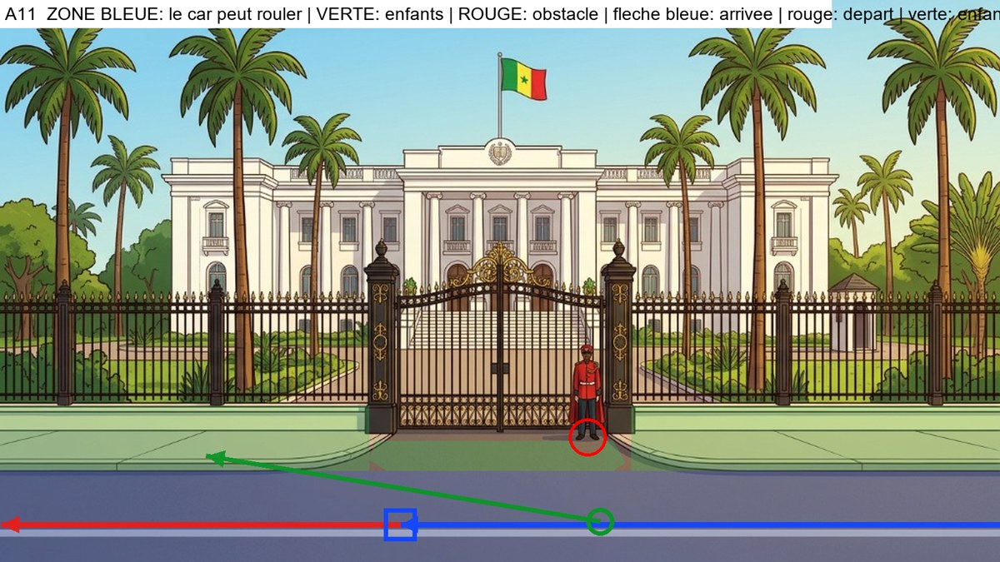

**Analyse du decor** : Avenue horizontale devant la grille. Trottoirs de chaque cote (y<752). Le garde rouge est devant la grille (x 940). Les enfants ne franchissent JAMAIS la grille : ils longent le trottoir.

**Plan de mise en scene** (a valider avant de generer) :
- Type : **voie horizontale : le car entre par la droite, vu de profil, et roule vers la gauche**
- Le car arrive : from the right edge, driving left along the avenue
- Il s'arrete : in the left-center of the avenue, beside the sidewalk
- Il repart : continuing left along the avenue, out of frame
- Les enfants se tiennent : on the avenue to the right of the car, near its rear
- Ils marchent : calmly onto the sidewalk and along it toward the left, looking at the palace gates (they do NOT go through the gate)
- A eviter : the fence and the gate (nobody goes through), the guard

### Images-cles (a generer avec Antigravity)

#### Image-cle K1 : le car vient de s'arreter (plan large)
- **Enregistrer sous** : `frontend/public/images/parcours1012/keyframes/a11/k1_car-arrete.png`
- **A donner a Antigravity** :
   - `frontend/public/images/parcours1012/decors/palais-exterieur.png`
   - `frontend/public/images/parcours1012/references/03_car-rapide_reference.png`
   - `frontend/public/images/parcours1012/references/05_car-profil-gauche_reference.jpg`
   - `frontend/public/images/parcours1012/references/05_car-face-arriere_reference.jpg`

```text
STYLE AND SCALE LOCK. 2D flat-vector animation illustration, 16:9 (1920x1080), clean dark-brown outlines, warm saturated colors, exactly the style of the reference images. Use the reference images as the ONLY source for faces, bodies, outfits and the vehicle, and use the background reference as the exact setting (same architecture, colors, light). Do not redesign anything. RELATIVE HEIGHTS (standing, same distance from the camera): Moussa 100% (11-year-old boy), Fatou 97% (11-year-old girl), Palou the lion 85% (a friend of the same age: his big mane top reaches Moussa's nose; slightly shorter than the children, NEVER taller, always upright on two legs, not a baby, not an adult lion), Papa Ibou 125% (adult). Characters keep these ratios and shrink with distance as real perspective requires. The vehicle is the Car Rapide of the references: tall boxy vintage Dakar minibus, yellow upper body, blue lower body, painted geometric patterns, painted eye and lion, roof rack with luggage, rear ladder, rear opening door; its roof is about 1.6 times Moussa's height. It is NOT a taxi, NOT a car, NOT a modern van. No text, no logo, no signs with writing.

Wide establishing shot. Background: the white neoclassical palace seen from OUTSIDE behind a long black and gold iron fence and gate, palm trees, a red-uniformed guard standing at the gate; in the foreground a pale sidewalk and a wide asphalt avenue running left-right with a dashed white line. Place the Car Rapide in side view facing left, stopped in the left-center of the avenue, beside the sidewalk. Nobody is outside. The car is drawn with correct perspective and scale for that spot. Avoid: the fence and the gate (nobody goes through), the guard.
```

#### Image-cle K2 : la porte arriere s'ouvre (debut du plan 2)
- **Enregistrer sous** : `frontend/public/images/parcours1012/keyframes/a11/k2_porte-ouverte.png`
- **A donner a Antigravity** :
   - `frontend/public/images/parcours1012/decors/palais-exterieur.png`
   - `frontend/public/images/parcours1012/references/03_car-rapide_reference.png`
   - `frontend/public/images/parcours1012/references/05_car-profil-gauche_reference.jpg`
   - `frontend/public/images/parcours1012/references/05_car-face-arriere_reference.jpg`

```text
STYLE AND SCALE LOCK. 2D flat-vector animation illustration, 16:9 (1920x1080), clean dark-brown outlines, warm saturated colors, exactly the style of the reference images. Use the reference images as the ONLY source for faces, bodies, outfits and the vehicle, and use the background reference as the exact setting (same architecture, colors, light). Do not redesign anything. RELATIVE HEIGHTS (standing, same distance from the camera): Moussa 100% (11-year-old boy), Fatou 97% (11-year-old girl), Palou the lion 85% (a friend of the same age: his big mane top reaches Moussa's nose; slightly shorter than the children, NEVER taller, always upright on two legs, not a baby, not an adult lion), Papa Ibou 125% (adult). Characters keep these ratios and shrink with distance as real perspective requires. The vehicle is the Car Rapide of the references: tall boxy vintage Dakar minibus, yellow upper body, blue lower body, painted geometric patterns, painted eye and lion, roof rack with luggage, rear ladder, rear opening door; its roof is about 1.6 times Moussa's height. It is NOT a taxi, NOT a car, NOT a modern van. No text, no logo, no signs with writing.

Medium shot, 3/4 rear view from the right of the car, the car facing left, the rear door on the right side of the frame. Same place and same setting as image K1. The Car Rapide's rear door is wide open and the empty interior with its seats is visible. Nobody has got out yet. No people in the frame.
```

#### Image-cle K3 : les trois sont descendus (fin du plan 2)
- **Enregistrer sous** : `frontend/public/images/parcours1012/keyframes/a11/k3_trois-descendus.png`
- **A donner a Antigravity** :
   - `frontend/public/images/parcours1012/decors/palais-exterieur.png`
   - `frontend/public/images/parcours1012/references/04_scene3_enfants-salut-face_reference.jpg` (planche des trois : tailles relatives)
   - `frontend/public/images/parcours1012/references/02_moussa-11_reference.png`
   - `frontend/public/images/parcours1012/references/02_fatou-11_reference.png`
   - `frontend/public/images/parcours1012/references/01_palou-1012_reference.png`
   - `frontend/public/images/parcours1012/references/03_car-rapide_reference.png`

```text
STYLE AND SCALE LOCK. 2D flat-vector animation illustration, 16:9 (1920x1080), clean dark-brown outlines, warm saturated colors, exactly the style of the reference images. Use the reference images as the ONLY source for faces, bodies, outfits and the vehicle, and use the background reference as the exact setting (same architecture, colors, light). Do not redesign anything. RELATIVE HEIGHTS (standing, same distance from the camera): Moussa 100% (11-year-old boy), Fatou 97% (11-year-old girl), Palou the lion 85% (a friend of the same age: his big mane top reaches Moussa's nose; slightly shorter than the children, NEVER taller, always upright on two legs, not a baby, not an adult lion), Papa Ibou 125% (adult). Characters keep these ratios and shrink with distance as real perspective requires. The vehicle is the Car Rapide of the references: tall boxy vintage Dakar minibus, yellow upper body, blue lower body, painted geometric patterns, painted eye and lion, roof rack with luggage, rear ladder, rear opening door; its roof is about 1.6 times Moussa's height. It is NOT a taxi, NOT a car, NOT a modern van. No text, no logo, no signs with writing.

Same framing as image K2. The rear door is open. Moussa, Palou and Fatou, all full body and clearly visible, stand on the ground on the avenue to the right of the car, near its rear, side by side, smiling, looking toward the driver's side of the car. Moussa: yellow t-shirt, orange cargo shorts, blue backpack, white socks, orange-red sneakers. Fatou: royal-blue dress, green ribbon on braided bun, brown satchel, blue sandals. Palou: golden fur, orange mane, white diamond on chest, tufted tail. Papa Ibou: green cap, orange-yellow checkered shirt, moustache. Correct relative heights: Palou slightly shorter than Moussa and Fatou. Avoid: the fence and the gate (nobody goes through), the guard.
```

#### Image-cle K4 : gros plan de Papa Ibou qui salue (plan 3)
- **Enregistrer sous** : `frontend/public/images/parcours1012/keyframes/a11/k4_papa-ibou-salue.png`
- **A donner a Antigravity** :
   - `frontend/public/images/parcours1012/references/02_papa-ibou_reference.png`
   - `frontend/public/images/parcours1012/references/06_papa-ibou-volant-gauche_reference.jpg`
   - `frontend/public/images/parcours1012/references/03_car-rapide_reference.png`

```text
STYLE AND SCALE LOCK. 2D flat-vector animation illustration, 16:9 (1920x1080), clean dark-brown outlines, warm saturated colors, exactly the style of the reference images. Use the reference images as the ONLY source for faces, bodies, outfits and the vehicle, and use the background reference as the exact setting (same architecture, colors, light). Do not redesign anything. RELATIVE HEIGHTS (standing, same distance from the camera): Moussa 100% (11-year-old boy), Fatou 97% (11-year-old girl), Palou the lion 85% (a friend of the same age: his big mane top reaches Moussa's nose; slightly shorter than the children, NEVER taller, always upright on two legs, not a baby, not an adult lion), Papa Ibou 125% (adult). Characters keep these ratios and shrink with distance as real perspective requires. The vehicle is the Car Rapide of the references: tall boxy vintage Dakar minibus, yellow upper body, blue lower body, painted geometric patterns, painted eye and lion, roof rack with luggage, rear ladder, rear opening door; its roof is about 1.6 times Moussa's height. It is NOT a taxi, NOT a car, NOT a modern van. No text, no logo, no signs with writing.

Close-up of Papa Ibou at the open driver's window of the Car Rapide, smiling warmly and waving his right hand, the yellow door with painted patterns around him. The background outside the window is a soft blurred version of the colors of the setting: the white neoclassical palace seen from OUTSIDE behind a long black and gold iron fence and gate, palm trees, a red-uniformed guard standing at the gate; in the foreground a pale sidewalk and a wide asphalt avenue running left-right with a dashed white line. Same style as a cinematic close-up of a cartoon.
```

#### Image-cle K5 : les enfants font au revoir, le car est a cote (debut du plan 4)
- **Enregistrer sous** : `frontend/public/images/parcours1012/keyframes/a11/k5_au-revoir.png`
- **A donner a Antigravity** :
   - `frontend/public/images/parcours1012/decors/palais-exterieur.png`
   - `frontend/public/images/parcours1012/references/04_scene3_enfants-salut-face_reference.jpg` (planche des trois : tailles relatives)
   - `frontend/public/images/parcours1012/references/02_moussa-11_reference.png`
   - `frontend/public/images/parcours1012/references/02_fatou-11_reference.png`
   - `frontend/public/images/parcours1012/references/01_palou-1012_reference.png`
   - `frontend/public/images/parcours1012/references/03_car-rapide_reference.png`
   - `frontend/public/images/parcours1012/references/05_car-profil-gauche_reference.jpg`

```text
STYLE AND SCALE LOCK. 2D flat-vector animation illustration, 16:9 (1920x1080), clean dark-brown outlines, warm saturated colors, exactly the style of the reference images. Use the reference images as the ONLY source for faces, bodies, outfits and the vehicle, and use the background reference as the exact setting (same architecture, colors, light). Do not redesign anything. RELATIVE HEIGHTS (standing, same distance from the camera): Moussa 100% (11-year-old boy), Fatou 97% (11-year-old girl), Palou the lion 85% (a friend of the same age: his big mane top reaches Moussa's nose; slightly shorter than the children, NEVER taller, always upright on two legs, not a baby, not an adult lion), Papa Ibou 125% (adult). Characters keep these ratios and shrink with distance as real perspective requires. The vehicle is the Car Rapide of the references: tall boxy vintage Dakar minibus, yellow upper body, blue lower body, painted geometric patterns, painted eye and lion, roof rack with luggage, rear ladder, rear opening door; its roof is about 1.6 times Moussa's height. It is NOT a taxi, NOT a car, NOT a modern van. No text, no logo, no signs with writing.

Medium-wide shot. The three friends, seen from behind (3/4 back) on the avenue to the right of the car, near its rear, wave goodbye with one raised hand toward the Car Rapide, which is stopped on the left in side view facing left, with Papa Ibou waving from the driver's window. Moussa: yellow t-shirt, orange cargo shorts, blue backpack, white socks, orange-red sneakers. Fatou: royal-blue dress, green ribbon on braided bun, brown satchel, blue sandals. Palou: golden fur, orange mane, white diamond on chest, tufted tail. Papa Ibou: green cap, orange-yellow checkered shirt, moustache. Palou is slightly shorter than the children. Avoid: the fence and the gate (nobody goes through), the guard.
```

#### Image-cle K6 : les enfants marchent vers le lieu (debut du plan 5)
- **Enregistrer sous** : `frontend/public/images/parcours1012/keyframes/a11/k6_marche.png`
- **A donner a Antigravity** :
   - `frontend/public/images/parcours1012/decors/palais-exterieur.png`
   - `frontend/public/images/parcours1012/references/04_scene3_enfants-salut-face_reference.jpg` (planche des trois : tailles relatives)
   - `frontend/public/images/parcours1012/references/02_moussa-11_reference.png`
   - `frontend/public/images/parcours1012/references/02_fatou-11_reference.png`
   - `frontend/public/images/parcours1012/references/01_palou-1012_reference.png`

```text
STYLE AND SCALE LOCK. 2D flat-vector animation illustration, 16:9 (1920x1080), clean dark-brown outlines, warm saturated colors, exactly the style of the reference images. Use the reference images as the ONLY source for faces, bodies, outfits and the vehicle, and use the background reference as the exact setting (same architecture, colors, light). Do not redesign anything. RELATIVE HEIGHTS (standing, same distance from the camera): Moussa 100% (11-year-old boy), Fatou 97% (11-year-old girl), Palou the lion 85% (a friend of the same age: his big mane top reaches Moussa's nose; slightly shorter than the children, NEVER taller, always upright on two legs, not a baby, not an adult lion), Papa Ibou 125% (adult). Characters keep these ratios and shrink with distance as real perspective requires. The vehicle is the Car Rapide of the references: tall boxy vintage Dakar minibus, yellow upper body, blue lower body, painted geometric patterns, painted eye and lion, roof rack with luggage, rear ladder, rear opening door; its roof is about 1.6 times Moussa's height. It is NOT a taxi, NOT a car, NOT a modern van. No text, no logo, no signs with writing.

Wide shot in correct perspective. The Car Rapide has gone: it is not in the frame. The three friends, full body and seen from behind, walk side by side calmly onto the sidewalk and along it toward the left, looking at the palace gates (they do NOT go through the gate). Moussa: yellow t-shirt, orange cargo shorts, blue backpack, white socks, orange-red sneakers. Fatou: royal-blue dress, green ribbon on braided bun, brown satchel, blue sandals. Palou: golden fur, orange mane, white diamond on chest, tufted tail. Papa Ibou: green cap, orange-yellow checkered shirt, moustache. Palou slightly shorter than the children, walking upright on two legs. Avoid: the fence and the gate (nobody goes through), the guard.
```

### Plans video (Flow, Frames to video, 4 s chacun)

#### Plan 1 : le car arrive (4 s)
- **Flow, mode Frames to video** : image de debut `frontend/public/images/parcours1012/decors/palais-exterieur.png`
- **Image de fin** : `frontend/public/images/parcours1012/keyframes/a11/k1_car-arrete.png`

```text
Animate the provided frame(s) like a 2D flat-vector cartoon. Keep every character, outfit, face and the Car Rapide EXACTLY as drawn; do not redraw or resize anything; Palou stays slightly shorter than the children. Natural, smooth, readable motion. No text, no speech, no music. Static wide shot of the empty setting. The Car Rapide enters from the right edge, driving left along the avenue and slowly stops in the left-center of the avenue, beside the sidewalk, ending exactly like the last frame. Avoid: the fence and the gate (nobody goes through), the guard.
```

#### Plan 2 : les trois descendent (4 s)
- **Flow, mode Frames to video** : image de debut `frontend/public/images/parcours1012/keyframes/a11/k2_porte-ouverte.png`
- **Image de fin** : `frontend/public/images/parcours1012/keyframes/a11/k3_trois-descendus.png`

```text
Animate the provided frame(s) like a 2D flat-vector cartoon. Keep every character, outfit, face and the Car Rapide EXACTLY as drawn; do not redraw or resize anything; Palou stays slightly shorter than the children. Natural, smooth, readable motion. No text, no speech, no music. Moussa steps down from the open rear door, then Palou hops down, then Fatou; they come to stand where the last frame shows them. The minibus does not move.
```

#### Plan 3 : Papa Ibou salue (gros plan) (4 s, a couper a 2,5 s au montage)
- **Flow, mode Frames to video** : image de debut `frontend/public/images/parcours1012/keyframes/a11/k4_papa-ibou-salue.png`

```text
Animate the provided frame(s) like a 2D flat-vector cartoon. Keep every character, outfit, face and the Car Rapide EXACTLY as drawn; do not redraw or resize anything; Palou stays slightly shorter than the children. Natural, smooth, readable motion. No text, no speech, no music. Close-up: Papa Ibou smiles and waves his hand warmly, a small head tilt, blinks; the background stays softly blurred.
```

#### Plan 4 : au revoir, le car repart (4 s)
- **Flow, mode Frames to video** : image de debut `frontend/public/images/parcours1012/keyframes/a11/k5_au-revoir.png`

```text
Animate the provided frame(s) like a 2D flat-vector cartoon. Keep every character, outfit, face and the Car Rapide EXACTLY as drawn; do not redraw or resize anything; Palou stays slightly shorter than the children. Natural, smooth, readable motion. No text, no speech, no music. The three children wave goodbye; Papa Ibou waves back; then the Car Rapide pulls away smoothly: it goes continuing left along the avenue, out of frame, getting smaller with distance until it leaves the frame. The children keep waving, then lower their arms. Avoid: the fence and the gate (nobody goes through), the guard.
```

#### Plan 5 : ils marchent vers le lieu, fondu au noir (4 s)
- **Flow, mode Frames to video** : image de debut `frontend/public/images/parcours1012/keyframes/a11/k6_marche.png`

```text
Animate the provided frame(s) like a 2D flat-vector cartoon. Keep every character, outfit, face and the Car Rapide EXACTLY as drawn; do not redraw or resize anything; Palou stays slightly shorter than the children. Natural, smooth, readable motion. No text, no speech, no music. The three friends walk side by side calmly onto the sidewalk and along it toward the left, looking at the palace gates (they do NOT go through the gate) with a natural walking cycle, getting slightly smaller with distance. Static camera. In the last second the image fades smoothly to black.
```

---

## Module a12 - Place de l'Independance

**Fichier cible** : `arrivee-a12.mp4` (environ 18 s) - **Decor** : `frontend/public/images/parcours1012/decors/place-independance-exterieur.png`

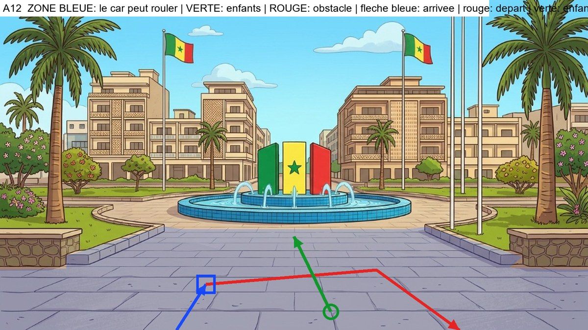

**Analyse du decor** : Place dallee. Massifs et muret a gauche (x<445) et a droite (x>1160), mats de drapeaux sur la droite, bassin de la fontaine au fond (y 505-610). Aucune sortie laterale : le car entre par le bas a gauche, fait demi-tour et sort par le bas a droite.

**Plan de mise en scene** (a valider avant de generer) :
- Type : **l'axe du decor va vers le fond : le car entre par le bas du cadre, vu de dos**
- Le car arrive : from the bottom edge, on the left, driving away from the camera
- Il s'arrete : on the left part of the plaza, away from the central axis
- Il repart : turning right across the plaza behind the children, then coming down and leaving through the bottom-right of the frame; it never goes onto the planters or toward the fountain basin
- Les enfants se tiennent : on the central axis to the right of the car, toward the camera
- Ils marchent : straight toward the fountain in the center of the square
- A eviter : the planters with their stone walls, the flag poles, the fountain basin

### Images-cles (a generer avec Antigravity)

#### Image-cle K1 : le car vient de s'arreter (plan large)
- **Enregistrer sous** : `frontend/public/images/parcours1012/keyframes/a12/k1_car-arrete.png`
- **A donner a Antigravity** :
   - `frontend/public/images/parcours1012/decors/place-independance-exterieur.png`
   - `frontend/public/images/parcours1012/references/03_car-rapide_reference.png`
   - `frontend/public/images/parcours1012/references/05_car-profil-gauche_reference.jpg`
   - `frontend/public/images/parcours1012/references/05_car-face-arriere_reference.jpg`

```text
STYLE AND SCALE LOCK. 2D flat-vector animation illustration, 16:9 (1920x1080), clean dark-brown outlines, warm saturated colors, exactly the style of the reference images. Use the reference images as the ONLY source for faces, bodies, outfits and the vehicle, and use the background reference as the exact setting (same architecture, colors, light). Do not redesign anything. RELATIVE HEIGHTS (standing, same distance from the camera): Moussa 100% (11-year-old boy), Fatou 97% (11-year-old girl), Palou the lion 85% (a friend of the same age: his big mane top reaches Moussa's nose; slightly shorter than the children, NEVER taller, always upright on two legs, not a baby, not an adult lion), Papa Ibou 125% (adult). Characters keep these ratios and shrink with distance as real perspective requires. The vehicle is the Car Rapide of the references: tall boxy vintage Dakar minibus, yellow upper body, blue lower body, painted geometric patterns, painted eye and lion, roof rack with luggage, rear ladder, rear opening door; its roof is about 1.6 times Moussa's height. It is NOT a taxi, NOT a car, NOT a modern van. No text, no logo, no signs with writing.

Wide establishing shot. Background: Independence Square: a wide paved plaza in the foreground leading to a round blue-tiled fountain with the green-yellow-red monument, beige buildings and flags behind; a planter with a stone wall on each side, flag poles on the right. Place the Car Rapide seen from behind (rear view, rear door facing the camera), stopped on the left part of the plaza, away from the central axis. Nobody is outside. The car is drawn with correct perspective and scale for that spot. Avoid: the planters with their stone walls, the flag poles, the fountain basin.
```

#### Image-cle K2 : la porte arriere s'ouvre (debut du plan 2)
- **Enregistrer sous** : `frontend/public/images/parcours1012/keyframes/a12/k2_porte-ouverte.png`
- **A donner a Antigravity** :
   - `frontend/public/images/parcours1012/decors/place-independance-exterieur.png`
   - `frontend/public/images/parcours1012/references/03_car-rapide_reference.png`
   - `frontend/public/images/parcours1012/references/05_car-profil-gauche_reference.jpg`
   - `frontend/public/images/parcours1012/references/05_car-face-arriere_reference.jpg`

```text
STYLE AND SCALE LOCK. 2D flat-vector animation illustration, 16:9 (1920x1080), clean dark-brown outlines, warm saturated colors, exactly the style of the reference images. Use the reference images as the ONLY source for faces, bodies, outfits and the vehicle, and use the background reference as the exact setting (same architecture, colors, light). Do not redesign anything. RELATIVE HEIGHTS (standing, same distance from the camera): Moussa 100% (11-year-old boy), Fatou 97% (11-year-old girl), Palou the lion 85% (a friend of the same age: his big mane top reaches Moussa's nose; slightly shorter than the children, NEVER taller, always upright on two legs, not a baby, not an adult lion), Papa Ibou 125% (adult). Characters keep these ratios and shrink with distance as real perspective requires. The vehicle is the Car Rapide of the references: tall boxy vintage Dakar minibus, yellow upper body, blue lower body, painted geometric patterns, painted eye and lion, roof rack with luggage, rear ladder, rear opening door; its roof is about 1.6 times Moussa's height. It is NOT a taxi, NOT a car, NOT a modern van. No text, no logo, no signs with writing.

Medium shot, the camera is low, in front of the car's rear, slightly to the left. Same place and same setting as image K1. The Car Rapide's rear door is wide open and the empty interior with its seats is visible. Nobody has got out yet. No people in the frame.
```

#### Image-cle K3 : les trois sont descendus (fin du plan 2)
- **Enregistrer sous** : `frontend/public/images/parcours1012/keyframes/a12/k3_trois-descendus.png`
- **A donner a Antigravity** :
   - `frontend/public/images/parcours1012/decors/place-independance-exterieur.png`
   - `frontend/public/images/parcours1012/references/04_scene3_enfants-salut-face_reference.jpg` (planche des trois : tailles relatives)
   - `frontend/public/images/parcours1012/references/02_moussa-11_reference.png`
   - `frontend/public/images/parcours1012/references/02_fatou-11_reference.png`
   - `frontend/public/images/parcours1012/references/01_palou-1012_reference.png`
   - `frontend/public/images/parcours1012/references/03_car-rapide_reference.png`

```text
STYLE AND SCALE LOCK. 2D flat-vector animation illustration, 16:9 (1920x1080), clean dark-brown outlines, warm saturated colors, exactly the style of the reference images. Use the reference images as the ONLY source for faces, bodies, outfits and the vehicle, and use the background reference as the exact setting (same architecture, colors, light). Do not redesign anything. RELATIVE HEIGHTS (standing, same distance from the camera): Moussa 100% (11-year-old boy), Fatou 97% (11-year-old girl), Palou the lion 85% (a friend of the same age: his big mane top reaches Moussa's nose; slightly shorter than the children, NEVER taller, always upright on two legs, not a baby, not an adult lion), Papa Ibou 125% (adult). Characters keep these ratios and shrink with distance as real perspective requires. The vehicle is the Car Rapide of the references: tall boxy vintage Dakar minibus, yellow upper body, blue lower body, painted geometric patterns, painted eye and lion, roof rack with luggage, rear ladder, rear opening door; its roof is about 1.6 times Moussa's height. It is NOT a taxi, NOT a car, NOT a modern van. No text, no logo, no signs with writing.

Same framing as image K2. The rear door is open. Moussa, Palou and Fatou, all full body and clearly visible, stand on the ground on the central axis to the right of the car, toward the camera, side by side, smiling, looking toward the driver's side of the car. Moussa: yellow t-shirt, orange cargo shorts, blue backpack, white socks, orange-red sneakers. Fatou: royal-blue dress, green ribbon on braided bun, brown satchel, blue sandals. Palou: golden fur, orange mane, white diamond on chest, tufted tail. Papa Ibou: green cap, orange-yellow checkered shirt, moustache. Correct relative heights: Palou slightly shorter than Moussa and Fatou. Avoid: the planters with their stone walls, the flag poles, the fountain basin.
```

#### Image-cle K4 : gros plan de Papa Ibou qui salue (plan 3)
- **Enregistrer sous** : `frontend/public/images/parcours1012/keyframes/a12/k4_papa-ibou-salue.png`
- **A donner a Antigravity** :
   - `frontend/public/images/parcours1012/references/02_papa-ibou_reference.png`
   - `frontend/public/images/parcours1012/references/06_papa-ibou-volant-gauche_reference.jpg`
   - `frontend/public/images/parcours1012/references/03_car-rapide_reference.png`

```text
STYLE AND SCALE LOCK. 2D flat-vector animation illustration, 16:9 (1920x1080), clean dark-brown outlines, warm saturated colors, exactly the style of the reference images. Use the reference images as the ONLY source for faces, bodies, outfits and the vehicle, and use the background reference as the exact setting (same architecture, colors, light). Do not redesign anything. RELATIVE HEIGHTS (standing, same distance from the camera): Moussa 100% (11-year-old boy), Fatou 97% (11-year-old girl), Palou the lion 85% (a friend of the same age: his big mane top reaches Moussa's nose; slightly shorter than the children, NEVER taller, always upright on two legs, not a baby, not an adult lion), Papa Ibou 125% (adult). Characters keep these ratios and shrink with distance as real perspective requires. The vehicle is the Car Rapide of the references: tall boxy vintage Dakar minibus, yellow upper body, blue lower body, painted geometric patterns, painted eye and lion, roof rack with luggage, rear ladder, rear opening door; its roof is about 1.6 times Moussa's height. It is NOT a taxi, NOT a car, NOT a modern van. No text, no logo, no signs with writing.

Close-up of Papa Ibou at the open driver's window of the Car Rapide, smiling warmly and waving his right hand, the yellow door with painted patterns around him. The background outside the window is a soft blurred version of the colors of the setting: Independence Square: a wide paved plaza in the foreground leading to a round blue-tiled fountain with the green-yellow-red monument, beige buildings and flags behind; a planter with a stone wall on each side, flag poles on the right. Same style as a cinematic close-up of a cartoon.
```

#### Image-cle K5 : les enfants font au revoir, le car est a cote (debut du plan 4)
- **Enregistrer sous** : `frontend/public/images/parcours1012/keyframes/a12/k5_au-revoir.png`
- **A donner a Antigravity** :
   - `frontend/public/images/parcours1012/decors/place-independance-exterieur.png`
   - `frontend/public/images/parcours1012/references/04_scene3_enfants-salut-face_reference.jpg` (planche des trois : tailles relatives)
   - `frontend/public/images/parcours1012/references/02_moussa-11_reference.png`
   - `frontend/public/images/parcours1012/references/02_fatou-11_reference.png`
   - `frontend/public/images/parcours1012/references/01_palou-1012_reference.png`
   - `frontend/public/images/parcours1012/references/03_car-rapide_reference.png`
   - `frontend/public/images/parcours1012/references/05_car-profil-gauche_reference.jpg`

```text
STYLE AND SCALE LOCK. 2D flat-vector animation illustration, 16:9 (1920x1080), clean dark-brown outlines, warm saturated colors, exactly the style of the reference images. Use the reference images as the ONLY source for faces, bodies, outfits and the vehicle, and use the background reference as the exact setting (same architecture, colors, light). Do not redesign anything. RELATIVE HEIGHTS (standing, same distance from the camera): Moussa 100% (11-year-old boy), Fatou 97% (11-year-old girl), Palou the lion 85% (a friend of the same age: his big mane top reaches Moussa's nose; slightly shorter than the children, NEVER taller, always upright on two legs, not a baby, not an adult lion), Papa Ibou 125% (adult). Characters keep these ratios and shrink with distance as real perspective requires. The vehicle is the Car Rapide of the references: tall boxy vintage Dakar minibus, yellow upper body, blue lower body, painted geometric patterns, painted eye and lion, roof rack with luggage, rear ladder, rear opening door; its roof is about 1.6 times Moussa's height. It is NOT a taxi, NOT a car, NOT a modern van. No text, no logo, no signs with writing.

Medium-wide shot from behind. In the foreground the three friends (seen from behind, 3/4 back) stand on the central axis to the right of the car, toward the camera and wave goodbye with one raised hand; beyond them the Car Rapide is stopped on the left part of the plaza, away from the central axis, seen from behind, with Papa Ibou's arm waving out of the driver's window. Moussa: yellow t-shirt, orange cargo shorts, blue backpack, white socks, orange-red sneakers. Fatou: royal-blue dress, green ribbon on braided bun, brown satchel, blue sandals. Palou: golden fur, orange mane, white diamond on chest, tufted tail. Papa Ibou: green cap, orange-yellow checkered shirt, moustache. Palou is slightly shorter than the children. Avoid: the planters with their stone walls, the flag poles, the fountain basin.
```

#### Image-cle K6 : les enfants marchent vers le lieu (debut du plan 5)
- **Enregistrer sous** : `frontend/public/images/parcours1012/keyframes/a12/k6_marche.png`
- **A donner a Antigravity** :
   - `frontend/public/images/parcours1012/decors/place-independance-exterieur.png`
   - `frontend/public/images/parcours1012/references/04_scene3_enfants-salut-face_reference.jpg` (planche des trois : tailles relatives)
   - `frontend/public/images/parcours1012/references/02_moussa-11_reference.png`
   - `frontend/public/images/parcours1012/references/02_fatou-11_reference.png`
   - `frontend/public/images/parcours1012/references/01_palou-1012_reference.png`

```text
STYLE AND SCALE LOCK. 2D flat-vector animation illustration, 16:9 (1920x1080), clean dark-brown outlines, warm saturated colors, exactly the style of the reference images. Use the reference images as the ONLY source for faces, bodies, outfits and the vehicle, and use the background reference as the exact setting (same architecture, colors, light). Do not redesign anything. RELATIVE HEIGHTS (standing, same distance from the camera): Moussa 100% (11-year-old boy), Fatou 97% (11-year-old girl), Palou the lion 85% (a friend of the same age: his big mane top reaches Moussa's nose; slightly shorter than the children, NEVER taller, always upright on two legs, not a baby, not an adult lion), Papa Ibou 125% (adult). Characters keep these ratios and shrink with distance as real perspective requires. The vehicle is the Car Rapide of the references: tall boxy vintage Dakar minibus, yellow upper body, blue lower body, painted geometric patterns, painted eye and lion, roof rack with luggage, rear ladder, rear opening door; its roof is about 1.6 times Moussa's height. It is NOT a taxi, NOT a car, NOT a modern van. No text, no logo, no signs with writing.

Wide shot in correct perspective. The Car Rapide has gone: it is not in the frame. The three friends, full body and seen from behind, walk side by side straight toward the fountain in the center of the square. Moussa: yellow t-shirt, orange cargo shorts, blue backpack, white socks, orange-red sneakers. Fatou: royal-blue dress, green ribbon on braided bun, brown satchel, blue sandals. Palou: golden fur, orange mane, white diamond on chest, tufted tail. Papa Ibou: green cap, orange-yellow checkered shirt, moustache. Palou slightly shorter than the children, walking upright on two legs. Avoid: the planters with their stone walls, the flag poles, the fountain basin.
```

### Plans video (Flow, Frames to video, 4 s chacun)

#### Plan 1 : le car arrive (4 s)
- **Flow, mode Frames to video** : image de debut `frontend/public/images/parcours1012/decors/place-independance-exterieur.png`
- **Image de fin** : `frontend/public/images/parcours1012/keyframes/a12/k1_car-arrete.png`

```text
Animate the provided frame(s) like a 2D flat-vector cartoon. Keep every character, outfit, face and the Car Rapide EXACTLY as drawn; do not redraw or resize anything; Palou stays slightly shorter than the children. Natural, smooth, readable motion. No text, no speech, no music. Static wide shot of the empty setting. The Car Rapide enters from the bottom edge, on the left, driving away from the camera and slowly stops on the left part of the plaza, away from the central axis, ending exactly like the last frame. Avoid: the planters with their stone walls, the flag poles, the fountain basin.
```

#### Plan 2 : les trois descendent (4 s)
- **Flow, mode Frames to video** : image de debut `frontend/public/images/parcours1012/keyframes/a12/k2_porte-ouverte.png`
- **Image de fin** : `frontend/public/images/parcours1012/keyframes/a12/k3_trois-descendus.png`

```text
Animate the provided frame(s) like a 2D flat-vector cartoon. Keep every character, outfit, face and the Car Rapide EXACTLY as drawn; do not redraw or resize anything; Palou stays slightly shorter than the children. Natural, smooth, readable motion. No text, no speech, no music. Moussa steps down from the open rear door, then Palou hops down, then Fatou; they come to stand where the last frame shows them. The minibus does not move.
```

#### Plan 3 : Papa Ibou salue (gros plan) (4 s, a couper a 2,5 s au montage)
- **Flow, mode Frames to video** : image de debut `frontend/public/images/parcours1012/keyframes/a12/k4_papa-ibou-salue.png`

```text
Animate the provided frame(s) like a 2D flat-vector cartoon. Keep every character, outfit, face and the Car Rapide EXACTLY as drawn; do not redraw or resize anything; Palou stays slightly shorter than the children. Natural, smooth, readable motion. No text, no speech, no music. Close-up: Papa Ibou smiles and waves his hand warmly, a small head tilt, blinks; the background stays softly blurred.
```

#### Plan 4 : au revoir, le car repart (4 s)
- **Flow, mode Frames to video** : image de debut `frontend/public/images/parcours1012/keyframes/a12/k5_au-revoir.png`

```text
Animate the provided frame(s) like a 2D flat-vector cartoon. Keep every character, outfit, face and the Car Rapide EXACTLY as drawn; do not redraw or resize anything; Palou stays slightly shorter than the children. Natural, smooth, readable motion. No text, no speech, no music. The three children wave goodbye; Papa Ibou waves back; then the Car Rapide pulls away smoothly: it goes turning right across the plaza behind the children, then coming down and leaving through the bottom-right of the frame; it never goes onto the planters or toward the fountain basin, getting smaller with distance until it leaves the frame. The children keep waving, then lower their arms. Avoid: the planters with their stone walls, the flag poles, the fountain basin.
```

#### Plan 5 : ils marchent vers le lieu, fondu au noir (4 s)
- **Flow, mode Frames to video** : image de debut `frontend/public/images/parcours1012/keyframes/a12/k6_marche.png`

```text
Animate the provided frame(s) like a 2D flat-vector cartoon. Keep every character, outfit, face and the Car Rapide EXACTLY as drawn; do not redraw or resize anything; Palou stays slightly shorter than the children. Natural, smooth, readable motion. No text, no speech, no music. The three friends walk side by side straight toward the fountain in the center of the square with a natural walking cycle, getting slightly smaller with distance. Static camera. In the last second the image fades smoothly to black.
```

---

